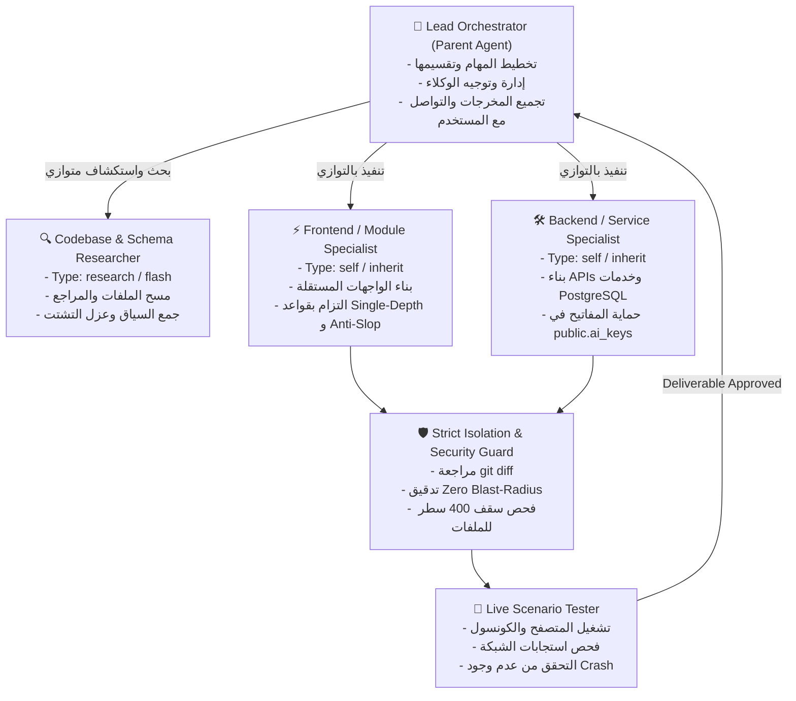

# Multi-Agent Orchestrator Skill (MaxP Enterprise Swarm Standard)

## 📌 النظرة العامة والهدف (Overview & Mission)

تعتمد منصة MaxP معيار **Multi-Agent Task Orchestration** لتنفيذ المهام البرمجية والهندسية المعقدة. بدلاً من الاعتماد على وكيل فردي أحادي السياق (Monolithic Sequential Agent) يتعرض لتشتت الذاكرة (Context Bleed) وبطء التنفيذ التتابعي، يتم تقسيم المهام وتوزيعها ديناميكياً على **فريق عمل من الوكلاء المتخصصين (Subagent Swarm)** يعملون بالتوازي أو بنظام خط الإنتاج (Pipeline Architecture).

---

## 🎯 متى يتم تفعيل تشغيل أكثر من إيجينت؟ (Trigger Matrix)

يتم تشغيل أكثر من إيجينت إلزامياً في الحالات التالية:

1. **المهام متعددة المراحل (Multi-Phase Tasks):** المهام التي تتطلب بحثاً واستكشافاً (Research)، ثم كتابة كود (Implementation)، ثم اختباراً وتحققاً (Verification).
2. **المهام متعددة النطاقات المتوازية (Cross-Domain Work):** عندما تتطلب المهمة تعديل واجهة أمامية (Frontend) + خدمات خلفية (Backend / Controller) + قاعدة بيانات (Database / Migration).
3. **التدقيق والمراجعة المزدوجة (Dual-Agent Review & Falsification):** فصل دور "المبرمج الذي ينفذ" عن دور "المدقق الذي يراجع"، للتأكد من عدم وجود كسر للقواعد (Zero Blast-Radius, Anti-AI-Slop, No AI keys in .env, Modular Screens < 400 lines).
4. **استكشاف قواعد الكود الضخمة (Deep Codebase Exploration):** استخدام وكيل قراءة مخصص (`research`) حتى لا يمتلئ سياق الوكيل الرئيسي بآلاف أسطر الملفات المستكشفة.
5. **الاختبار والتحقق الميداني (Live Scenario Verification):** تفويض وكيل اختبار لفحص السيناريو عبر المتصفح (`chrome-devtools`) أو الطرفية والتأكد من انعدام أخطاء الكونسول والـ 200 OK.

---

## 👥 هيكل فريق الوكلاء المتخصصين (Subagent Roles & Archetypes)



### 1. الوكيل الرئيسي (Lead Orchestrator - Parent Agent):
- **الدور:** قائد الأوركسترا. يحلل طلب المستخدم، يفكك المهمة إلى مهام فرعية مستقلة (Subtasks)، يحدد التبعيات، ويطلق الوكلاء المناسبين عبر `invoke_subagent`.
- **المسؤولية:** تجميع نتائج الوكلاء، حل التعارضات، وإعداد التقرير النهائي للمستخدم، والالتزام بقاعدة الرفع التلقائي `auto-task-push`.

### 2. وكيل البحث والاستكشاف (Codebase / Schema Researcher):
- **النوع:** `research` (قراءة فقط - Read-Only).
- **النموذج:** `flash` أو `inherit`.
- **المهمة:** فحص شجرة الملفات، فحص مسارات الاستيراد، والبحث بـ `grep` عن مراجع الدوال والمكونات لتحديد نطاق التأثير والتأكد من عدم كسر أي شاشة أخرى.

### 3. وكيل البناء والتنفيذ (Module Implementer / Builder):
- **النوع:** `self` أو وكيل مخصص مُعرّف عبر `define_subagent` مجهز بأدوات الكتابة (`enable_write_tools: true`).
- **المهمة:** تطبيق التعديلات بدقة متناهية وفق معايير المشروع (Modular Screens < 400 lines, Anti-AI-Slop, OLED Single-Surface Chassis).

### 4. وكيل تدقيق العزل والأمان (Isolation & Security Auditor):
- **النوع:** `self` أو `code-reviewer`.
- **المهمة:** فحص `git diff` للتأكد التام من عزل التعديلات (Zero Blast-Radius)، خلو الكود من أي مفاتيح ذكاء اصطناعي، عدم تعديل ملفات الستايل العامة، والتزام التصميم بالمعايير.

### 5. وكيل الاختبار والتحقق الحي (Live Scenario Verifier):
- **النوع:** `self` (مجهز بـ MCP و DevTools).
- **المهمة:** تنفيذ سيناريو الاختبار العملي، فحص سجلات الكونسول (`list_console_messages`)، فحص استدعاءات الشبكة (`list_network_requests`) وإصدار شهادة نجاح الاختبار قبل الاعتماد والرفع.

---

## 🛠️ بروتوكول التشغيل البرمجي (Tool Invocation Protocol)

### 1. إطلاق عدة وكلاء بالتوازي في استدعاء واحد (Parallel Launching):
استخدم أداة `invoke_subagent` مع مصفوفة `Subagents` لإطلاق وكلاء متعددين في نفس اللحظة للعمل بالتوازي:

```json
{
  "Subagents": [
    {
      "Role": "Backend Service Implementer",
      "TypeName": "self",
      "Model": "inherit",
      "Workspace": "inherit",
      "Prompt": "قم بتحديث خدمة الحسابات dental_tech_wages لإضافة فلتر التاريخ مع الحفاظ التام على العقود الحالية وعدم تغيير أي حقل استجابة قديم..."
    },
    {
      "Role": "Frontend Screen Specialist",
      "TypeName": "self",
      "Model": "inherit",
      "Workspace": "inherit",
      "Prompt": "قم ببناء تبويب تقارير فني الأسنان DentalTechReportsTab.tsx كشاشة مستقلة تماماً (أقل من 350 سطر) مع ربطها بالـ API الجديد..."
    }
  ]
}
```

### 2. تعريف وكلاء متخصصين عند الحاجة (Custom Agents via `define_subagent`):
إذا تطلبت المهمة دوراً متخصصاً بنظام وأدوات محددة (مثل وكيل تدقيق الكود فقط):
```json
{
  "name": "strict-isolation-auditor",
  "description": "وكيل متخصص في تدقيق التغييرات ومنع أي تأثير جانبي خارج الملفات المستهدفة",
  "system_prompt": "أنت مدقق صارم لعزل التعديلات في منصة MaxP. افحص الـ diff وتأكد من عدم كسر أي شاشة أخرى وعدم تخطي سقف 400 سطر...",
  "enable_write_tools": false,
  "enable_mcp_tools": false,
  "enable_subagent_tools": false
}
```

### 3. الانتظار التفاعلي بدون حلقات استطلاع (Zero Polling Loops):
- **قاعدة صارمة:** بعد استدعاء `invoke_subagent`، **لا تقم بعمل Loop أو Polling** على `manage_subagents(Action='status')`.
- سيتولى النظام إيقاظك تفاعلياً (Reactive Wakeup) فور انتهاء كل وكيل وإرسال نتائجه إلى صندوق الرسائل الخاص بك.
- توقف ببساطة عن استدعاء الأدوات بانتظار استلام المخرجات.

### 4. التنسيق والتواصل المباشر (Inter-Agent Messaging):
- استخدم `send_message` لتزويد الوكيل بتعليمات إضافية، تعديل خطة، أو تزويده بنتائج وكيل آخر انتهى من مهامه.

---

## 📋 مصفوفة توزيع العمل في مهام MaxP المعتادة

| نوع المهمة | الوكلاء المطلوب تشغيلهم | الترتيب والتزامن |
| :--- | :--- | :--- |
| **إضافة ميزة كاملة (Full Feature)** | 1. Researcher (استكشاف النماذج)<br>2. Frontend Builder<br>3. Backend Builder<br>4. Tester & Reviewer | 1 يعمل أولاً ← 2 و 3 بالتوازي ← 4 للتحقق والتدقيق النهائي |
| **إصلاح خطأ دقيق (Bug Fix)** | 1. Researcher / Root-Cause Investigator<br>2. Hotfix Implementer<br>3. Blast-Radius Auditor | 1 للتحقيق ← 2 للإصلاح ← 3 لمراجعة الـ diff والتأكد من انعدام التأثيرات الجانبية |
| **إعادة هيكلة وتطوير شاشات (Refactoring / Modularization)** | 1. Component Splitter (تفكيك الشاشات)<br>2. Style & Anti-Slop Auditor<br>3. Live Browser Tester | 1 للتفكيك تحت 400 سطر ← 2 لتدقيق الواجهة ← 3 للتأكد من عمل المتصفح بدون أخطاء |
| **مراجعة وتأمين النظام (Security & Audit)** | 1. Tenant Boundary Auditor<br>2. Falsification / Attacker Subagent | يعملان بنظام المراجعة المزدوجة (Dual-Agent Verification) لتفنيد أو إثبات الثغرة |

---

## 🔒 القواعد الحاكمة غير القابلة للتفاوض (Non-Negotiable Swarm Rules)

1. **لا تنفيذ أحادي للمهام الكبيرة (Ban Monolithic Execution on Large Tasks):** أي مهمة تشمل أكثر من شاشتين أو تمس كل من الفرونت إند والباك إند، أو تتطلب بحثاً عميقاً يجب تفويضها فوراً عبر أكثر من إيجينت متخصص.
2. **عزل النطاقات (Workspace & Domain Isolation):** لا تدع إيجينت الواجهة يلمس خدمات الباك إند أو العكس في نفس الدفعة، لتجنب حدوث تضارب في التعديلات (Merge Conflicts).
3. **التدقيق الصارم لما بعد التنفيذ (Strict Post-Subagent Audit):** الوكيل الرئيسي (Lead Orchestrator) لا يرفع الكود أو ينهي المهمة إلا بعد أن يجري التحقق العملي ومراجعة `git status` و `git diff`.
4. **الرفع التلقائي الإلزامي (Auto Task Push):** بعد تجميع مخرجات الوكلاء والتحقق النهائي، يقوم الوكيل الرئيسي بالرفع المباشر إلى GitHub وفق مهارة `auto-task-push`.
5. **الخضوع لبروتوكول تنسيق الوكلاء (Cross-Agent Coordination Lock):** أي إيجينت يعمل على هذا المستودع — بما فيهم الوكيل الرئيسي والوكلاء الفرعيون عند الكتابة على نفس الشجرة — يلتزم ببروتوكول `cross-agent-coordination`: `status` قبل البدء → `claim` باسم الإيجينت قبل أول تعديل ملفات → الرفع فقط عبر `guard --push` → `release` بعد الإنهاء. وعلى الوكيل الرئيسي ألا يطلق جولات كتابة موازية أثناء وجود قفل نشط لإيجينت آخر. الأداة: `scripts/agent-coord/coord.py` — البروتوكول الكامل: `docs/agent-coordination.md`.
