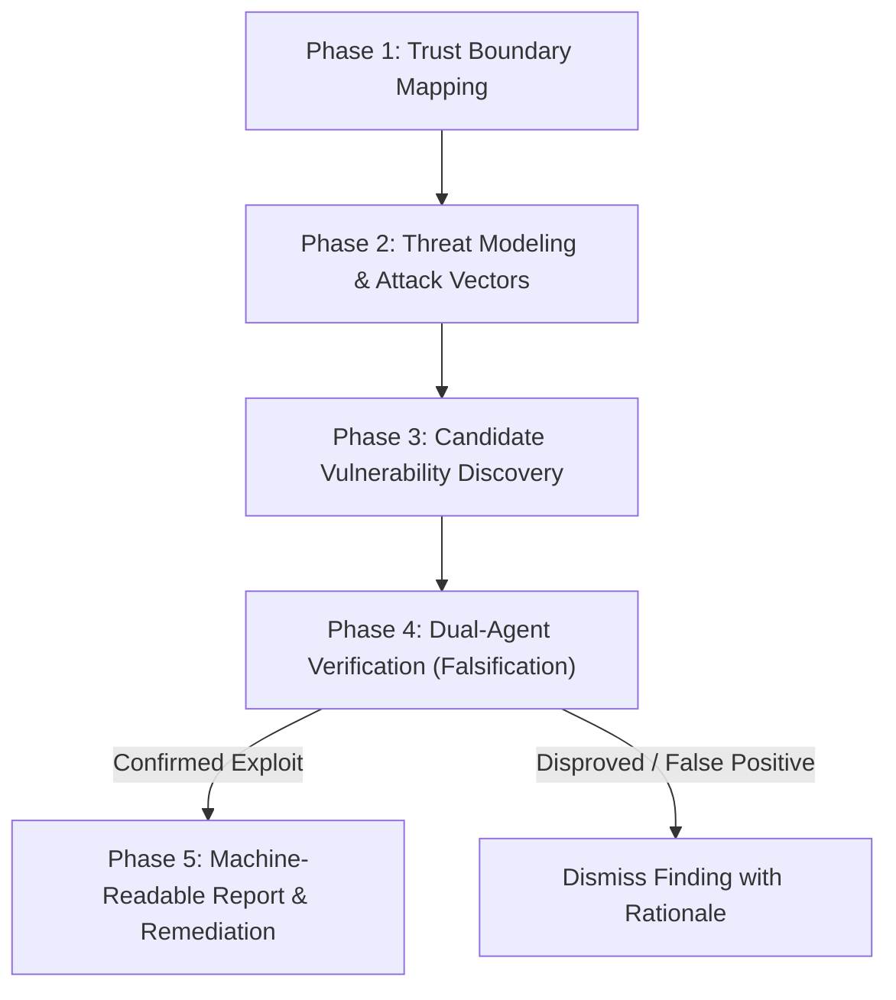

# Security Audit Skill (MaxP Enterprise Standard)

Inspired by **Cloudflare's `security-audit-skill`**, this skill provides a rigorous, multi-phase methodology for auditing codebase security. It eliminates hallucinations and false positives through **Dual-Agent Verification**, ensuring that only reproducible, high-severity vulnerabilities are reported and remediated.

---

## 🎯 Core Audit Pillars for MaxP Platform

1. **Multi-Tenant Isolation (Tenant Boundary):**
   - Every database query (`SELECT`, `UPDATE`, `DELETE`, `INSERT`) touching business data MUST be explicitly scoped by `companyId` (or verified via tenant context middleware).
   - Guard against **IDOR** (Insecure Direct Object References) where user A accesses records of company B by altering query params or payload IDs.

2. **Zero AI Keys in Filesystem / .env:**
   - Strict enforcement of MaxP's rule: AI keys (`OPENAI_API_KEY`, `GEMINI_API_KEY`, `ANTHROPIC_API_KEY`, `DEEPSEEK_API_KEY`, etc.) MUST NEVER be in `.env`, config files, or git logs.
   - All AI keys MUST be queried dynamically from `public.ai_keys` (`isActive = true ORDER BY priority ASC`).

3. **Injection & Boundary Escapes:**
   - SQL / NoSQL Injection (prevent string concatenation in raw queries; mandate parameterized queries).
   - Command / Shell Injection (prevent passing unsanitized user input to child processes or remote SSH commands).
   - SSRF (Server-Side Request Forgery) in scrapers, webhooks, or media proxies.

4. **Prompt Injection & Agent Safeguards:**
   - Unsanitized user inputs fed into system prompts without escaping delimiters (`<user_data>`, etc.).
   - Tool execution authorization: verify the agent cannot execute destructive tools (`drop table`, `rm`, unvetted API calls) without confirmation or access token checks.

---

## 🔄 The 5-Phase Audit Protocol



### Phase 1: Trust Boundary Mapping
Identify all zones where data crosses security contexts:
- **Client → Backend API:** JWT validation, role checks (`ADMIN`, `STAFF`, `DOCTOR`, `TECHNICIAN`, `CUSTOMER`).
- **Backend API → Database:** Scoping by `companyId` and `userId`.
- **Backend → External Services / AI Providers:** Encryption in transit, key resolution from `public.ai_keys`.
- **User Input → Agent Execution Runtime:** System prompt sanitization and tool parameter bounds.

### Phase 2: Threat Modeling & Attack Vectors
Map each boundary to STRIDE categories:
- **Spoofing:** Can an unauthenticated actor forge a session token or pass an arbitrary `userId`?
- **Tampering:** Can an actor modify prices, order statuses, or salary ledger entries (`dental_tech_wages`)?
- **Repudiation:** Are critical state changes logged with timestamps and actor IDs?
- **Information Disclosure:** Does an error response or debug endpoint leak database schemas, stack traces, or tenant secrets?
- **Denial of Service:** Are rate-limits and payload size guards configured on upload and AI streaming endpoints?
- **Elevation of Privilege:** Can a regular staff member access tenant billing, super-admin panels, or central keys?

### Phase 3: Candidate Vulnerability Discovery
Scan the code systematically:
- Search for raw SQL: `grep_search` for `query(`, `execute(`, `$1`, `SELECT.*WHERE` without parameterized replacements.
- Search for tenant leaks: endpoints missing `req.user.companyId` in database filters.
- Search for secrets: inspect `.env*`, `process.env.*KEY`, `os.environ`.

### Phase 4: Dual-Agent Verification (Cloudflare Pattern)
> [!IMPORTANT]
> **Never report a vulnerability based on theoretical suspicion alone.**
> Every candidate vulnerability MUST undergo independent verification:

1. **Invoke a Fresh Subagent (Verifier):**
   - Provide the exact file, lines, and putative vulnerability description.
   - **Mandate:** The verifier's explicit goal is to **attempt to disprove** the vulnerability (e.g. check if parent middleware, ORM sanitizers, route guards, or type constraints already block the exploit).
2. **Evaluation:**
   - If the verifier successfully writes a concrete proof-of-concept exploit scenario that passes all defenses, the vulnerability is **CONFIRMED**.
   - If a guard exists (e.g., `verifyTenant` middleware already strips or overrides `companyId`), the finding is marked **DISPROVED (False Positive)** and logged.

### Phase 5: Structured Machine-Readable Output
Confirmed findings are output using this standard schema:

```json
{
  "finding_id": "SEC-MAXP-2026-001",
  "title": "Missing companyId filter in Dental Case Retrieval",
  "severity": "CRITICAL",
  "target_file": "apps/backend/src/routes/dentalCases.ts",
  "line_range": "45-52",
  "cwe_id": "CWE-639 (Insecure Direct Object Reference)",
  "trust_boundary_violated": "Tenant Data Isolation (public.dental_cases)",
  "attack_vector": "User can supply caseId belonging to another clinic and retrieve confidential patient records.",
  "verification_proof": "Verified by secondary agent: GET /api/dental/cases/:id passes id directly to DB without AND company_id = $2 filter.",
  "remediation": "Add req.user.companyId to query parameters and DB WHERE clause."
}
```

---

## 🛠️ Automated Scripts & Quick Scans

Run this quick command to check for hardcoded secrets and unparameterized queries:

```bash
# Scan for suspicious hardcoded AI keys in src:
rg -i "(sk-[a-zA-Z0-9]{20,}|AIzaSy[a-zA-Z0-9_-]{33}|xai-[a-zA-Z0-9]+)" apps/ packages/

# Scan for missing tenant filter in direct queries:
rg -i "FROM\s+[a-z_]+\s+WHERE" apps/backend/ | rg -v "company_id"
```
