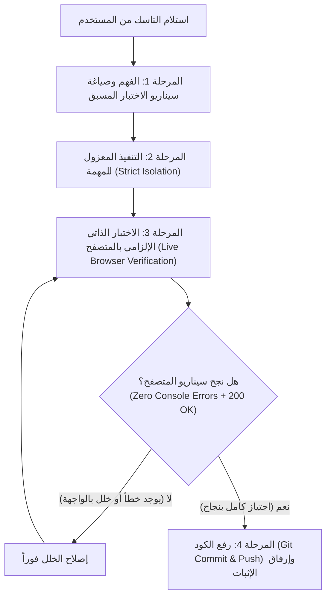

# Task Scenario & Mandatory Browser Self-Verification Skill
## مهارة فهم التاسك، صياغة السيناريو، والاختبار الذاتي الإلزامي بالمتصفح قبل الرفع

هذه المهارة تضع قانوناً هندسياً صارماً وغير قابل للتجاوز في بيئة عمل MaxP Platform:
> **"NO PUSH WITHOUT LIVE PROOF"**
> **ممنوع منعاً باتاً رفع أو اعتماد أي تحديث (Git Commit / Push) دون وضع سيناريو مسبق، وتنفيذه، وفتح المتصفح وتجربة النتيجة عملياً والتأكد من سلامتها 100%.**

---

## 🧭 دورة حياة تنفيذ أي تاسك (The 4-Phase Lifecycle)



---

## المرحلة 1: فهم التاسك وصياغة السيناريو (Task Ingestion & Scenario Formulation)

قبل لمس أي ملف كود أو كتابة أي سطر، يجب على الوكيل تنفيذ الآتي:
1. **التحليل الجذري للمطلوب:**
   - تحديد المشكلة أو الميزة المطلوبة بدقة.
   - تحديد الملفات المستهدفة فقط مع الالتزام الصارم بقاعدة `strict-change-isolation` (عدم التأثير على باقي أجزاء المنصة).
2. **صياغة سيناريو الاختبار المسبق (The Pre-Flight Test Scenario):**
   - **الرابط أو الشاشة المستهدفة (Target Route/URL):** مثلاً `http://localhost:5173/admin/marketing/ai-studio` أو المسار المعني.
   - **خطوات تجربة المستخدم (User Actions Step-by-Step):** ما هي الإجراءات المحددة التي سيقوم بها المستخدم لاختبار الميزة؟ (مثل: الضغط على زر X، ملء حقل Y، فتح نافذة Z).
   - **معايير النجاح (Pass / Verification Criteria):**
     - ما هي النتيجة المرئية المتوقعة في الشاشة؟
     - ما هو رد الـ API المتوقع في الـ Network Tab؟
     - اشتراط خلو الـ Console تماماً من الأخطاء (Zero Console Errors).

---

## المرحلة 2: التنفيذ المنضبط (Isolated Implementation)

1. تطبيق التعديلات المطلوبة في الملفات المعنية فقط.
2. عدم تعديل أي ملفات مشتركة بدون التأكد من عدم كسر وظائف أخرى.
3. الالتزام الصارم بمعايير التصميم المعتمدة في المنصة (Single-Surface Chassis, OLED/Dark mode standards, Anti-AI-Slop).

---

## المرحلة 3: بوابة الاختبار الذاتي الإلزامي بالمتصفح (The Mandatory Browser Gate)

> [!CAUTION]
> ### 🛑 حظر قطعي للرفع (Push Ban)
> يُحظر على الوكيل تماماً استدعاء `git commit` أو `git push` في هذه المرحلة. لا يتم الانتقال للرفع إلا بعد نجاح الفحص الحي بالمتصفح.

### خطوات الفحص بالمتصفح (Hands-On Browser Testing):
1. **التحقق من تشغيل بيئة العمل محلياً:**
   - التأكد من أن سيرفر التطوير (Dev Server أو Backend API) يعمل وجاهز لاستقبال الطلبات على المنفذ المناسب (مثل `http://localhost:5173` أو `http://localhost:3000`).
2. **فتح المتصفح والتنقل للشاشة المستهدفة:**
   - استخدام أدوات المتصفح المدمجة (`chrome-devtools` MCP):
     - `call_mcp_tool` مع السيرفر `chrome-devtools` والأداة `navigate_page` للذهاب إلى الرابط المعني.
3. **تنفيذ خطوات سيناريو الفحص تفاعلياً:**
   - محاكاة نقرات المستخدم وتفاعلاته عبر أدوات المتصفح:
     - `click`: للنقر على الأزرار والقوائم وعناصر الواجهة.
     - `fill` أو `type_text`: لإدخال البيانات والنصوص في الحقول.
     - `evaluate_script`: لفحص حالات DOM أو استدعاء دوال واجهة معينة إن لزم.
     - `wait_for`: لانتظار ظهور العناصر المتغيرة أو استجابة الـ Asynchronous UI.
4. **فحص الـ Console وسجلات الأخطاء (Console Audit):**
   - استدعاء `list_console_messages` عبر `chrome-devtools`.
   - **الشرط الحاكم:** يجب ألا يحتوي الـ Console على أي أخطاء من نوع `error` أو استثناءات JavaScript غير معالجة (`Uncaught TypeError`, `SyntaxError`, `404/500 Fetch Error`).
5. **فحص الـ Network وطلبات الخادم (Network Audit):**
   - استدعاء `list_network_requests` والتأكد من أن جميع اتصالات الـ Backend ترجع بكود نجاح (`200 OK` أو `201 Created`) دون انهيار `500` أو مسارات مفقودة `404`.
6. **التحقق البصري المباشر (Visual & Layout Audit):**
   - استدعاء `take_screenshot` أو `take_snapshot` للتأكد من أن الواجهة تظهر بشكل سليم ومتناسق، بدون نصوص متداخلة أو كسر في الـ Layout.
7. **التعامل مع حالات الفشل:**
   - إذا ظهر أي خطأ في الكونسول أو فشل في الشبكة أو عيب في الواجهة: **يتوقف الوكيل فوراً عن الرفع**، يقوم بتصحيح الخلل في الكود، ويعيد تشغيل سيناريو المتصفح حتى يجتازه بنجاح تام.

### للتاسكات الخلفية البحتة (Backend / Scripts / DB Only):
إذا كان التاسك لا يمتلك واجهة رسومية مباشرة (مثل سكريبت قاعدة بيانات، أو Controller API صرف):
- يقوم الوكيل بتشغيل اختبار عملي مكافئ (مثل إرسال طلب `curl` أو تشغيل سكريبت فحص محلي يختبر الـ Endpoint مباشرة ويتأكد من الـ Response والـ Status Code قبل الرفع).

---

## المرحلة 4: الرفع المعتمد والتوثيق (Verified Git Push & Reporting)

بعد اجتياز بوابة الاختبار بالمتصفح والتأكد التام من نجاح السيناريو:
1. يتم تفعيل مهارة `auto-task-push` لتنفيذ:
   ```bash
   git status
   git add <files>
   git commit -m "<رسالة معبرة تشرح ما تم تنفيذه واختباره>"
   git push origin main
   ```
2. **تقديم تقرير الإنجاز للمستخدم شاملاً:**
   - **السيناريو المعتمد:** ما تم التخطيط له وتنفيذه.
   - **نتيجة الاختبار بالمتصفح:** تأكيد فتح المتصفح، الخطوات التي تم تجربتها، وتأكيد خلو الكونسول من الأخطاء (Zero Errors).
   - **بيانات الرفع:** تفاصيل الـ Commit وهاش التحديث على GitHub.
