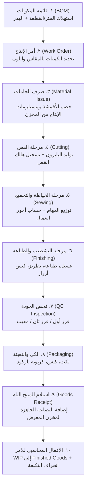

# خطة بنية وتصميم منتج «التصنيع» (Manufacturing Execution & Production Engine) — (تصميم فني بدون كود)

> **الوثيقة:** وثيقة التصميم الفني والمعماري لمنتج التصنيع وإدارة خطوط الإنتاج.  
> **المرجع:** `C:\maxp-knowledge\_reports\2026-10-14-two-products-master-plan.md` وتيكت `2026-10-14-agy-accounting-wave1-ticket.md`.  
> **السيناريو الأول:** مصانع الملابس الجاهزة والمنسوجات (Garment & Apparel Manufacturing).  
> **الجهة:** Antigravity (المشروع: `maxp-platform-13` · الريبو الرسمي: `shroukmagdi74-source/maxperformance14`).  
> **التاريخ:** 2026-10-14.  
> **الحالة:** تصميم معتمد — صفر كود تصنيع في هذه الدفعة (كود التصنيع يبدأ في الدفعة ٣).

---

## ١) الملخص التنفيذي والسياق

أظهر تقييم الفجوة مع أنظمة ERP (مثل Odoo) ودراسة احتياجات عملاء المنصة (خاصة مصانع الملابس الجاهزة والورش الصناعية والتجار أصحاب خطوط الإنتاج الخاصة) أن المنصة الحالية تملك إدارة ممتازة لحركات المخزون والمبيعات، لكنها تفتقر لوحدة تصنيع حقيقية (Manufacturing Execution System - MES):
- وحدات BOM الحالية في الكود مقتصرة على معمل الأسنان (`dental_lab.prisma`) ووصفات الكافيهات (`cafe_restaurant.prisma`).
- مصفوفة مقاسات وألوان الملابس (Size/Color Matrix) تتطلب مرونة فائقة في استهلاك المواد الخام (أقمشة بالأمتار، خيوط، أزرار، سحابات، بطانات، تيكتات).
- الحاجة الماسة لحساب **التكلفة الفعلية للقطعة (Unit Costing)** بناءً على الخامات الفعلية والعمالة التشغيلية المباشرة والمصروفات غير المباشرة.
- الربط المحاسبي عبر حسابات **الإنتاج تحت التشغيل (Work in Progress - WIP)** الذي يغذي محرك المحاسبة الجديد في كل مرحلة إنتاجية.

تحدد هذه الوثيقة المعمارية الكاملة لنظام التصنيع تمهيداً للتنفيذ البرمجي في الدفعة ٣ (الأساس الخلفي للتصنيع) والدفعة ٤ (واجهات التصنيع).

---

## ٢) دورة حياة تصنيع الملابس الجاهزة (Garment Lifecycle)



---

## ٣) هندسة قائمة المكونات متعددة المتغيرات (Multi-Variant BOM)

قائمة مواد تصنيع الملابس تختلف عن المنتجات النمطية لأنها تعتمد على **المصفوفة الثنائية (المقاس × اللون)**:

### ٣.١ هيكل الـ BOM المقترح
1. **رأس قائمة المكونات (`BillOfMaterials`):**
   - `id`: المعرف الفريد.
   - `companyId`: معرف الشركة.
   - `productId`: معرف المنتج النهائي في جدول `Product`.
   - `code`: كود الإصدار (مثل: `BOM-HOODIE-2026-V1`).
   - `name`: اسم الموديل (مثل: "سويت شيرت هودي أوفر سايز").
   - `version`: رقم الإصدار (`1.0`, `1.1`).
   - `baseQuantity`: الكمية الأساسية للإنتاج المرجعي (افتراضي: `1` قطعة أو `100` دزينة).
   - `isActive`: حالة الاعتماد.
   - `wasteMarginPercent`: نسبة الهالك المسموح به للمواد (مثل: `3.5%`).

2. **بنود الخامات والمستلزمات (`BomComponentItem`):**
   - `bomId`: معرف القائمة.
   - `rawMaterialId`: معرف الخامة في جدول المنتجات/الخامات (نوع `RAW_MATERIAL`).
   - `consumptionPerUnit`: معدل الاستهلاك للقطعة الواحدة (Decimal).
   - `unit`: وحدة القياس (متر `METER`، كجم `KG`، بكرة `SPOOL`، قطعة `PIECE`، ياردة `YARD`).
   - `appliesToSizes`: مصفوفة المقاسات المطبقة عليها (مثل: `["M", "L", "XL"]` أو `["ALL"]` — لاستهلاك قماش أكثر في المقاسات الكبيرة).
   - `appliesToColors`: مصفوفة الألوان المطبقة عليها (مثل: خيط أبيض للون الأبيض، أزرار سوداء للون الأسود).
   - `scrapRate`: نسبة الفاقد المقدر في التشغيل لهذا المكون بالتحديد.

### ٣.٢ تصنيف خامات الملابس النمطية في النظام
- **الأقمشة الأساسية (Shell Fabric):** ميلتون قطن، جبردين، سنغل ليكرا، بيكيه (تقاس بالمتر أو الكيلوجرام).
- **البطانات والأقمشة المساعدة (Lining & Interlining):** فازلين، بطانة بوليستر، ريب قطني للأسورة والياقة.
- **مستلزمات الحياكة (Haberdashery/Trims):** خيوط حياكة، خيوط أوفرلوك، سوست معدنية/بلاستيكية، أزرار، كبسولات.
- **مواد الهوية والتغليف (Packaging & Branding):** تيكت الرقبة (منسوج)، تيكت الغسيل، هانج تاج كرتون، كيس سيلوفان لاصق، كرتونة شحن.

---

## ٤) أوامر الإنتاج ومراحل التشغيل المخصصة (Work Orders & Stages)

### ٤.١ أمر الإنتاج (`ProductionOrder` / `WorkOrder`)
- `id`: المعرف الفريد.
- `orderNumber`: رقم أمر الإنتاج (مثل: `MO-2026-00042`).
- `companyId`: الشركة.
- `bomId`: قائمة المكونات المعتمدة للأمر.
- `productId`: المنتج المستهدف.
- `plannedQuantity`: إجمالي الكمية المخططة.
- `producedQuantity`: إجمالي الكمية تامة الصنع المستلمة فعلياً.
- `scrappedQuantity`: كمية التوالف/الهالك.
- `status`: حالة الأمر من Enum `ProductionOrderStatus`:
  - `PLANNED`: مخطط (حجز الخامات وجدولتها).
  - `RELEASED`: معتمد وجاهز للصرف وبدء التشغيل.
  - `IN_PROGRESS`: قيد التشغيل في خطوط الإنتاج.
  - `QC_PENDING`: مكتمل الخياطة وبانتظار فحص الجودة النهائي.
  - `COMPLETED`: مكتمل ومستلم بالكامل في المخزن.
  - `CANCELLED`: ملغي مع إرجاع الخامات غير المستهلكة.
- `startDate`: تاريخ البدء الفعلي.
- `dueDate`: تاريخ التسليم المستهدف.
- `targetWarehouseId`: المخزن المستهدف لاستلام التام (مثل: "مخزن المعرض الرئيسي").
- `sourceWarehouseId`: مخزن سحب الخامات (مثل: "مستودع الأقمشة").

### ٤.٢ مصفوفة إنتاج المقاسات والألوان (`ProductionOrderVariantMatrix`)
تسجيل كميات أمر التشغيل المفصلة:
```text
| الموديل: هودي شتوي | أسود | رمادي | كحلي | الإجمالي |
|---|---|---|---|---|
| مقاس M | 100 | 100 | 50 | 250 قطعة |
| مقاس L | 150 | 150 | 100 | 400 قطعة |
| مقاس XL | 150 | 150 | 100 | 400 قطعة |
| مقاس XXL | 50 | 50 | 50 | 150 قطعة |
| إجمالي الأمر | 450 | 450 | 300 | 1,200 قطعة |
```

### ٤.٣ مراحل التشغيل التتابعية (`ProductionStage`)
يدعم النظام مراحل نمطية قابلة للتخصيص والإضافة لكل مصنع:
1. **مرحلة القص (Cutting):** فرد الأقمشة، وضع الباترون، القص بماكينات الشفرات أو الليزر، وتوليد حزم القطع (Cut Bundles).
2. **مرحلة التجهيز والطباعة/التطريز (Printing/Embroidery):** مرحلة داخلية أو خارجية لدى مورد تشغيل للغير (Subcontractor).
3. **مرحلة الخياطة والتجميع (Sewing & Assembly):** خطوط الإنتاج (الماكينات: أوفر، سنجر، أورليه).
4. **مرحلة التشطيب والتنظيف (Finishing & Thread Trimming):** قص الزوائد الخيطية، تركيب الإكسسوارات.
5. **مرحلة الفحص والجودة (Quality Control - QC):** مطابقة القياسات، سلامة الغرز، فحص العيوب وفرز (درجة أولى / ديفوهات).
6. **مرحلة الكي والتعبئة (Ironing & Packing):** مكابس البخار، تركيب التيكتات، التغليف في الأكياس ووضع ملصق الباركود.

---

## ٥) الربط المخزني مع مستودعات المنصة القائمة (`inventory.prisma`)

نظام التصنيع يتكامل مباشرة مع نماذج وحركات المخزون الحالية:

### ٥.١ أذون صرف الخامات (`MaterialIssueReceipt`)
- عند انتقال أمر الإنتاج إلى `IN_PROGRESS`، يُنشأ **إذن صرف خامات تصنيع (Material Issue Voucher)**.
- يُخصم المخزون من المستودع الأصلي (`WarehouseStock.quantity` الخامات).
- نوع الحركة المخزنية: `STOCK_OUT_MANUFACTURING`.
- تظل الخامات مسجلة في تكلفة أمر الإنتاج كقيمة مستهلكة.

### ٥.٢ أذون استلام المنتج التام (`FinishedGoodsReceipt`)
- عند اكتمال فحص الجودة بنجاح وتعبئة القطع، يُنشأ **إذن استلام إنتاج تام (Finished Goods Receipt)**.
- تُضاف القطع المنتجة إلى رصيد المنتج في مخزن التام (`WarehouseStock.quantity` للمنتج النهائي بمتغيراته).
- نوع الحركة المخزنية: `STOCK_IN_MANUFACTURING`.
- يتم تسجيل تكلفة القطعة الفعلية المحسوبة كمتوسط مرجح لتكلفة الوحدة المخزنية (`weightedAverageCost`).

### ٥.٣ معالجة الهالك والتوالف (Waste & Scrap Management)
- تسجيل الفاقد الفعلي في مرحلة القص (قصاصات القماش - عوادم) وفي مرحلة الخياطة.
- إذا كان الهالك ضمن النسبة المسموح بها في الـ BOM (`wasteMarginPercent`)، يُحمّل على تكلفة الإنتاج التام.
- إذا كان الهالك استثنائياً أو إهمالاً، يُرحّل إلى حساب خسائر الهالك غير الطبيعي كبند مصروف منفصل.

---

## ٦) محرك حساب تكلفة الأمر وتكلفة القطعة (Costing Engine)

المعادلة الثلاثية لحساب التكلفة الصناعية:

$$\text{إجمالي تكلفة أمر الإنتاج} = \text{تكلفة الخامات المباشرة} + \text{تكلفة العمالة المباشرة} + \text{التكاليف الصناعية غير المباشرة (MOH)}$$

$$\text{تكلفة القطعة الواحدة} = \frac{\text{إجمالي تكلفة أمر الإنتاج}}{\text{عدد القطع السليمة تامة الصنع}}$$

### ٦.١ تكلفة الخامات المباشرة (Direct Materials Cost)
- مجموع: (كمية الخامة المصروفة فعلياً × سعر متوسط التكلفة للخامة في المخزن).
- مثال: 1.5 متر قماش ميلتون بسعر 120 ج/م = 180 ج + 15 ج مستلزمات (سوستة، تيكت، خيط) = **195 ج خامات**.

### ٦.٢ تكلفة العمالة المباشرة (Direct Labor Cost)
- تدعم طريقتين للمصانع المصرية:
  1. **نظام القطعة (Piece-Rate Wage):** أجر محدد لكل مرحلة (مثال: القص 4 ج/قطعة + الخياطة 18 ج/قطعة + الكي والتعبئة 3 ج/قطعة = **25 ج عمالة**).
  2. **نظام ساعات التشغيل (Standard Hours):** زمن دورة التشغيل بالدقيقة × أجر دقيقة الخط.

### ٦.٣ التكاليف الصناعية غير المباشرة (Manufacturing Overhead - MOH)
- توزيع نسبة تقديرية من إيجار المصنع، فاتورة الكهرباء الصناعية، وصيانة الماكينات (مثال: **10 ج/قطعة**).
- **إجمالي تكلفة القطعة = 195 + 25 + 10 = 230 ج.م.**

---

## ٧) الربط المحاسبي الكامل (WIP & General Ledger Integration)

يتكامل التصنيع مباشرة مع محرك المحاسبة (`accounting.prisma` / `accountingService.js`):

```text
١. عند صرف الخامات من المستودع إلى خط الإنتاج:
   من حـ/ إنتاج تحت التشغيل (WIP) - خامات (حساب 110402)      [مدين]
     إلى حـ/ مخزون الخامات ومستلزمات الإنتاج (حساب 110401)   [دائن]

٢. عند إثبات استحقاق أجور عمال الإنتاج على أمر التشغيل:
   من حـ/ إنتاج تحت التشغيل (WIP) - أجور (حساب 110402)       [مدين]
     إلى حـ/ رواتب وأجور مستحقة (حساب 210201)               [دائن]

٣. عند تحميل التكاليف الصناعية غير المباشرة المخصصة:
   من حـ/ إنتاج تحت التشغيل (WIP) - أعباء (حساب 110402)      [مدين]
     إلى حـ/ تكاليف صناعية محملة (حساب 5103)               [دائن]

٤. عند استلام المنتج التام وإقفال أمر الإنتاج:
   من حـ/ مخزون الإنتاج التام والبضاعة الجاهزة (حساب 110403) [مدين]
     إلى حـ/ إنتاج تحت التشغيل (WIP) (حساب 110402)          [دائن]
     (يتم تصفير رصيد أمر الإنتاج بالكامل من حساب WIP وترحيله لمخزن التام)

٥. عند بيع المنتج للعميل وشحنه:
   من حـ/ تكلفة البضاعة المباعة COGS (حساب 5101)             [مدين]
     إلى حـ/ مخزون الإنتاج التام (حساب 110403)              [دائن]
```

---

## ٨) خريطة واجهات الدفعات القادمة (Frontend Cockpit Roadmap)

في الدفعة الرابعة (Wave 4) سيتم بناء الواجهات بنمط Single-Surface Cockpit المتناسق:
1. **لوحة أوامر الإنتاج ومخطط كانبان (`ManufacturingOrdersPage.tsx`):**
   - أعمدة تتبع مرئية: مخطط ← معتمد ← قيد التشغيل ← فحص الجودة ← مكتمل.
   - مؤشر إنجاز فوري لكل أمر (نسبة القطع المنجزة مقابل المستهدف).
2. **شاشة محرر قائمة المكونات المتقدمة (`BomBuilderModal.tsx`):**
   - واجهة بصرية لإضافة الخامات وتحديد الاستهلاك بالمقاس واللون.
   - حاسبة تقديرية فورية لتكلفة القطعة قبل بدء الإنتاج.
3. **شاشة تتبع مراحل التشغيل اليومي (`ProductionShopFloorPage.tsx`):**
   - شاشة مخصصة لمدير صالة الإنتاج لتسجيل إنتاجية العمال والورديات بالباركود.
4. **شاشة فحص الجودة والفرز (`ManufacturingQcPage.tsx`):**
   - تسجيل فحص العينات، نسب الديفوهات، وأسباب الرفض.
5. **تقرير تحليل التكاليف والانحرافات (`ManufacturingCostReportPage.tsx`):**
   - مقارنة التكلفة المعيارية المخططة بالتكلفة الفعلية (Variance Analysis).

---

## ٩) حدود التصنيع في المنصة والمخاطر والمعالجات

1. **الدفعة الحالية (Wave 1):** وثيقة تصميم فني فقط — صفر كود في الدفعة الحالية لحماية استقرار المنصة.
2. **الدفعة القادمة (Wave 3):** سكيما Prisma لنماذج التصنيع + خدمة `manufacturingService.js` + اختبارات معزولة.
3. **عزل المستأجرين:** كل أمر تصنيع وكل BOM مربوط حصرياً بـ `companyId`.
4. **حماية التكلفة:** منع إقفال أمر الإنتاج إذا كانت هناك كميات غير مسواة أو سطور صرف خامات سالبة.
