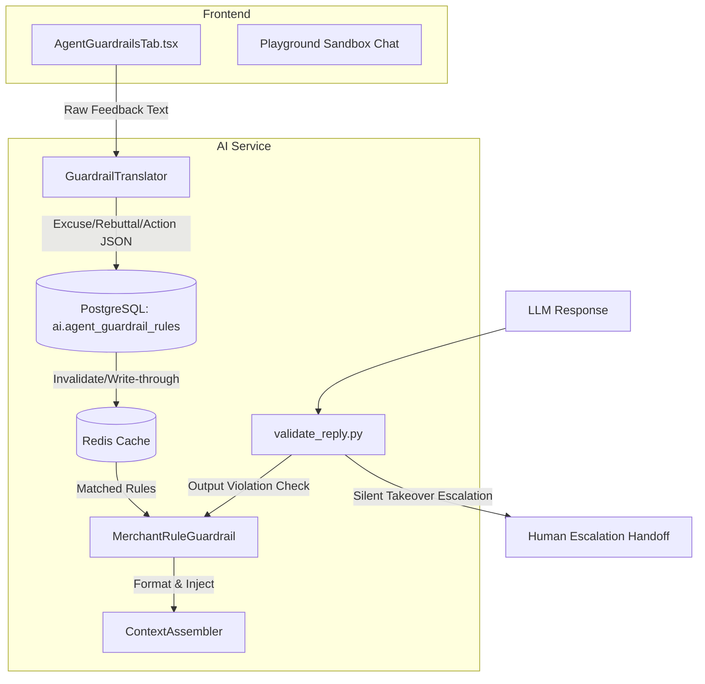

# Merchant Agent Guardrails & Dynamic Learning System

Documentation of the dynamic, database-backed guardrails system implemented for merchant agents.

## Architecture

## Setup & Configuration

1. **Database Schema**:
   Managed via SQLAlchemy `AgentGuardrailRule` in the `ai` schema. Table includes:
   - `id`: Unique identifier
   - `agent_id` & `company_id`: References
   - `excuse`, `rebuttal`, `action`: Modern Standard Arabic translated fields
   - `source`: Tracking label (`template_default`, `merchant_manual`, `correction_auto`)
   - `embedding`: Vector data (Gemini Embedding 2) for similarity matching.
   
2. **FastAPI Router**:
   Admin REST API paths:
   - `GET /admin/agents/{agent_id}/guardrails`
   - `POST /admin/agents/{agent_id}/guardrails`
   - `PUT /admin/agents/{agent_id}/guardrails/{rule_id}`
   - `DELETE /admin/agents/{agent_id}/guardrails/{rule_id}`
   - `POST /admin/agents/{agent_id}/guardrails/conflict-check`

3. **Prompt Injection & Validation**:
   - `ContextAssembler` injects matched rules at priority 1.5.
   - `validate_reply.py` validates output against rules, initiating `ctx.escalation_requested = True` silent human takeover if violated.
   
4. **Settings Tab**:
   Integrated into `AgentProfilesPage.tsx` settings, containing a playground sandbox chat panel that logs applied guardrails.
