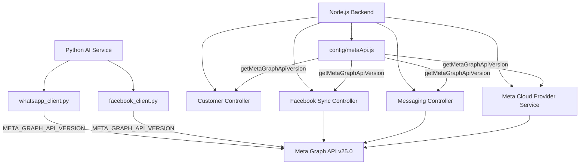

# MaxP Platform Backend Structure & Architecture

This document describes the structure of the Node.js backend, its key modules, configuration patterns, and system architecture.

## Configuration & Environment

Configuration variables are loaded from the environment and exposed via config modules. WhatsApp configuration details (including credentials, access tokens, and API versioning) are managed dynamically through the platform's settings.

### Meta Graph API Versioning

Meta Graph API version (used by WhatsApp Cloud API, Facebook Messenger, and Instagram Graph API) is managed dynamically.

- **Module**: `apps/backend/config/metaApi.js`
- **Variable**: `META_GRAPH_API_VERSION`
- **Default**: `v25.0`
- **Helper Function**: `getMetaGraphApiVersion()` returns the configured Graph API version, defaulting to `v25.0` if not set.
- **Dynamic Overrides**: Individual session configurations can override this standard version through database records, enabling smooth rollouts and targeted compatibility tests.

#### System Architecture Diagram

## Folder Structure

- `config/`: Configuration loaders (database, metaApi, redis, etc.)
- `controller/`: Request handlers grouped by domain
  - `conversation/`: Facebook, Instagram, and WhatsApp messaging syncing and crud
- `services/`: Business logic layer (e.g. database clients, third-party provider integrations)
- `routes/`: Express route definitions mapped to controllers
- `prisma/`: Prisma database schema definitions and migration files
- `tests/`: Jest test suites (unit and integration)

## Python AI Service Database Updates

To support unified model resolution and fallback mechanisms:
- **Table**: `ai.agents` (mapped by `Agent` model in `apps/ai-service/src/db/models/agent.py`)
- **Added Column**: `model_policy` (`JSONB`, default `{}`)
- **Purpose**: Persists the fallback model configuration snapshot (copied from the agent template) to resolve failovers during message processing.

