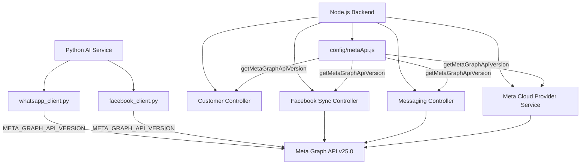

# MaxP Platform Backend Structure & Architecture

This document describes the structure of the Node.js backend, its key modules, configuration patterns, and system architecture.

## Configuration & Environment

Configuration variables are loaded from the environment and exposed via config modules. WhatsApp configuration details (including credentials, access tokens, and API versioning) are managed dynamically through the platform's settings.

### Meta Graph API Versioning

Meta Graph API version (used by WhatsApp Cloud API, Facebook Messenger, and Instagram Graph API) is managed dynamically.

- **Module**: `apps/backend/config/metaApi.js`
- **Variable**: `META_GRAPH_API_VERSION`
- **Default**: `v25.0`
- **Helper Function**: `getMetaGraphApiVersion()` returns the configured Graph API version, defaulting to `v25.0` if not set.
- **Dynamic Overrides**: Individual session configurations can override this standard version through database records, enabling smooth rollouts and targeted compatibility tests.

#### System Architecture Diagram

## Folder Structure

- `config/`: Configuration loaders (database, metaApi, redis, etc.)
- `controller/`: Request handlers grouped by domain
  - `conversation/`: Facebook, Instagram, and WhatsApp messaging syncing and crud
- `services/`: Business logic layer (e.g. database clients, third-party provider integrations)
- `routes/`: Express route definitions mapped to controllers
- `prisma/`: Prisma database schema definitions and migration files
- `tests/`: Jest test suites (unit and integration)

## Python AI Service Database Updates

To support unified model resolution and fallback mechanisms:
- **Table**: `ai.agents` (mapped by `Agent` model in `apps/ai-service/src/db/models/agent.py`)
- **Added Column**: `model_policy` (`JSONB`, default `{}`)
- **Purpose**: Persists the fallback model configuration snapshot (copied from the agent template) to resolve failovers during message processing.
- **Index Update (2026-06-26)**: Dropped strict `uq_company_agent_name` unique constraint on `(company_id, name)` and replaced with partial unique index `uq_company_agent_name_active` (conditional on `status != 'ARCHIVED'`). This allows name reuse when agents are archived.

## Backend Agent Control API Extensions (2026-06-26)

- **GET /agents?status=ARCHIVED**: Fetches soft-deleted (archived) agents.
- **DELETE /agents/:id?permanent=true**: Performs a hard/permanent deletion of the agent from the database instead of the default soft-delete/archiving behavior.
- **PATCH /agents/:id/status**: Restores an agent by setting status to `ACTIVE`.

## Ready Agent Profiles System (2026-06-26)

- **Storage**: Catalog stored in `SystemSettings` table under `systemName = 'agentQuickProfiles'`.
- **Backend Endpoints**:
  - `GET /super-admin/agents/quick-profiles`: List all profiles.
  - `POST /super-admin/agents/quick-profiles`: Create a new profile.
  - `PUT /super-admin/agents/quick-profiles/:slug`: Update an existing profile.
  - `DELETE /super-admin/agents/quick-profiles/:slug`: Delete a profile.
  - `PUT /super-admin/agents/quick-profiles/reorder`: Reorder profiles by passing a list of slugs.
  - `GET /agent-manager/quick-profiles`: Merchant-facing endpoint to fetch active profiles.
- **Frontend Pages**:
  - `/super-admin/agent-profiles`: Super Admin UI for CRUD and reordering.
  - Merchant `AgentProfilesPage`: Dynamically loads the templates from the API.

## Facebook Ads Dashboard Component Architecture (2026-06-26)

The Facebook Ads Dashboard page (`/advertising/facebook-ads`) was refactored from a single monolithic file into modular components:

- **Orchestrator**: `apps/frontend/src/pages/advertising/FacebookAdsDashboard.tsx`
  - Manages top-level state: campaigns, performance summary, decision summary, ad accounts, filters.
  - Renders header, metrics overview, sub-navigation, and delegates sections to child components.

- **Components** (`apps/frontend/src/components/advertising/dashboard/`):
  - `BudgetAlertsPanel.tsx` — WhatsApp budget alerts (create rules, view active rules, view logs).
  - `CampaignsListSection.tsx` — Campaign listing with filtering, sorting, search, pagination.
  - `DecisionSummarySection.tsx` — AI-driven quick decisions and performance recommendations.
  - `MetricCard.tsx`, `MiniMetric.tsx`, `SelectFilter.tsx` — Shared UI atoms.

- **Helpers**: `apps/frontend/src/utils/facebookAdsHelpers.ts`
  - `getHealthDecision()`, `getDecisionClass()`, `getRulePayload()` — extracted from the dashboard.
  - Formatting utilities: `formatCurrency`, `formatNumber`, `formatPercentage`, `formatDate`.

## Python AI Service Intent Classifier Modernization (2026-06-28)

- **Module**: `apps/ai-service/src/intent/`
- **Pattern**: Pure semantic intent classification with dynamic exemplars.
- **Details**:
  - `schema.py`: Exposes `INTENT_POLICIES` containing dynamic semantic descriptions for each intent, purged of all hardcoded keyword/phrase examples. Also defines the `ClassifierResponse` Pydantic model for structured output validation.
  - `dynamic_registry.py`: Extends registry loading to backfill dynamic intent descriptions from static defaults.
  - `classifier.py`: Dynamically generates the LLM system prompt from allowed intents and their registered descriptions. Dynamically extracts and injects the 2 best matching few-shot exemplars from golden cases. Enforces classification execution using only the agent's preferred model (`preferredProvider`/`preferredModel`) with zero fallback models.
  - `resolve_intent.py`: Binds classification execution specifically to the agent's configured LLM client instance (`ctx.llm_client` or `ctx.agent.client`).

## Agent Modernization & Structured Parameter Passing (2026-06-28)

- **Goal**: Transition from single-parameter unstructured requests to explicit multi-parameter schema validations.
- **Details**:
  - `booking_reserve`: Redefined in `booking.py` using a structured `ReserveInput` Pydantic model. Accepts explicit fields: `patient_name`, `patient_phone`, `gender`, `service_name`, `branch_name`, `appointment_date`, and `appointment_time`.
  - `booking_tools.py`: Restructured `reserve_appointment` function to process these parameters directly, resolving branch names dynamically and bypassing legacy regex/NLP text parsing.
  - `planner.py`: Restructured `to_tool_plan` to restrict the allowedTools fallback to supervisor agents with active sub-agent spawning capabilities, avoiding scoping mismatch leakages for normal agents.
- **Workspace-wide Anti-Regression Control**:
  - `.agents/AGENTS.md`: Establishes project-wide rules prohibiting unstructured `request` string parameters for data creation/updates.
  - `scripts/verify-agent-configs.js`: Lint script that automatically inspects all local agent configs on commit/push to prevent regressions to unstructured request configurations.

## Agent Modular Skills Architecture (2026-06-28)

- **Goal**: Transition agents from monolithic files to modular, reusable, and toggleable SaaS skills.
- **Details**:
  - **`medical-center-booking` Skill**: Located at `apps/ai-service/skills/medical-center-booking/`. Contains `skill.json` metadata mapping `booking_slots`, `booking_reserve`, and `booking_status` tools, plus `SKILL.md` detailing slot-filling and branch matching policies.
  - **`booking-upsell-packages` Skill**: Located at `apps/ai-service/skills/booking-upsell-packages/`. Uses `booking_info` to parse session pack prices and upsell cost-saving package combinations to patients.
  - **`clinic-knowledge-resolver` Skill**: Located at `apps/ai-service/skills/clinic-knowledge-resolver/`. Utilises `knowledge_search` tool to execute semantic lookups over the clinic's local knowledge base (for insurance, rules, location).
  - **Skill Registry**: Mapped under `allowedSkills` in the `MEDICAL_CENTER` agent configuration (`agent.json`). Allowed tools expanded to include `knowledge_search` mapped in `role_tools.yaml`.

