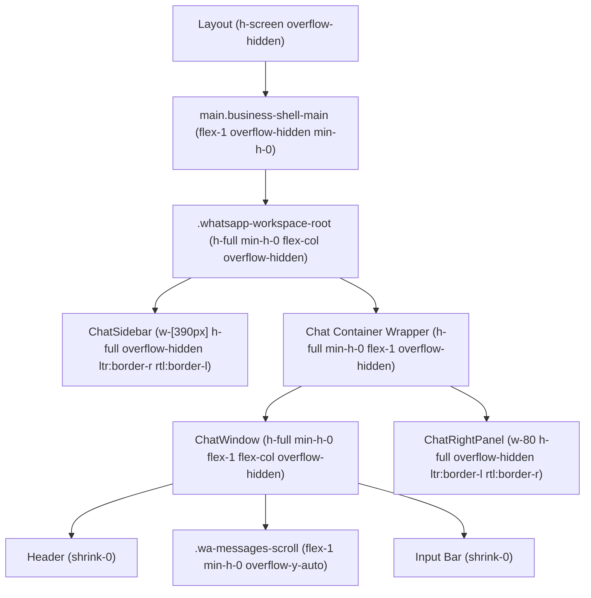

# Backend & System Architecture

## Overview
MaxP Platform provides unified e-commerce, CRM, HR, and WhatsApp multi-channel inbox management.

## Frontend Layout Architecture ΓÇö WhatsApp Workspace

