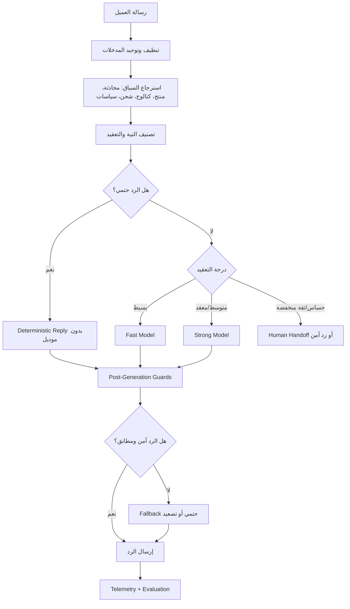

# خطة تحسين جودة ردود AI حسب نوع الرسالة والموديل - 2026-05-05

## الملخص

النظام الحالي عندنا مبني حول `CoreAIAgent`: يجمع سياق المحادثة، يربط الرسالة بالكتالوج والشحن والمنتج، يولد الرد عبر الموديل المتاح، ثم يراجع الرد لتصحيح الأسعار والشحن ومنع التسريبات الداخلية.

النسخة الأفضل المقترحة ليست مجرد تغيير موديل. الأفضل هو بناء طبقة توجيه ذكية فوق المسار الحالي:

1. تحديد نوع الرسالة وتعقيدها.
2. استخدام رد حتمي بدون LLM عندما تكون الحقيقة واضحة.
3. استخدام موديل سريع ورخيص للرسائل البسيطة.
4. استخدام موديل أقوى للرسائل المعقدة أو متعددة النية أو الصور.
5. تشغيل حراس بعد الرد للتأكد أن السعر والشحن والمنتج مطابقين للداتا.
6. قياس الجودة والتكلفة والسرعة لكل مسار.

## الهدف

- تقليل الردود الخاطئة في السعر والشحن والإجمالي.
- منع أي تسريب prompt أو reasoning للعميل.
- تقليل التكلفة باستخدام موديلات خفيفة للرسائل السهلة.
- رفع جودة الردود المعقدة باستخدام موديلات أقوى عند الحاجة فقط.
- جعل الإدارة تقدر تعرف: أي موديل رد؟ لماذا؟ بكام؟ وهل الرد اتصحح أو وقع في fallback؟

## الوضع الحالي المختصر

- مسار Messenger الإنتاجي موحد على `CoreAIAgent`.
- يوجد grounding للكتالوج والمنتجات والشحن.
- يوجد تصحيح أسعار وشحن بعد الرد.
- يوجد fallback عند فشل Gemini أو provider.
- يوجد telemetry لتسجيل الموديل والمزود.
- يوجد اختيار موديل نشط وتدوير مفاتيح وfailover.

النقص الأساسي:

- لا يوجد حتى الآن router واضح يختار الموديل حسب تعقيد الرسالة.
- `predictedTokens` موجودة كمدخل توافق في بعض المسارات لكنها ليست أساس قرار ذكي.
- تقييم الجودة الحالي يحتاج تشديد حتى لا يضع PASS على رد فيه خطأ رقم أو إجمالي.
- نحتاج سياسة واضحة: متى لا نستخدم موديل أصلا، ومتى نستخدم موديل خفيف، ومتى نصعد لموديل قوي.

## المعمارية المقترحة



## سياسة التوجيه المقترحة

### 1. رد حتمي بدون موديل

يستخدم عندما تكون المعلومة واضحة ولا تحتاج صياغة إبداعية:

- سعر منتج مثبت.
- شحن محافظة محددة.
- إجمالي سعر + شحن.
- قائمة ألوان/مقاسات من متغيرات المنتج.
- طلب بيانات ناقصة للأوردر.
- رد منع خصوصية أو سؤال خارج النطاق.

المزايا:

- أسرع رد.
- أقل تكلفة.
- أقل احتمال هلوسة.
- مناسب جدا للأرقام والسياسات الصريحة.

### 2. موديل سريع للرسائل البسيطة

يستخدم في:

- تحية ورد اجتماعي قصير.
- سؤال عام بدون قرار شراء حساس.
- إعادة صياغة رد حتمي بشكل طبيعي مع facts مثبتة.
- متابعة بسيطة بعد عرض سعر أو صورة.

أمثلة موديلات مناسبة:

- `gemini-2.5-flash-lite`
- `gemini-2.5-flash`
- أي موديل رخيص/سريع من provider مضبوط.

المزايا:

- يحافظ على نبرة طبيعية.
- تكلفة أقل من الموديلات القوية.
- زمن استجابة أقل في الشات.

### 3. موديل قوي للرسائل المعقدة

يستخدم في:

- رسالة فيها أكثر من سؤال: سعر + مقاس + شحن + اعتراض.
- اعتراض سعر أو مقارنة بين منتجات.
- فهم صورة أو رسالة `[attachment]` مع سياق سابق.
- محادثة طويلة فيها ملخص وبيانات أوردر.
- سؤال ملتبس يحتاج فهم نية، وليس مجرد keyword.
- شكوى أو تعديل أوردر أو حالة تحتاج حذر.

أمثلة:

- موديل أقوى من Google/OpenRouter حسب المتاح.
- Gemma/Gemini أعلى قدرة لو مثبت أنه أفضل في اللهجة والالتزام.

المزايا:

- جودة فهم أعلى.
- أقل أخطاء في الرسائل المركبة.
- أفضل في اللهجة والتفاوض والاعتراضات.

### 4. تصعيد بشري أو رد آمن

يستخدم عندما:

- الثقة في المنتج المطابق منخفضة.
- العميل يطلب شيء حساس أو غير موجود في الداتا.
- الرد النهائي فشل في الحراس أكثر من مرة.
- الموديلات كلها فشلت أو رجعت رد غير آمن.

سياسة الإنتاج الحالية بعد تحديث 2026-05-05:

- إذا فشل توليد الرد من الموديل والمزود الاحتياطي ولم يوجد رد مولد آمن، لا يتم إرسال رد ثابت للعميل.
- ممنوع استخدام تحية عامة أو رسالة دعم عامة كـ fallback أخير فقط لأن الرسالة تشبه نمطًا معروفًا.
- الردود الحتمية المسموحة تظل محصورة في الحقائق المؤكدة أو الحراس قبل/بعد التوليد، مثل السعر والشحن ومنع التسريب، وليست بديلًا عامًا عن فشل التوليد.

المزايا:

- يمنع إرسال رد قد يضر البيع أو الثقة.
- يحمي من اختراع خصومات أو أسعار أو وعود.
- يعطي فريق خدمة العملاء نقطة تدخل واضحة.

## Sprint 1: قياس الوضع الحالي

الهدف:

بناء baseline قبل أي تعديل حتى نعرف التحسن بالأرقام.

المهام:

- توثيق مسارات الرد الحالية في `backend/services/CoreAIAgent.js`.
- استخراج آخر 100-300 محادثة AI من Agent Inbox وتوسيم الأخطاء:
  - سعر خطأ.
  - شحن خطأ.
  - إجمالي خطأ.
  - رد غير مناسب للنية.
  - prompt/reasoning leak.
  - طلب بيانات موجودة بالفعل.
- إضافة report داخلي يلخص:
  - نسبة الردود الصحيحة.
  - متوسط زمن الرد.
  - توزيع الموديلات.
  - تكلفة تقريبية لكل 1000 رسالة.

التحقق:

- تقرير baseline محفوظ في `backend/tmp` أو `docs`.
- عينة مراجعة يدوية تؤكد أن التصنيف واقعي.

المزايا:

- يمنعنا من تحسين إحساسي بدون أرقام.
- يحدد أكثر نوع خطأ مكلف فعليا.

## Sprint 2: بناء Message Complexity Classifier

الهدف:

إضافة طبقة خفيفة تعطي كل رسالة intent + complexity + risk.

المخرجات المقترحة:

```json
{
  "intent": "price_shipping_total",
  "complexity": "deterministic|simple|complex|handoff",
  "risk": "low|medium|high",
  "reasons": ["grounded_product", "governorate_found", "contains_total_question"]
}
```

المهام:

- إضافة service جديد مثل:
  - `backend/services/aiAgent/messageRoutingPolicy.js`
- استخدام signals موجودة من Core:
  - matchedProduct
  - detectedIntent
  - messageType
  - hasIncomingImageContext
  - productPricingQuote
  - conversationSummary
  - customer message length and multi-question signals
- إضافة tests للحالات:
  - سعر فقط.
  - شحن فقط.
  - سعر + شحن + إجمالي.
  - صورة + "بكام ده؟".
  - اعتراض سعر.
  - سؤال خارج الداتا.

التحقق:

- Jest tests للclassifier.
- log/telemetry يوضح قرار التصنيف بدون تغيير الرد النهائي في البداية.

المزايا:

- أول خطوة لفصل القرار عن توليد الرد.
- يقلل الاعتماد على if conditions المتفرقة داخل Core.

## Sprint 3: Model Routing Policy

الهدف:

ربط نتيجة التصنيف بسياسة اختيار موديل واضحة.

السياسة المقترحة:

- `deterministic`: لا يستخدم LLM إلا لو نحتاج polish اختياري.
- `simple`: يستخدم fast model.
- `complex`: يستخدم strong model.
- `handoff`: لا يرسل رد مولد إلا fallback آمن أو يحول لبشري.

المهام:

- توسيع `modelManager.getNextKeySimple()` أو إضافة wrapper جديد:
  - `selectModelForMessage(companyId, routingDecision, options)`
- دعم إعدادات per company:
  - fast provider/model.
  - strong provider/model.
  - enable/disable strong escalation.
  - max cost per conversation.
  - fallback order.
- تحديث `backend/services/aiRuntimeService.js` أو `CoreAIAgent.js` لاستخدام route context.
- تسجيل قرار الاختيار في `aiTelemetryService`.

التحقق:

- Tests تثبت أن الرسائل البسيطة تذهب للموديل السريع.
- Tests تثبت أن الصور والرسائل المركبة تذهب للموديل الأقوى.
- Tests تثبت أن failover لا يكسر اختيار النوع.

المزايا:

- تكلفة أقل بدون التضحية بالجودة.
- تحكم واضح في الإنتاج.
- يمكن تجربة موديلات جديدة على نوع رسائل معين فقط.

## Sprint 4: Strengthen Fact Guards

الهدف:

جعل الحراس بعد الرد أقوى من الموديل نفسه في الأرقام والحقائق.

المهام:

- توحيد `authoritative blueprint` لكل حالة رقمية.
- تشديد قواعد:
  - السعر لا يتغير عن المنتج المثبت.
  - الشحن لا يتحول إلى 0 إلا لو الداتا تقول ذلك.
  - الإجمالي = سعر المنتج + الشحن + رسوم الفئة إن وجدت.
  - لا يطلب الاسم/الموبايل/العنوان لو موجودين في summary.
- منع prompt/reasoning leak قبل الإرسال بشكل نهائي.
- إضافة rejection reason في telemetry:
  - `price_mismatch`
  - `shipping_mismatch`
  - `internal_leak`
  - `ungrounded_zero_price`
  - `missing_required_fact`

التحقق:

- Focused tests في:
  - `backend/tests/services/CoreAIAgent.catalogVariantContext.test.js`
- Production smoke على سيناريوهات Wofod/Swan بدون إرسال خارجي مباشر.

المزايا:

- يقلل أخطاء الثقة العالية: السعر والإجمالي.
- يجعل الموديل أداة صياغة، وليس مصدر الحقيقة.

## Sprint 5: AI Evaluation Gate

الهدف:

تقييم الردود لا يكتفي بكلمة PASS لو الرد شكله لطيف، بل يراجع الحقائق.

المهام:

- تحديث evaluator ليقارن الرد بالـcontext:
  - expected price.
  - expected shipping.
  - expected total.
  - expected product.
  - expected next question.
- إضافة rules تمنع PASS لو:
  - السعر ناقص رقم.
  - الإجمالي يساوي الشحن فقط.
  - المنتج غلط.
  - الرد فيه internal text.
- إضافة dashboard أو report يعرض failure reasons.

التحقق:

- إعادة تشغيل سيناريو Swan High Skotch:
  - السعر 499.
  - شحن الإسكندرية 75.
  - الإجمالي 574.
- يجب أن يفشل أي رد يقول 49 أو 75 كإجمالي.

المزايا:

- يمنع النظام من خداع نفسه.
- يعطي قائمة fixes واضحة بدل مراجعة يدوية طويلة.

## Sprint 6: Admin UI للتحكم والمراقبة

الهدف:

إظهار السياسة للإدارة بدل تركها مخفية في الكود.

المهام:

- تحديث `frontend/src/pages/SuperAdminAIProviders.tsx`.
- إضافة إعدادات:
  - Fast model.
  - Strong model.
  - Deterministic-only intents.
  - Enable strong escalation.
  - Enable human handoff on high risk.
  - Cost caps.
- عرض telemetry:
  - model used.
  - routing decision.
  - fallback source.
  - guards applied.
  - estimated cost.

التحقق:

- Frontend ESLint.
- Browser check للصفحة.
- API tests لحفظ واسترجاع الإعدادات.

المزايا:

- إدارة أسهل بدون deploy لكل تعديل.
- تجربة موديلات مختلفة بسرعة.
- رؤية واضحة لتكلفة وجودة كل مزود.

## Sprint 7: Canary Rollout

الهدف:

تشغيل النظام الجديد تدريجيا بدل تغيير كامل مفاجئ.

المهام:

- تشغيل classifier في shadow mode أولا.
- تفعيل routing لشركة اختبار أو نسبة صغيرة.
- مقارنة:
  - before/after accuracy.
  - response time.
  - cost.
  - human override rate.
- إضافة kill switch يرجع للمسار الحالي.

التحقق:

- 24-48 ساعة مراقبة.
- مراجعة عينة محادثات فعلية.
- عدم وجود prompt leak أو أخطاء إجمالي حرجة.

المزايا:

- تقليل مخاطرة الإنتاج.
- قرار مبني على بيانات حقيقية.

## مؤشرات النجاح

- خفض أخطاء السعر والشحن والإجمالي بنسبة واضحة.
- صفر prompt/reasoning leaks في العينة المراجعة.
- تقليل تكلفة الرسائل البسيطة.
- ثبات أو تحسن متوسط زمن الرد.
- ارتفاع نسبة PASS الحقيقية بعد تشديد evaluator.
- انخفاض تدخل الإنسان في الحالات السهلة، وزيادته فقط في الحالات عالية المخاطرة.

## المخاطر والتعامل معها

- خطر: classifier يصنف رسالة معقدة كبسيطة.
  - الحل: risk score محافظ، وأي صورة/رسالة متعددة الأسئلة تصعد تلقائيا.

- خطر: موديل قوي أغلى من اللازم.
  - الحل: cost caps وshadow metrics قبل التفعيل الكامل.

- خطر: إعدادات UI تسبب اختيار موديل غير صالح.
  - الحل: health check عند الحفظ، وفallback آمن.

- خطر: الرد الحتمي يكون جاف.
  - الحل: polish اختياري بموديل سريع مع fact guards صارمة.

- خطر: evaluator يفشل ردود صحيحة بسبب صياغة مختلفة.
  - الحل: تقييم الحقائق الرقمية والمنتج أولا، ثم النبرة ثانيا.

## ترتيب التنفيذ المقترح

الأولوية العملية:

1. Baseline + Evaluation hardening.
2. Classifier في shadow mode.
3. Routing policy للموديلات.
4. Fact guards إضافية.
5. Admin UI.
6. Canary rollout.

أفضل بداية ليست تغيير الموديل. أفضل بداية هي أن نعرف كل رسالة راحت فين، ولماذا، وهل الرد مطابق للداتا. بعد كده اختيار الموديل يصبح قرار مضبوط، مش تجربة عشوائية.

## تحديث إنتاجي سريع - سبب الردود الثابتة وعدم فهم الرسائل القصيرة

مراجعة محادثات Wofod بعد إصلاح تسريب الـprompt أظهرت أن التسريب اتقفل، لكن ظهرت مشكلة جانبية: حارس الرد الحتمي كان يتدخل أكثر من اللازم. هذا جعل بعض الرسائل تبدو محفوظة، خصوصا عندما تكون رسالة العميل قصيرة مثل "ليه؟" أو "رجالي صح" بعد سياق شحن أو أوردر سابق.

الأسباب التي ظهرت في العينة:

- مسار `authoritative blueprint` كان يغلب رد الموديل حتى في أسئلة توضيحية لا تحتاج إعادة سعر/شحن.
- تجميع بيانات الأوردر كان يبدأ بسرعة مع رسائل ليست نية شراء واضحة، مثل سؤال عن فئة المنتج.
- رسائل الصور كانت ترسل عددا كبيرا من صور المنتج في مرة واحدة.
- تحقق Facebook recipient كان يستطيع اختيار محادثة قديمة أو فارغة لنفس العميل بدل أحدث محادثة بها رسائل عميل، فينتج `NO_CUSTOMER_MESSAGES`.
- عند فشل الموديل والمزود الاحتياطي، كان fallback عام يرسل رد آمن ثابت. بعد التحديث يظل النظام صامتا بدلا من إرسال رد canned غير مفهوم.

التعديلات المطبقة:

- إضافة ردود حتمية مخصصة فقط لأسئلة: سبب طلب البيانات، اعتراض الشحن، وتأكيد فئة المنتج.
- منع مسار الأوردر من خطف الأسئلة التوضيحية أو طلبات الصور أو المقارنات.
- منع إضافة سؤال بيع تلقائي بعد ردود الصور والمقارنات والاعتراضات.
- تحديد صور Messenger المرفقة بحد افتراضي 3 صور بدل إرسال دفعات كبيرة.
- تحسين اختيار محادثة Facebook المناسبة بالاعتماد على أحدث محادثة لنفس الصفحة وبها رسائل عميل.

التحقق:

- `CoreAIAgent.catalogVariantContext.test.js`: 121 اختبارا ناجحا.
- `production-facebook-fix.test.js`: 7 اختبارات ناجحة.
- الاختبارات الجديدة تغطي تحديدا: "رجالي صح"، "ليه ابعت رقم الموبايل؟"، تقليل صور Messenger، وعدم إضافة سؤال محافظة بعد رد الصور.
