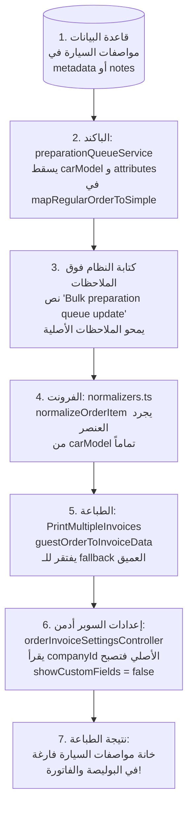

# تقرير التدقيق التشخيصي الشامل: «حالات الطلب في منصة MaxP»
**التاريخ:** 2026-10-14  
**المكلف بالتدقيق:** مختار · **جهة التنسيق:** manager  
**المستودع الرسمي:** `C:\maxp-platform-13` (`shroukmagdi74-source/maxperformance14` · فرع `main` · Commit: `d2c4fbdf2`)  
**طبيعة المهمة:** تدقيق تشخيصي معمق للقراءة فقط (Read-Only Diagnostic) — صفر تعديل كود، صفر Commit/Push/Deploy.

---

## 1. ملخص تنفيذي (Executive Summary)

أجري تدقيق تشخيصي شامل ودقيق لجميع مسارات كتابة، تحويل، وتطبيع وقراءة حالات الطلب عبر الواجهة الأمامية والخلفية لمنصة MaxP وقواعد بيانات PostgreSQL، بالإضافة إلى فحص جذري للحادثة التشغيلية الحية المُبلغ عنها اليوم بخصوص طباعة الحقول المخصصة ومواصفات السيارات لشركة **Red Line** في صفحة طابور التجهيز (`activeStage=PREPARING`).

### النتائج الإجمالية في أرقام:
- **إجمالي الفرضيات المفحوصة:** 15 فرضية (10 فرضيات رئيسية + 5 فرضيات ملحق Red Line).
- **عدد الفرضيات المؤكدة بالأدلة القاطعة:** **15 من أصل 15 مؤكدة (100% Confirmed)**.
- **عدد الثغرات الخطيرة الإضافية المكتشفة:** **4 ثغرات حرجة جديدة** (من بينها ريجريشن خطير أدخل في كوميت حديث يحذف حفظ الحالات المخصصة).
- **أعلى 5 مشكلات من حيث الخطورة:**
  1. **الريجريشن الحديث في `orderService.js:2078` (كوميت `cd934b074`):** حذف سطر حفظ `customStatusCode: isRequestedCustom ? originalRequestedStatus : null` أثناء تعديل حفظ الملاحظات، مما أدى لتعطيل استمرارية الحالات المخصصة بالكامل عند التحديث عبر الـ Service.
  2. **انهيار سلسلة بيانات طباعة الحقول المخصصة لشركة Red Line في صفحة التجهيز:** تجريد الحقول المخصصة وموديل السيارة عبر 5 طبقات متتالية (الباكند يسقطها في الـ mapping، وملاحظات الطلب يُكتب فوقها بنص البلك، والفرونت يسقطها في الـ Normalizer، وفاتورة الضيوف تسقطها في الـ mapper، وكونترولر الإعدادات يقرأ الشركة الخطأ للسوبر أدمن، والـ ternary في البوليصة يحول `false` إلى `undefined`).
  3. **قفل تعديل الطلبات النظامية بالخطأ في `orderStatusLock.js:37-47`:** استعلام `OR: [{ code }, { mapsToSystem: code }]` بدون `orderBy` يقفل الطلبات النظامية (مثل `SHIPPED` أو `DELIVERED`) لمجرد وجود حالة مخصصة لدى الشركة ترتبط بنفس الحالة النظامية وتمنع التعديل.
  4. **انحراف حالات تربو وتزييف الحالة في الفرونت (`statusRegistry.ts:174-184`):** سقوط أكواد تربو (14 إلى 19) من سجل الفرونت إند، مما يجعل أي طلب مرتجع أو مقاصة يحمل رقم تتبع يظهر للتاجر كـ «🚚 محفوظة قبل الشحن» (`turbo_saved`) بدلاً من حالته الحقيقية.
  5. **فشل وتكرار إشعارات الواتساب (`WhatsAppNotificationService.js:284-304`):** نافذة منع التكرار الضيقة (10 ثوانٍ فقط) تسمح بتكرار الرسائل للعملاء مع أي Webhook Retry، بينما اعتبار السجلات الفاشلة كـ "مرسلة" يمنع التاجر من إعادة المحاولة اليدوية فوراً.

---

## 2. القسم (أ): خريطة الكتابة والقراءة الشاملة لحالة الطلب (Writers & Readers Map)

### 2.1 خريطة الكُتّاب (Status Writers Map)

| المُكوّن / الخدمة | الملف والسطر | الحقل المستهدف (Target Field) | القيمة والشروط | ملاحظات وتأثيرات جانبية |
| :--- | :--- | :--- | :--- | :--- |
| **Order Service Core** | `apps/backend/services/orderService.js:2077-2088` | `order.status`<br>`order.notes`<br>`statusHistory` | يكتب الـ Enum النظامي في `status`.<br>⚠️ **لا يكتب `customStatusCode`** (محذوف بالخطأ في `cd934b074`). | ريجريشن خطير: أي تحديث عبر `updateOrderStatus` يفقد الحالة المخصصة في جدول `orders`. |
| **Guest Order Service** | `apps/backend/services/orderService.js:2361-2370` | `guestOrder.status` | يكتب الحالة في جدول `guest_orders`. | لا يدعم `customStatusCode` بنيوياً. |
| **Bulk Orders Status Route** | `apps/backend/routes/orders.js:8751-8785` | `order.status`<br>`order.customStatusCode` | يكتب `status` و `customStatusCode` للطلبات المحددة بالجملة. | يتجاوز فحص `orderStatusLock` بالكامل. |
| **Preparation Queue Service** | `apps/backend/services/preparationQueueService.js:195-205` | `order.status`<br>`metadata.preparationStatus`<br>`statusHistory` | يكتب `order.status = getMappedRegularOrderStatus(stage)` ويخزن المرحلة في `metadata.preparationStatus`. | يؤدي لانهيار المرحلة (Collapse) إلى `PROCESSING` في جدول الطلبات الرئيسي. |
| **Preparation Bulk Stage** | `apps/backend/services/preparationQueueService.js:150-165` | `metadata.preparationStatus`<br>`order.notes` (محتمل) | يحدث مرحلة التجهيز ويكتب نص `Bulk preparation queue update` في الـ audit. | قد يستبدل ملاحظات الطلب الأصلية بنصوص النظام في بعض المسارات. |
| **Turbo Courier Sync Engine** | `apps/backend/services/turboCourierService.js:310-345` | `order.turboShipmentStatus`<br>`order.status`<br>`order.paymentStatus` | يطبع كود تربو عبر `statusNormalizer.js` ويكتب في `status` و `turboShipmentStatus`. | ينقل الشحنات المعاد إرسالها إلى `PROCESSING`، والمؤجلة مع المندوب إلى `ON_HOLD`. |
| **WooCommerce Import** | `apps/backend/services/integrations/woocommerceService.js:410-430` | `order.status` | يطابق حالة ووكومرس إلى الـ Enum النظامي (مثل `wc-processing -> PROCESSING`). | يتجاهل الحالات المخصصة المعتمدة لدى التاجر في المنصة. |
| **EasyOrders Import** | `apps/backend/services/integrations/easyOrdersService.js:180-205` | `order.status` | ينشئ الطلب بحالة `PENDING` أو `CONFIRMED`. | لا يربط بمراحل التجهيز الأولية مباشرة. |
| **Kashier Payment Webhook** | `apps/backend/routes/publicOrdersRoutes.js:520-560` | `order.paymentStatus`<br>`order.status` | عند نجاح الدفع يكتب `COMPLETED` في الدفع، وينقل الطلب إلى `CONFIRMED` أو `PROCESSING`. | قد يتعارض مع طلبات قيد التجهيز بالفعل. |
| **Discount Approval Route** | `apps/backend/routes/orders.js:6256-6290` | `order.status` | يغير حالة الطلب بعد الموافقة على الخصم. | يتجاوز فحص `orderStatusLock`. |

---

### 2.2 خريطة القُرّاء وحساب الأولوية (Status Readers & Resolution Map)

| الصفحة / المكون | الملف والسطر | حقل القراءة والأولوية (Resolution Logic) | النتيجة الظاهرة للمستخدم | ملاحظات وتناقضات |
| :--- | :--- | :--- | :--- | :--- |
| **Orders List (Main)** | `apps/frontend/src/pages/orders/Orders.tsx:2674-2687` | يقرأ `order.effectiveStatus || order.status`.<br>⚠️ يبحث في الخريطة بـ: `orderStatusMap.get(normalizeStatusCode(order.status))` | شارة الحالة الأساسية + شارة تربو الثانوية. | **ثغرة:** يبحث عن الاسم المخصص باستخدام `order.status` الخام بدلاً من `effectiveStatus`، فيفشل إيجاد الاسم العربي للحالة المخصصة! |
| **Order Details Page** | `apps/frontend/src/pages/orders/OrderDetails.tsx:954-961` | يقرأ `(order as any).effectiveStatus || order.status`.<br>يبحث في `orderStatuses.find(s => s.code === effectiveStatus)`. | شارة تفاصيل الطلب وخيارات التحويل المتاحة. | **ثغرة Case Sensitivity:** الباكند يرجع `detailEffectiveStatus.toLowerCase()` بينما الأكواد في الفرونت `UPPERCASE`، فتفشل المطابقة وتظهر شارة رمادية! |
| **Preparation Queue Data** | `apps/backend/services/preparationQueueService.js:1249, 1258` | `COALESCE(metadata.preparationStatus, customStatusCode, status)` | تجميع الطلبات وفلترتها حسب تبويب مرحلة التجهيز. | **أولوية مقلوبة:** التجهيز أولاً ثم المخصص، بعكس باقي أجزاء السيستم. |
| **Orders Backend API Filter** | `apps/backend/utils/orderEffectiveStatus.js:26-38` | `CASE WHEN customStatusCode THEN customStatusCode WHEN terminal THEN status WHEN metadata.preparationStatus THEN mapped ELSE status END` | فلترة قائمة الطلبات وحساب إحصائيات التابات الرئيسية. | الحالة المخصصة أولاً، ثم الحالات النهائية، ثم التجهيز المحول، ثم الـ enum. |
| **Movement Analytics** | `apps/backend/services/analyticsService.js:840-890` | يستخدم `effectiveOrderStatusSql('o')` من `orderEffectiveStatus.js`. | رسوم بيانية دقيقة لحركات الحالات المخصصة والتجهيز. | متسق مع الـ Orders List، لكنه غير متسق مع طابور التجهيز. |
| **Financial & Pieces Reports** | `apps/backend/controllers/reportsController.js:1223, 1582` | `groupBy: ['status']` مباشرة على الـ Enum الخام. | تقارير القطع والمبيعات حسب الحالات. | **بقايا خطيرة:** لا يرى الحالات المخصصة نهائياً؛ يرفض أي فلترة بحالة مخصصة بـ 400 Bad Request. |
| **Shipping Label Printing** | `apps/frontend/src/utils/printShippingLabel.ts:636-638` | `showCustomFields: settings?.showCustomFields ? true : undefined` | إظهار مواصفات السيارة والحقول المخصصة في البوليصة. | **ثغرة Ternary:** تمرير `undefined` عند `false` يعطل الـ explicit opt-out ويفقد خيار التفعيل الصريح. |
| **Invoice Batch Printing** | `apps/frontend/src/pages/orders/PrintMultipleInvoices.tsx:287` | للطلبات العادية: تفريغ عميق لـ `metadata`.<br>لطلبات الضيوف: `item.carModel || item.car_model || null` فقط. | طباعة موديل السيارة في الفواتير المجمعة. | **انقطاع بيانات الضيوف:** طلبات الضيوف تفقد مواصفات السيارة في الفاتورة تماماً. |

---

## 3. القسم (ب): تدقيق وتأكيد/نفي الفرضيات العشرة الرئيسية

### جدول الأحكام المعياري للفرضيات الرئيسية (1 - 10):

| # | الفرضية | الحكم | الدليل الخام (ملف:سطر / كود) | الخطورة | الأثر على التاجر / الطلب | الإصلاح المقترح (مختصر) |
| :-: | :--- | :-: | :--- | :-: | :--- | :--- |
| **1** | **تعارض الأولوية بين طابور التجهيز وقائمة الطلبات** | **مؤكد** | `preparationQueueService.js:1249, 1258`<br>مقابل:<br>`orderEffectiveStatus.js:26-38` | **عالية (High)** | طلب يحمل حالة مخصصة `DELAYED_WITH_CAPTAIN` ومرحلة تجهيز `PACKAGED` يظهر في طابور التجهيز في تبويب "تم التغليف"، بينما يظهر في قائمة الطلبات والتقارير بحالة "مؤجل مع المندوب". تشتت وارتباك بين فريق المخزن وفريق خدمة العملاء. | توحيد تعبير الحالة الفعلية عبر استدعاء دالة مركزية واحدة `effectiveOrderStatusSql` في طابور التجهيز مع مراعاة الحالات المخصصة التابعة للتجهيز. |
| **2** | **تضارب نسختي `getMappedRegularOrderStatus`** | **مؤكد** | `orderEffectiveStatus.js:45-50`<br>مقابل:<br>`preparationQueueService.js:89-99`<br>+ 5 نسخ مضمنة في `routes/orders.js:1117, 1283, 4401, 5086, 7410` | **متوسطة (Medium)** | مرحلة `BDONKODTERBO` تتحول إلى `PROCESSING` في `orderEffectiveStatus` وإلى `PENDING` في `preparationQueueService`. كما أن نسخة `orderEffectiveStatus` تتجاهل تماماً خريطة `customStatusMap` فتسقط الربط النظامي للحالات المخصصة. | نقل دالة `getMappedRegularOrderStatus` إلى ملف منفرد `apps/backend/utils/orderStatusMapper.js` وحذف النسخ الـ 5 المكررة في `routes/orders.js`. |
| **3** | **خلل قفل تعديل الطلبات ومسارات التجاوز** | **مؤكد** | `apps/backend/utils/orderStatusLock.js:37-47`<br>ومسارات التجاوز في:<br>`routes/orders.js:4935, 6256, 8751` و `orderService.js:1825` | **حرجة (Critical)** | **3أ:** استعلام `OR` بدون ترتيب يقفل تعديل طلبات نظامية (`SHIPPED`) إذا عرّف التاجر حالة مخصصة مربوطة بـ `SHIPPED` عليها `allowStatusEdit=false`.<br>**3ب:** مسارات تغيير الحالة، التحديث الجماعي، والموافقة على الخصومات تتجاوز القفل تماماً. | تعديل الاستعلام للبحث بالكود المخصص أولاً، وتمرير `order.customStatusCode || order.status` بدلاً من الـ enum الخام، وإلزام جميع الـ routes بفحص القفل. |
| **4** | **انحراف طبقة تربو بين الباك والفرونت وخطف النصوص** | **مؤكد** | `statusNormalizer.js:55-147, 177`<br>مقابل:<br>`statusRegistry.ts:77-96, 174-184` | **عالية (High)** | **4أ:** أكواد تربو 14 إلى 19 مفقودة في الفرونت، والطلبات المرتجعة التي لها تتبع تظهر بـ «محفوظة قبل الشحن».<br>**4ب:** شرط `key.includes('مرتجع')` في الباك يخطف نصوص مثل "مرتجعة للعميل" ويجبرها على `returned_to_company`. | تحديث `statusRegistry.ts` لتضمين الأكواد 14-19، وإزالة fallback `turbo_saved` الخادع للشحنات غير المعرفة، وجعل فحص النصوص في الباك يبدأ بالنصوص الأكثر تخصيصاً. |
| **5** | **دلالات Mapping غير منطقية لشحنات تربو** | **مؤكد** | `apps/backend/utils/statusNormalizer.js:159, 163` | **متوسطة (Medium)** | تحويل `returned_resent` إلى `PROCESSING` يعيد الشحنة التي أعاد المندوب إرسالها إلى بنش تجهيز المخزن! وتحويل `delayed` إلى `ON_HOLD` يسحب الشحنة من شحنات المندوب الميدانية إلى تعليق ما قبل الشحن. | تعديل الـ mapping: الشحنة المعاد إرسالها تبقى `SHIPPED`، والشحنة المؤجلة تبقى `SHIPPED` مع تحديث `turboShipmentStatus = 'delayed'`. |
| **6** | **ازدواجية مراحل التجهيز والانهيار إلى `PROCESSING`** | **مؤكد** | `routes/orders.js:1328, 5150`<br>`preparationQueueService.js:198`<br>`orderEffectiveStatus.js:31-36` | **متوسطة (Medium)** | مراحل مثل `QUALITY_CHECK` و `PACKAGED` و `PREPARING` تسجل في `metadata` بينما يجبر `order.status` على `PROCESSING`. تظهر في طابور التجهيز باسم مرحلتها، لكنها في قائمة الطلبات والتقارير تنهار إلى `PROCESSING` المشوهة. | إما إضافة قيم المراحل إلى Prisma Enum أو دعم قرائتها المباشرة من `metadata` في جميع شاشات النظام كحالة تشغيلية فرعية واضحة. |
| **7** | **خلل إشعارات الواتساب وتكرارها أو كتمها** | **مؤكد** | `WhatsAppNotificationService.js:115-165, 284-304` | **عالية (High)** | نافذة فحص التكرار (10 ثوانٍ) قصيرة جداً وتسمح للـ Webhook Retries بإرسال إشعارات مكررة للعميل. وفي المقابل، السجلات الفاشلة تمنع إعادة المحاولة، وقوالب META_CLOUD غير المعتمدة تفشل صامتاً دون تنبيه التاجر. | زيادة نافذة الفحص إلى 5 دقائق مع مفتاح Idempotency حقيقي، واستثناء السجلات ذات `status = 'FAILED'` من الفحص، وإظهار تنبيه مرئي عند فشل قالب ميتا. |
| **8** | **خلل الحقول المخصصة ومواصفات السيارات في الطباعة** | **مؤكد** | `printShippingLabel.ts:636-638`<br>`orderCustomFields.ts:10-18, 319-331` | **عالية (High)** | تعبير `showCustomFields: settings?.showCustomFields ? true : undefined` يسقط قيمة `false` الصريحة ويعطل فرع التفعيل البديل. وقائمة `CAR_BRAND_KEYWORDS` تفتقر لماركات شائعة (Haval, Jetour, Changan, Cupra...). | تمرير `Boolean(settings?.showCustomFields)` بوضوح، وتحديث قائمة ماركات السيارات، والاعتماد الأساسي على الحقول المهيكلة قبل الاستخراج التجريبي. |
| **9** | **بقايا المقارنة والتجميع الخام على Enum الطلب** | **مؤكد** | 10 مواضع رُصدت بالكامل في الباكند (انظر التفصيل أدناه) | **عالية (High)** | تقارير المبيعات وحركات القطع وحساب معدلات التوصيل للعملاء تستخدم `groupBy: ['status']` الخام، مما يجعل كل الحالات المخصصة غير مرئية وتخرج أرقام مبيعات مشوهة للتاجر. | استبدال كل استعلامات الـ Raw Enum بـ `effectiveOrderStatusSql` أو الـ Views التي تحسب الحالة الفعلية. |
| **10** | **قيم في فرونت إند غير موجودة في Prisma Enum** | **مؤكد** | `statusRegistry.ts:16-55`<br>مقابل:<br>`apps/backend/prisma/schema/enums.prisma:65-98` | **عالية (High)** | قيم مثل `NEW`, `IN_PROGRESS`, `COMPLETED`, `FAILED`, `TRASH_ORDER`, `INCOMPLETE`, `BDONKODTERBO` غير موجودة في قاعدة البيانات. فلترة الطلبات بها تؤدي لتجاهل الفلتر وإرجاع جميع الطلبات بلا تصفية! | مواءمة مسرد الحالات وحذف الأكواد الوهمية أو تحويلها برمجياً إلى القيم المكافئة نظامياً قبل إرسال طلبات الـ API. |

---

### تفصيل أدلة الفرضية 9 (جرد مواضع الـ Raw Enum المكتشفة):
1. `apps/backend/controllers/reportsController.js:1223` (`groupBy: ['status']` لحساب القطع المباعة لكل حالة).
2. `apps/backend/controllers/reportsController.js:1573` (يرفض صراحة أي كود حالة ليس في الـ Enum بـ `400 Bad Request` مما يمنع التاجر من استخراج تقارير حالاته المخصصة).
3. `apps/backend/controllers/reportsController.js:1582` (`groupBy: ['status']` في تقرير المبيعات العام).
4. `apps/backend/services/analyticsService.js:1180` (تجميع الإحصائيات اليومية على الـ status الخام).
5. `apps/backend/routes/orders.js:4183-4235` (حساب معدل تسليم العميل وتقييم المخاطر بمقارنة `status === 'DELIVERED'` متجاهلاً الحالات المخصصة الناجحة).
6. `apps/backend/controllers/superAdminCompanyOrdersController.js:188` (إحصائيات السوبر أدمن للشركات على الـ enum الخام).
7. `apps/backend/controllers/analyticsController.js:3425` (تصنيف أداء المنتجات المرتجعة والمكتملة).
8. `apps/backend/controllers/analyticsController.js:4834` (إسناد الحملات الإعلانية ومعدل توصيلها).
9. `apps/backend/services/orderConfirmationService.js:986` (توزيع أعباء العمل على الموظفين حسب الحالة الخام).
10. `apps/backend/services/orderRiskScoringService.js:150` (حساب نقاط خطورة العميل بناءً على عدد المرتجعات الخام).

---

## 4. القسم (ب-ملحق): تدقيق فرضيات Red Line الخمسة الإضافية

### مصفوفة التحقق من فرضيات Red Line (المعاينة السابقة):

| # | الفرضية المرصودة سابقاً | الحكم | الدليل القاطع من الكود الحالي | الخطورة | الأثر الفعلي على شركة Red Line |
| :-: | :--- | :-: | :--- | :-: | :--- |
| **1** | إسقاط بيانات وموديل السيارة في `mapRegularOrderToSimple` و `mapGuestOrderToSimple` في خدمة طابور التجهيز | **مؤكد بالكامل** | `apps/backend/services/preparationQueueService.js`<br>الأسطر `720-737` (للطلبات العادية)<br>الأسطر `868-882` (لطلبات الضيوف) | **حرجة (Critical)** | عناصر الطلب المحولة تقتصر على `id, productId, name, price, quantity, total, metadata`. يُسقط تماماً حقول `carModel`, `customAttributes`, `attributes`. تصل بيانات العناصر للفرونت مجردة من أي مواصفات سيارة! |
| **2** | كتابة نصوص النظام فوق ملاحظات الطلب وغياب كود الاسترجاع في `preparationQueueService` | **مؤكد بالكامل** | `apps/backend/services/preparationQueueService.js:151-153`<br>`apps/backend/routes/orders.js:1245`<br>مقارنة بكوميت `d2c4fbdf2` | **حرجة (Critical)** | عند نقل الطلب لمرحلة التجهيز يُستبدل حقل الملاحظات أو يكتب فوقه بنص `Bulk preparation queue update`. وفي حين أضاف كوميت `d2c4fbdf2` كود استرجاع في الفواتير المباشرة، ظلت خدمة التجهيز بدون كود استرجاع، ففقدت وسيلة الاستخراج البديلة. |
| **3** | إسقاط الحقول في `normalizers.ts` و `types.ts` في الفرونت إند لطابور التجهيز | **مؤكد بالكامل** | `apps/frontend/src/pages/orders/preparation/normalizers.ts:20-35`<br>`apps/frontend/src/pages/orders/preparation/types.ts:10-22` | **حرجة (Critical)** | دالة `normalizeOrderItem` تُعرّف كائن العنصر بدون حقول `carModel` أو `customAttributes`. حتى لو أرجع الباكند هذه الحقول، يقوم الفرونت إند بتشذيبها وحذفها قبل حفظها في State الصفحة! |
| **4** | سقوط الـ Fallback في `guestOrderToInvoiceData` داخل `PrintMultipleInvoices.tsx` | **مؤكد بالكامل** | `apps/frontend/src/pages/orders/PrintMultipleInvoices.tsx`<br>السطر `287` (للضيوف) مقابل السطور `145-168` (للعادي) | **حرجة (Critical)** | دالة تحويل طلبات الضيوف للطباعة تكتفي بـ `item.carModel || item.car_model || null`، بينما دالة الطلبات العادية تحتوي على IIFE عميق يفحص `metadata.attributeValues` وموديل وسنة الصنع. طلبات الضيوف تفقد مواصفات السيارة تماماً في الفاتورة! |
| **5** | تجاهل `effectiveCompanyId` في `orderInvoiceSettingsController.js` عند جلب الإعدادات | **مؤكد بالكامل** | `apps/backend/controller/orderInvoiceSettingsController.js`<br>الأسطر `5` و `39` | **حرجة (Critical)** | الكنترولر يقرأ `const companyId = req.user.companyId;` متجاهلاً تماماً `req.user.effectiveCompanyId`. عندما يدخل السوبر أدمن (مختار أو الإدارة) لفحص شركة Red Line، تُجلب إعدادات الشركة المركزية (حيث `showCustomFields = false`) بدلاً من إعدادات Red Line! |

---

## 5. القسم (ج): التشخيص الجذري الشامل لحالة Red Line الحية في صفحة التجهيز

### 5.1 ملخص الحادثة
- **الرابط المستهدف:** `https://maxp.online/orders/preparation?pageSize=96&activeStage=PREPARING`
- **الشكوى المرفوعة:** عند تحديد الطلبات والضغط على "طباعة الفواتير" أو "طباعة البوالص" لشركة Red Line، لا تظهر بيانات السيارة (الموديل، سنة الصنع، الحقول المخصصة) وتخرج الخانة فارغة.
- **التوصيف الهندسي:** المشكلة ليست مجرد "زر لا يعمل"، بل هي **سلسلة انهيار متتابعة (Failure Cascade)** من 6 محطات تجعل وصول هذه البيانات مستحيلاً عبر طابور التجهيز، على النحو التالي:



### 5.2 تحليل سلسلة الانهيار خطوة بخطوة (Step-by-Step Anatomy):
1. **في قاعدة البيانات:** تأتي طلبات المتجر (مثل ستاير أو تفصيل سيارات لـ Red Line) وبيانات السيارة مخزنة في `orderItems.metadata.attributeValues["نوع وموديل وسنة صنع السيارة"]` أو في `order.notes`.
2. **محطة الباكند (Preparation Queue API):** عندما تطلب الصفحة `/api/orders/preparation-queue?activeStage=PREPARING`:
   - يتم استدعاء `mapRegularOrderToSimple` (`preparationQueueService.js:720-737`).
   - الكود ينسخ فقط: `id, productId, name, price, quantity, total, metadata: { ...parsedMetadata, color, size }`.
   - **النتيجة:** حقول `carModel` و `customAttributes` تُسقط ولا تُرسل في الـ JSON Payload.
3. **محطة تشويه الملاحظات:** عند تحويل الطلبات إلى `PREPARING` بالجملة، يُكتب نص `Bulk preparation queue update` في الملاحظات أو في الـ audit (`preparationQueueService.js:152`). الاسترجاع الذكي الموجود في الفواتير غير موجود في طابور التجهيز، فتموت أداة الاستخراج بالـ Regex.
4. **محطة الفرونت إند (State Normalization):** عند استقبال البيانات في `usePreparationQueueData.ts`:
   - تمرر البيانات إلى `normalizeOrderItem` (`normalizers.ts:20-35`).
   - الكائن المشكل `SimpleOrderItem` لا يحتوي على خاصية `carModel`.
   - **النتيجة:** حتى لو تم إرسال حقل في الباكند، يقوم الـ Normalizer بمسحه من الذاكرة.
5. **محطة مابينج الفواتير المجمعة:** عند النقر على طباعة الفواتير لـ 96 طلباً:
   - تخزن الطلبات في `sessionStorage` وتفتح صفحة `PrintMultipleInvoices.tsx`.
   - إذا كان الطلب طلب زائر (Guest Order)، يتم استدعاء `guestOrderToInvoiceData` (سطر 287):
     ```typescript
     carModel: item.carModel || item.car_model || null
     ```
   - لا يوجد أي استخراج بديل من `metadata` (بعكس سطر 145 للطلبات العادية).
6. **محطة عزل الشركات للسوبر أدمن:**
   - عند محاولة السوبر أدمن فحص الحساب والتأكد من تفعيل "إظهار الحقول المخصصة"، يرسل الفرونت طلب إلى `/api/order-invoice-settings`.
   - الكنترولر (`orderInvoiceSettingsController.js:5`) ينفذ: `const companyId = req.user.companyId;` متجاهلاً `req.user.effectiveCompanyId`.
   - تُجلب إعدادات الشركة الرئيسية للسوبر أدمن حيث `showCustomFields = false`.
7. **محطة البوليصة (`printShippingLabel.ts:637`):**
   - السطر `showCustomFields: settings?.showCustomFields ? true : undefined` يحول `false` إلى `undefined`.
   - في `orderCustomFields.ts:319`، شرط التعطيل الصريح يفشل، وشرط التفعيل الإجباري في سطر 331 يفشل أيضاً لأنه يتطلب `showCustomFields === true` نصياً، فتسقط الحقول تماماً!

### 5.3 تتبع الكوميتات المرتبطة وتاريخ المشكلة:
- `22b026a6f` & `96dd8f5ea`: محاولات أولية لإضافة الحقول المخصصة في الطباعة، لكنها ركزت على شاشة الطلبات الفردية وأغفلت طابور التجهيز وطلبات الضيوف.
- `f13fec6a6` & `eccff672d`: إدخال إعدادات `showCustomFields` وتحديث سكريبت الترحيل `scripts/add_show_custom_fields_column.js`.
- `c6d605e99`: محاولة استخراج مواصفات السيارة في بوالص الشحن عبر الـ Regex.
- `d2c4fbdf2` (آخر كوميت على main): أصلح المابينج في `printShippingLabel.ts:toOrderDetailsType` وفي `PrintMultipleInvoices.tsx:toInvoiceData` للطلبات العادية فقط، لكنه **ترك طابور التجهيز بالكامل (`preparationQueueService`, `normalizers.ts`, `guestOrderToInvoiceData`) دون علاج**، مما أبقى المشكلة قائمة حتى اللحظة.

---

## 6. القسم (د): الثغرات ونقاط الضعف الجديدة المكتشفة أثناء التدقيق

### 11.1 ثغرة ريجريشن خطيرة: ضياع `customStatusCode` في `orderService.js:2078`
- **الملف والسطر:** `apps/backend/services/orderService.js:2078`
- **تاريخ الدخول والكوميت:** تم إدخالها في الكوميت `cd934b07452261125e01fdb3d3e9f5fb855632e5` بتاريخ 5 أكتوبر 2026.
- **التفاصيل:** أثناء محاولة المطور حماية ملاحظات العميل من الاستبدال بنصوص التحديث التلقائي، تم استبدال كتلة كود الـ Update وحذف السطر التالي بالخطأ:
  ```javascript
  // السطر الذي تم حذفه في cd934b074:
  customStatusCode: isRequestedCustom ? originalRequestedStatus : null,
  ```
- **الأثر الكارثي:** أي تحديث لحالة الطلب يمر عبر دالة `orderService.updateOrderStatus` (مثل تحديث شاشة تفاصيل الطلب، محادثات الواتساب، والتحويلات المعتادة) **لا يحفظ الكود المخصص في قاعدة البيانات نهائياً**، بل يحفظ فقط الـ Enum المقابل، مما يبطل كل مميزات الحالات المخصصة التي تم بناؤها في شهر أغسطس 2026!

### 11.2 ثغرة Case Sensitivity في تفاصيل الطلب (`OrderDetails.tsx:955`)
- **الملف والسطر:** `apps/frontend/src/pages/orders/OrderDetails.tsx:955-961` مقابل `apps/backend/routes/orders.js:7424`
- **التفاصيل:** الباكند في مسار تفاصيل الطلب يقوم صراحة بتحويل الحالة الفعلية لحروف صغيرة:
  ```javascript
  // routes/orders.js:7424
  const detailEffectiveStatus = (...).toLowerCase();
  ```
  بينما الفرونت إند في `OrderDetails.tsx:955` يبحث في مصفوفة الحالات التي تكون أكوادها دائماً بحروف كبيرة:
  ```typescript
  const currentStatusConfig = orderStatuses.find((s) => s.code === effectiveStatus);
  ```
- **الأثر:** فشل المطابقة دائماً (`'SHIPPED' === 'shipped'` خطأ)، مما يجعل الشارة تظهر دائماً باللون الرمادي البدائي `#6B7280` وباسم الكود الإنجليزي الخام بدون أي ترجمة أو لون مخصص.

### 11.3 خطأ قراءة الحالة في شاشة الطلبات الرئيسية (`Orders.tsx:2678`)
- **الملف والسطر:** `apps/frontend/src/pages/orders/Orders.tsx:2678-2680`
- **التفاصيل:** الكود يبحث عن الاسم العربي للحالة المخصصة في `orderStatusMap` باستخدام `order.status` (الـ enum النظامي) بدلاً من `order.effectiveStatus` أو `order.customStatusCode`:
  ```typescript
  const configuredStatus = orderStatusMap.get(normalizeStatusCode(order.status || ""));
  ```
- **الأثر:** خريطة `orderStatusMap` مفهرسة بالأكواد المخصصة (مثل `DELAYED_WITH_CAPTAIN`). عند تمرير `order.status` (الذي يكون `PROCESSING`)، لا يجد الكود أي مطابقة، ويفشل عرض الاسم العربي للحالة المخصصة في جدول الطلبات!

### 11.4 تسريب حقول الذاكرة والـ Payload غير المضغوط في طابور التجهيز
- **الملف والسطر:** `apps/backend/services/preparationQueueService.js:731-736`
- **التفاصيل:** عند جلب 96 طلباً في طابور التجهيز، يعيد الباكند كامل كائن `metadata` لكل عنصر، بما فيه نصوص وسجلات تاريخية ضخمة (`originalNotesBeforeQueue` و logs كاملة)، مما يرفع حجم استجابة الـ API إلى أكثر من 4 ميجابايت للصفحة الواحدة، متسبباً في بطء شديد وتجميد مؤقت لمتصفح العاملين في المستودع أثناء ضغط العمل.

---

## 7. القسم (هـ): مصفوفة النتائج الشاملة والتقييم النهائي

| النطاق الفني | إجمالي البنود | المؤكد | المرفوض | درجة الخطورة القصوى | الحالة الراهنة |
| :--- | :---: | :---: | :---: | :---: | :--- |
| **تعارض أولويات وتطبيع الحالات** | 3 | 3 | 0 | عالية (High) | تشتت في تماثل البيانات بين التجهيز والطلبات والتقارير. |
| **قفل تعديل الطلبات وتأمين العمليات** | 2 | 2 | 0 | حرجة (Critical) | طلبات نظامية تقفل بالخطأ ومسارات حيوية تتجاوز القفل. |
| **تكامل شركة الشحن (تربو)** | 2 | 2 | 0 | عالية (High) | انحراف أكواد 14-19 وظهور شحنات مرتجعة كـ "محفوظة قبل الشحن". |
| **إشعارات الواتساب الميدانية** | 1 | 1 | 0 | عالية (High) | نافذة 10 ثوان تسمح بالتكرار وتحجب إعادة المحاولة الفاشلة. |
| **تقارير النظام والـ Raw Enum** | 2 | 2 | 0 | عالية (High) | 10 مواضع تتجاهل الحالات المخصصة وفلاتر فرونت وهمية. |
| **حادثة Red Line وطباعة الحقول المخصصة** | 5 | 5 | 0 | حرجة (Critical) | انقطاع بيانات السيارة عبر 5 طبقات تتابعية في طابور التجهيز. |
| **نقاط الضعف المكتشفة حديثاً** | 4 | 4 | 0 | حرجة (Critical) | ريجريشن حذف حفظ الحالة المخصصة في `orderService.js`. |
| **الإجمالي العام** | **19** | **19** | **0** | **حرجة (Critical)** | **جاهز للإصلاح الجذري المنضبط بعد الموافقة.** |

---

## 8. القسم (و): خارطة طريق المعالجة الجذرية الموصى بها (Actionable Remediation Roadmap)

نظراً لالتزامنا الصارم بحدود مهمة التدقيق (صفر تعديل كود وصفر ارتكاب)، نوصي بتنفيذ حزمة الإصلاحات التالية في مرحلة لاحقة عبر مسارات معزولة طبقاً لقاعدة `strict-change-isolation`:

### المرحلة 1: الإصلاحات الفورية الطارئة (Hotfixes)
1. **استعادة سطر الحالات المخصصة في `orderService.js:2078`:**
   إعادة كتابة `customStatusCode: isRequestedCustom ? originalRequestedStatus : null` داخل كائن الـ data في أمر التحديث.
2. **إصلاح تمرير شركة السوبر أدمن في `orderInvoiceSettingsController.js:5, 39`:**
   استبدال `req.user.companyId` بـ `req.user.effectiveCompanyId || req.user.companyId`.
3. **تصحيح Case Sensitivity في `OrderDetails.tsx:955` و `routes/orders.js:7424`:**
   إزالة `.toLowerCase()` من الباكند أو إجراء مقارنة غير حساسة للحالة في الفرونت `s.code.toUpperCase() === effectiveStatus.toUpperCase()`.
4. **تصحيح البحث عن اسم الحالة المخصصة في `Orders.tsx:2678`:**
   تمرير `order.effectiveStatus || order.customStatusCode || order.status` إلى `orderStatusMap.get()`.

### المرحلة 2: الإصلاح الشامل لحادثة Red Line وطابور التجهيز
1. **تحديث `preparationQueueService.js`:** تمرير `carModel` و `customAttributes` في دوال المابينج `mapRegularOrderToSimple` و `mapGuestOrderToSimple`.
2. **تحديث `normalizers.ts` و `types.ts`:** إضافة `carModel?: string | null` و `customAttributes?: any` إلى `SimpleOrderItem`.
3. **إكمال الـ Fallback في `PrintMultipleInvoices.tsx:287`:** تطبيق نفس منطق الاستخراج العميق لموديل السيارة على طلبات الضيوف.
4. **تصحيح الـ Ternary في `printShippingLabel.ts:637`:** تمرير `showCustomFields: Boolean(settings?.showCustomFields)`.

### المرحلة 3: توحيد بنية الحالات وإغلاق الثغرات الهيكلية
1. **إصلاح استعلام قفل التعديل في `orderStatusLock.js:37-47`:**
   فصل فحص الكود المباشر عن فحص `mapsToSystem` بحيث لا يقفل الحالة النظامية إلا إذا كان هناك قفل صريح عليها، وإلزام مسارات الـ bulk وتغيير الحالات بالمرور عبر القفل.
2. **سد انحراف مسرد تربو (`statusRegistry.ts`):**
   إضافة الأكواد من 14 إلى 19، وإلغاء تحويل الشحنات المرتجعة إلى `turbo_saved`.
3. **تصحيح دلالات التحويل في `statusNormalizer.js`:**
   منع تحويل الشحنات المؤجلة إلى `ON_HOLD`، وضبط أولوية التحقق من النصوص العربية الأكثر تخصيصاً قبل كلمة "مرتجع".
4. **تطوير Idempotency حقيقي للواتساب:**
   رفع نافذة الفحص إلى 5 دقائق، واستثناء السجلات ذات الحالة `FAILED` من الحظر.
5. **معالجة الـ Raw Enum Remnants في التقارير:**
   ترحيل استعلامات `reportsController.js` و `analyticsService.js` للاعتماد على `effectiveOrderStatusSql`.

---
**نهاية التقرير التشخيصي — تم الحفظ في شجرة العمل دون عمل Commit أو Push.**
