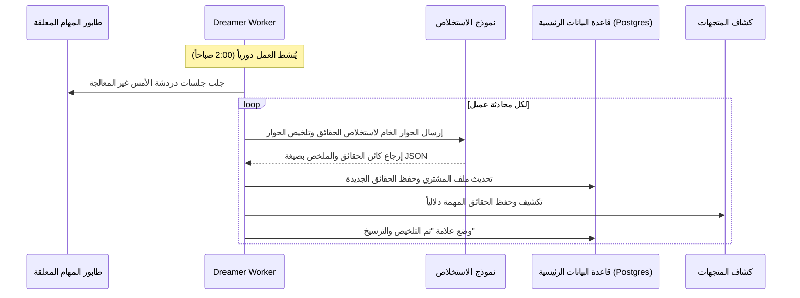

# 💾 معمارية الذاكرة الذكية وفض تعارض الحقائق (Agentic Memory)

هذا المستند يفصل معمارية الذاكرة متعددة المستويات للوكيل الذكي في منصة **MaxP**، وطرق استخلاص الحقائق، وخوارزميات حسم التعارضات، وتأطير السلوك التجاري زمنياً.

---

## 🗂️ 1. البنية الرباعية للذاكرة الوكيلة (The 4-Tier Memory Structure)

يتكون نظام إدارة ذاكرة الوكيل من 4 مستويات متكاملة:

1.  **ذاكرة العمل قصيرة المدى (Working / Short-Term Memory):**
    *   *المكان:* كاش Redis / الذاكرة المؤقتة للخادم.
    *   *مفهوم العمل:* نافذة منزلقة (Sliding Window) لآخر 15 رسالة حوارية مع الاحتفاظ بناتج عمليات التلخيص التراكمي (Ongoing Summary) للأجزاء القديمة لمنع تشتت الوكيل.
2.  **الذاكرة العرضية (Episodic Memory):**
    *   *المكان:* قاعدة بيانات المتجهات (Vector Database).
    *   *مفهوم العمل:* تحويل تفاعلات ودردشات الأمس إلى ناقلات دلالية تمكن الوكيل من تذكر سياق وحلول مشاكله السابقة.
3.  **الذاكرة الدلالية (Semantic Memory / Knowledge Base):**
    *   *المكان:* قواعد بيانات PostgreSQL المهيكلة والـ RAG Files.
    *   *مفهوم العمل:* مستندات الأسئلة الشائعة، كتالوج السلع والأسعار، وسياسات الشحن الدقيقة.
4.  **الذاكرة الإجرائية (Procedural Memory / Skill Store):**
    *   *المكان:* سجل مخططات الأدوات (Tool Schemas & SDK).
    *   *مفهوم العمل:* معرفة الوكيل الدقيقة بكيفية استدعاء الـ APIs والتسلسل الصحيح لتنفيذ حركات المتجر.

---

## 🌙 2. دورة نوم الوكيل وترسيخ الذاكرة (The Asynchronous Dreamer)

لمنع إبطاء زمن استجابة المحادثات الحية للعملاء، يتم فصل عملية استخلاص الحقائق وتحديث البيانات وتلخيص الحوارات وترحيلها كعملية خلفية مستقلة غير متزامنة (**Dreamer Worker**) تعمل دورياً ليلاً:

---

## ⚖️ 3. محرك فض تعارض الذاكرة وحل النزاعات (Truth Arbitration Engine)

عند تعارض حقيقة قديمة مسجلة بملف العميل مع سلوكه الحالي (مثال: الـ Bio تسجل تفضيل مقاس "44"، والعميل اشترى مقاس "42" لثلاث مرات متتالية)، يقوم **محرك التحكيم** بحساب أوزان الحقائق لتحديد الحقيقة النشطة بناءً على المعادلة الحسابية التالية:

$$Arbitration\_Score = (Recency \times W_r) + (Frequency \times W_f) + (Confidence \times W_c) + (Source\_Reliability \times W_s)$$

### أوزان المحددات الأربعة (Arbitration Weights Parameters):

1.  **الحداثة (Recency - الوزن $W_r = 0.3$):** يمنح وزناً أعلى للسلوكيات المرصودة مؤخراً.
2.  **التكرار الملاحظ (Frequency - الوزن $W_f = 0.3$):** عدد مرات رصد وتكرار نفس السلوك من قِبل العميل.
3.  **درجة اليقين (Confidence - الوزن $W_c = 0.1$):** مدى وضوح وصحة المعلومة أثناء الاستخلاص من الـ LLM.
4.  **موثوقية المصدر (Source Reliability - الوزن $W_s = 0.3$):** يعطي أولوية قصوى لعمليات الشراء الفعلية المؤكدة في المتجر على مجرد الأحاديث اللفظية في الشات.

*إذا قرر المحرك تفوق السلوك الجديد، يتم تفعيل الحقيقة الجديدة وأرشفة الحقيقة القديمة برمجياً بوضع تاريخ نهاية الصلاحية (`validTo = new Date()`).*

---

## 📅 4. الذاكرة الزمنية والمنطق الواعي بالوقت (Temporal Memory Layer)

الذاكرة الزمنية تؤطر سلوك وتفضيلات المشترين بنطاقات زمنية محددة لتعكس الواقع المتغير:

*   **حقول الصلاحية (`validFrom` / `validTo`):** لتحديد الفترة الزمنية التي كان فيها السلوك نشطاً.
*   **التفضيلات الموسمية:** ربط تفضيلات المشتري بفترات زمنية محددة دورياً (مثال: الأحذية الخفيفة في شهور الصيف، والأحذية الثقيلة في الشتاء).
*   **انتهاء صلاحية السياسات والعروض تلقائياً:** احتساب انتهاء الخصومات الممنوحة للمشترين برمجياً بمجرد تخطي النطاق الزمني دون الحاجة لتعليمات صعبة.
