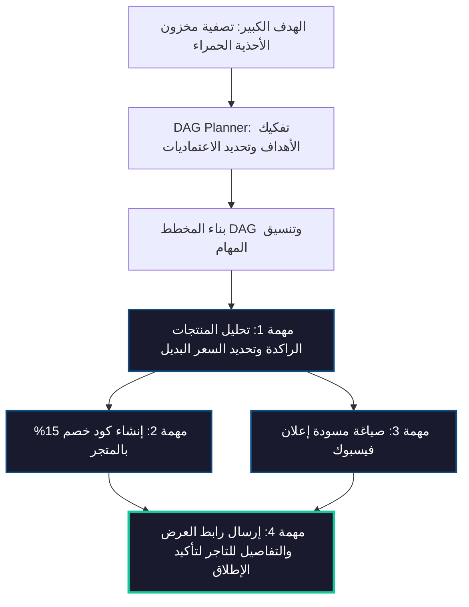

# ⛓️ الاسترجاع المصحح والمنفذ الرسومي للمهام (Corrective RAG & DAG Engine)

هذا المستند يفصل منطق معمارية **الـ Corrective RAG (الاسترجاع المصحح ذي الحالة)** ومحرك **الـ DAG Planner & Executor (التخطيط والجدولة متعددة الخطوات)** في منصة **MaxP** لتمكين الوكيل من حل المشكلات المعقدة وتصحيح خطواته ذاتياً.

---

## 🔍 1. الـ Corrective Stateful Agentic RAG

يعمل محرك الاسترجاع الذكي كـ **آلة حالة واعية (Stateful State Machine)** تقوم بتقييم وتصحيح مسار جلب المعلومات تلقائياً بدلاً من مجرد جلب مستندات والهلوسة بها:

```mermaid
graph TD
    classDef process fill:#1A1A2E,stroke:#0F4C81,stroke-width:2px,color:#fff;
    classDef decision fill:#1A1A2E,stroke:#F5B461,stroke-width:2px,color:#fff;
    classDef boundary fill:#1A1A2E,stroke:#16C79A,stroke-width:3px,color:#fff;

    Start[سؤال العميل/التاجر] --> InitState[تهيئة حالة البحث RAG State]:::process
    
    InitState --> Retrieve[استرجاع Chunks دلالياً]:::process
    
    Retrieve --> Eval{Retrieval Evaluator: هل المعلومات كافية؟}:::decision
    
    Eval -->|نعم: 100% صلة| Generate[توليد إجابة نهائية موثقة بمراجع]:::process
    
    Eval -->|لا / ضعيفة أو ناقصة| Reformulate[إعادة الصياغة دلالياً Reformulate Query]:::process
    
    Reformulate --> TryFallback[تفعيل المصادر البديلة: الكتالوج الحي / بحث الويب]:::process
    
    TryFallback --> Retrieve
    
    Generate --> Success([إرسال الرد الموثق]) :::boundary
```

### أ. خوارزمية التشغيل وتصحيح المعرفة (Self-Healing Loop):
1.  **التقييم المستمر للمستندات (Continuous Relevance Evaluation):** يفحص مقيم الجودة القطع المسترجعة فوراً ويعطيها درجة توافق ويسجل مواضع النواقص.
2.  **إعادة الصياغة الدلالية (Query Reformulation):** إعادة صياغة سؤال المشتري برمجياً بالاعتماد على النواقص المكتشفة لزيادة دقة البحث الدلالي.
3.  **تغيير المصادر التلقائي (Source Fallback):** يتنقل المحرك بالترتيب الحتمي للمصادر (`vector_db_faq` ⬅️ `system_api_catalog` ⬅️ `web_search_fallback`).
4.  **منع الحلقات اللانهائية (Loop Prevention):** يتم الاحتفاظ بسجل مصادر البحث التي جربت بالفعل في الجلسة الحالية وحظر تكرار المحاولة لمنع استهلاك التوكنات وتنبيه العميل أو المدير بصعوبة الوصول للمعلومة فور تجاوز عدد المحاولات الأقصى.

---

## ⛓️ 2. محرك التخطيط والمنظم الرسومي للمهام (DAG Planner & Executor)

عند إرسال التاجر لهدف إستراتيجي معقد، يقوم الـ CEO Agent بتفكيكه لـ DAG Plan وجدولته وتشغيل مهامه وحل اعتمادياته:



### أ. آليات المنفذ الرسومي (DAG Execution Mechanics):
1.  **الفرز الترتيبي للمهام (Topological Sorting):** فرز المهام بناءً على اعتماديتها وتمرير المهام غير المعتمدة على خطوات سابقة للتنفيذ الفوري.
2.  **التنفيذ المتوازي المتكيف (Parallel Execution):** تشغيل الخطوات غير المعتمدة على بعضها في نفس الوقت عبر `Promise.all` لتوفير زمن التشغيل لأقل حد.
3.  **حل المتغيرات الحركي (Parameter Resolution):** دعم تعبير القوالب (مثل `{{TaskA.output.productIds}}`) ليقوم المنفذ بقراءة مخرجات الخطوة السابقة وحقنها كمدخل للخطوة التالية تلقائياً قبل تشغيل الأداة البرمجية.
4.  **إعادة التخطيط الفوري عند الفشل (Dynamic Replanning):** إذا فشلت خطوة برمجية وتعذر معالجتها بالـ Retries:
    *   يتم إيقاف المخطط مؤقتاً ونقله لحالة `REPLANNING`.
    *   يُرسل تقرير الفشل والأعطال وحالة المهام الأخرى المنجزة للـ LLM.
    *   يولد النموذج تعديلاً للمخطط (مثل حذف مهام الإعلانات المعطلة وحقن إرسال رسائل دورية بدلاً منها).
    *   يتم دمج المهام الجديدة بالـ DAG واستئناف المعالجة بأمان.
