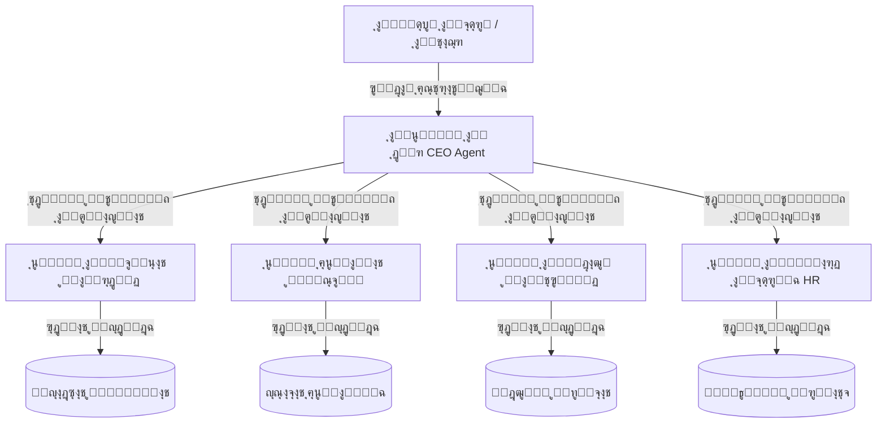

# ุฎุทุฉ ู…ุนู…ุงุฑูŠุฉ ุงู„ุนู…ูŠู„ ุงู„ุฐูƒูŠ ู„ู€ MaxP (ู…ุณุชูˆุญุงุฉ ู…ู† OpenClaw ูˆ Hermes ูˆ Paperclip)

ู‡ุฐุง ุงู„ู…ุณุชู†ุฏ ูŠู…ุซู„ ู…ุณูˆุฏุฉ ู„ู„ุฃููƒุงุฑ ูˆุงู„ุฎูŠุงุฑุงุช ุงู„ู…ุนู…ุงุฑูŠุฉ ุงู„ู…ู‚ุชุฑุญุฉ ู„ู†ุธุงู… ุงู„ุนู…ูŠู„ ุงู„ุฐูƒูŠ (Agentic AI) ุงู„ุฎุงุต ุจุงู„ู…ู†ุตุฉุŒ ู„ูŠูƒูˆู† ุจู…ุซุงุจุฉ ู…ุฑุฌุน ู„ู„ู…ู†ุงู‚ุดุฉ ูˆุชุญุฏูŠุฏ ุงู„ุชูุงุตูŠู„ ุงู„ู†ู‡ุงุฆูŠุฉ ู„ู„ุชู†ููŠุฐ.

---

## ๐Ÿ“Œ ู…ู‚ุงุฑู†ุฉ ุงู„ู†ู…ุงุฐุฌ ุงู„ู…ู„ู‡ู…ุฉ (Inspiration Matrix)

| ุงู„ุจุนุฏ ุงู„ู…ุนู…ุงุฑูŠ | OpenClaw | Hermes Agent (Nous Research) | Paperclip AI | Microsoft Agent Framework (MAF) |
| :--- | :--- | :--- | :--- | :--- |
| **ุงู„ุชุฑูƒูŠุฒ ุงู„ุฑุฆูŠุณูŠ** | ุนู…ูŠู„ ู…ุญู„ูŠ ู…ุณุชู‚ู„ (Local Agent) ู„ู„ู…ุณุชุฎุฏู… ุงู„ูุฑุฏูŠ. | ุนู…ูŠู„ ูุงุฆู‚ ุงู„ุฐูƒุงุก ู…ุณุชู…ุฑ ู„ู„ุชุนู„ู… ุงู„ุชุฑุงูƒู…ูŠ ูˆุชุทูˆูŠุฑ ุงู„ู…ู‡ุงุฑุงุช. | ู„ูˆุญุฉ ุชุญูƒู… ูˆุชู†ุณูŠู‚ (Control Plane) ู„ุฅุฏุงุฑุฉ ูุฑู‚ ูƒุงู…ู„ุฉ ู…ู† ุงู„ุนู…ู„ุงุก. | ุฅุทุงุฑ ุนู…ู„ ู…ุคุณุณูŠ ู…ูˆุญุฏ ู„ุชู†ููŠุฐ ูˆุญูˆูƒู…ุฉ ูˆูƒู„ุงุก ู…ุชุนุฏุฏูŠู†. |
| **ุงู„ู…ูŠุฒุฉ ุงู„ุฃู‚ูˆู‰** | **ุงู„ุฐุงูƒุฑุฉ ุงู„ู†ุดุทุฉ (Active Memory)** ูˆุณู‡ูˆู„ุฉ ุงู„ุงุณุชุฎุฏุงู…. | **ุงู„ุชุทูˆูŠุฑ ุงู„ุฐุงุชูŠ ู„ู„ู…ู‡ุงุฑุงุช (Self-Improving)** ูˆุงู„ุฌุฏูˆู„ุฉ ุจุงู„ู„ุบุฉ ุงู„ุทุจูŠุนูŠุฉ. | **ุงู„ู‡ูŠูƒู„ ุงู„ุฅุฏุงุฑูŠ (Hierarchy)** ูˆุญูˆูƒู…ุฉ ุงู„ู…ูŠุฒุงู†ูŠุฉ ูˆุงู„ู€ Audit Trail. | **ุงู„ุจุฑู…ุฌูŠุงุช ุงู„ูˆุณูŠุทุฉ (Middleware)** ูˆู‡ูŠูƒู„ูŠุฉ ุงู„ุชุฌุฑูŠุฏ ุงู„ู…ูˆุญุฏ ูˆุงู„ุชุณู„ูŠู…. |
| **ุขู„ูŠุฉ ุงู„ุชุดุบูŠู„** | ุชุดุบูŠู„ ู…ุจุงุดุฑ ูˆู…ุณุชู…ุฑ ุนู„ู‰ ุฌู‡ุงุฒ ุงู„ู…ุณุชุฎุฏู…. | ุชุดุบูŠู„ ู…ุณุชู…ุฑ ู…ุน ุฑุจุท ู‚ู†ูˆุงุช ุชูˆุงุตู„ ู…ุชุนุฏุฏุฉ (Omnichannel). | ู†ุจุถุงุช ู‚ู„ุจ ู…ุฌุฏูˆู„ุฉ (Heartbeat System) ู„ุชูˆููŠุฑ ุงู„ุชูƒู„ูุฉ. | ุฏูˆุฑุงุช ู…ุนุงู„ุฌุฉ ู…ุฑู†ุฉ ุชุฏุนู… ุงู„ุชุณู„ุณู„ ูˆุงู„ุชูˆุงุฒูŠ ูˆุงู„ุชุณู„ูŠู… ุงู„ุจูŠู†ูŠ. |
| **ุงู„ุฐุงูƒุฑุฉ** | ู…ู„ูุงุช Markdown ู…ุญู„ูŠุฉ + ู‚ุงุนุฏุฉ ุจูŠุงู†ุงุช SQLite. | ู…ู„ูุงุช `USER.md` ูˆ `MEMORY.md` + ูุญุต FTS5. | ุณุฌู„ ุชุญู‚ูŠู‚ ู…ูˆุญุฏ ูˆุฃุจุฏูŠ (Append-only Audit Trail). | ุฅุฏุงุฑุฉ ุฌู„ุณุงุช ุณุญุงุจูŠุฉ ู…ูˆุฒุนุฉ ูˆู†ู‚ุงุท ุญูุธ ู„ุญุงู„ุงุช ุงู„ุชุดุบูŠู„. |

---

## ๐Ÿ—๏ธ ุงู„ู…ุนู…ุงุฑูŠุฉ ุงู„ู…ู‚ุชุฑุญุฉ ู„ู€ MaxP (Autonomous Merchant Control Plane)

ุจู…ุง ุฃู† ู…ู†ุตุฉ **MaxP** ู‡ูŠ ู…ู†ุตุฉ ุณุญุงุจูŠุฉ ู…ุชุนุฏุฏุฉ ุงู„ุดุฑูƒุงุช (Multi-tenant SaaS)ุŒ ูุฅู† ุงู„ู…ุนู…ุงุฑูŠุฉ ุงู„ู…ู‚ุชุฑุญุฉ ุชุฑูƒุฒ ุนู„ู‰ 5 ู…ุญุงูˆุฑ ุฑุฆูŠุณูŠุฉ ุชุฌู…ุน ุจูŠู† ุฃู…ุงู† ุงู„ู€ SaaS ูˆู‚ูˆุฉ ุงู„ู†ุธู… ุงู„ู…ุณุชู‚ู„ุฉ:

### 1. ุทุจู‚ุฉ ุชู†ุณูŠู‚ ูุฑู‚ ุงู„ุนู…ู„ุงุก (Agent Team Coordination - ู…ู† Paperclip)
*   **ุนู…ูŠู„ ุงู„ู…ุฏูŠุฑ ุงู„ุชู†ููŠุฐูŠ (CEO Agent):** ูŠุณุชู‚ุจู„ ุงู„ุฃู‡ุฏุงู ุงู„ูƒุจุฑู‰ ู…ู† ุงู„ุชุงุฌุฑ (ู…ุซุงู„: "ุชุฌู‡ูŠุฒ ุญู…ู„ุฉ ุชุฎููŠุถุงุช ู„ู„ุฌู…ุนุฉ ุงู„ุจูŠุถุงุก") ูˆูŠู‚ูˆู… ุจุชู‚ุณูŠู…ู‡ุง ุฅู„ู‰ ู…ู‡ุงู… ูุฑุนูŠุฉ (Sub-tasks) ูˆุฅุณู†ุงุฏู‡ุง ู„ู„ุนู…ู„ุงุก ุงู„ู…ุชุฎุตุตูŠู†.
*   **ุงู„ุนู…ู„ุงุก ุงู„ู…ุชุฎุตุตูˆู† (Specialist Agents):**
    *   **ุนู…ูŠู„ ุงู„ุชุณูˆูŠู‚ (Marketing Agent):** ุตูŠุงุบุฉ ุฅุนู„ุงู†ุงุช ููŠุณุจูˆูƒุŒ ุชุญุฏูŠุฏ ุงู„ุฌู…ู‡ูˆุฑ ุงู„ู…ุณุชู‡ุฏู.
    *   **ุนู…ูŠู„ ุงู„ู…ุฎุฒูˆู† ูˆุงู„ุชุณุนูŠุฑ (Inventory & Pricing Agent):** ู…ุฑุงุฌุนุฉ ุฃุณุนุงุฑ ุงู„ุฃุญุฐูŠุฉุŒ ุงู„ุชุฃูƒุฏ ู…ู† ุงู„ู…ุฎุฒูˆู†ุŒ ูƒุชุงุจุฉ ุชุนุฏูŠู„ุงุช ุงู„ุฃุณุนุงุฑ ูƒู…ุณูˆุฏุฉ.
    *   **ุนู…ูŠู„ ุฎุฏู…ุฉ ุงู„ุนู…ู„ุงุก (Customer Support Agent):** ุชูˆู„ูŠ ุงู„ุฑุฏูˆุฏ ุงู„ุชู„ู‚ุงุฆูŠุฉ ูˆุงู„ูˆุงุชุณุงุจ ูˆุชู†ุจูŠู‡ ุงู„ุชุฌุงุฑ ุจุงู„ุญุงู„ุงุช ุงู„ุนุงุฌู„ุฉ.

### 2. ุงู„ุฐุงูƒุฑุฉ ุงู„ู†ุดุทุฉ ูˆุชู†ู‚ูŠุฉ ุงู„ู…ุนู„ูˆู…ุงุช (Active Memory & Dreaming - ู…ู† OpenClaw & Hermes)
*   **ุงู„ุฐุงูƒุฑุฉ ุงู„ู†ุดุทุฉ ุงู„ู‡ุฌูŠู†ุฉ (Hybrid Active Memory):** ุนู†ุฏ ูˆุตูˆู„ ุฑุณุงู„ุฉ ุฃูˆ ู…ู‡ู…ุฉุŒ ู†ู‚ูˆู… ุจุนู…ู„ูŠุฉ ุงุณุชุนู„ุงู… ุณุฑูŠุนุฉ ุชุฌู…ุน ุจูŠู† ุฏู„ุงู„ุงุช ุงู„ู…ุชุฌู‡ (Vector Embeddings) ูˆุงู„ุจุญุซ ุงู„ู†ุตูŠ (Lexical/BM25) ุนู„ู‰ ู‚ุงุนุฏุฉ ุงู„ุจูŠุงู†ุงุช ู„ุนุฒู„ ูˆุฌู„ุจ ุณูŠุงู‚ ุงู„ุดุฑูƒุฉ ูู‚ุท.
*   **ุนุงู…ู„ ุงู„ุฃุญู„ุงู… ูˆุชู†ู‚ูŠุฉ ุงู„ุฐุงูƒุฑุฉ (Dreaming Worker):** ูˆุธูŠูุฉ ุฏูˆุฑูŠุฉ (Cron Job) ุชุฑุงุฌุน ุงู„ู…ุญุงุฏุซุงุช ุงู„ูŠูˆู…ูŠุฉ ูˆุชู‚ูˆู… ุจุชุฑู‚ูŠุฉ ุงู„ุญู‚ุงุฆู‚ ูˆุงู„ุชูุถูŠู„ุงุช ุงู„ู…ูƒุชุดูุฉ ุฅู„ู‰ ุฐุงูƒุฑุฉ ู…ุณุชุฏูŠู…ุฉ (`Durable Memories`) ูˆุชุตููŠุฉ ุงู„ู…ุชู†ุงู‚ุถุงุช ู„ุชูˆููŠุฑ ุงุณุชู‡ู„ุงูƒ ุงู„ู€ Tokens.

### 3. ุฃุฏูˆุงุช ุขู…ู†ุฉ ู…ุน ู…ูˆุงูู‚ุฉ ุจุดุฑูŠุฉ (Scoped Tools & Human-in-the-Loop)
*   **ุฃุฏูˆุงุช ุงู„ู‚ุฑุงุกุฉ (Read-Only):** ูŠู†ูุฐู‡ุง ุงู„ุนู…ูŠู„ ููˆุฑุงู‹ (ุนุฑุถ ุชู‚ุงุฑูŠุฑ ุงู„ุฅุนู„ุงู†ุงุชุŒ ุชูุงุตูŠู„ ุงู„ุทู„ุจุงุชุŒ ูƒู…ูŠุฉ ุงู„ู…ุฎุฒูˆู†).
*   **ุฃุฏูˆุงุช ุงู„ูƒุชุงุจุฉ (Write Actions):** ุชุชุทู„ุจ ู…ูˆุงูู‚ุฉ ูŠุฏูˆูŠุฉ. ูŠู‚ูˆู… ุงู„ุนู…ูŠู„ ุจุชุฌู‡ูŠุฒ ุงู„ุนู…ู„ูŠุฉ ูˆุญูุธู‡ุง ูƒู…ุณูˆุฏุฉ (Draft / Proposal) ูˆูŠุฑุณู„ ุฑู…ุฒ ุชุฃูƒูŠุฏ (ู…ุซุงู„: `ู†ูุฐ X92A`) ู„ู„ุชุงุฌุฑ ุนุจุฑ ุชู„ุฌุฑุงู… ุฃูˆ ู„ูˆุญุฉ ุงู„ุชุญูƒู… ู„ู„ู…ูˆุงูู‚ุฉ ุงู„ุฑุณู…ูŠุฉ ู‚ุจู„ ุงู„ุชุนุฏูŠู„ ุงู„ูุนู„ูŠ ููŠ ู‚ุงุนุฏุฉ ุงู„ุจูŠุงู†ุงุช.

### 4. ุงู„ุฌุฏูˆู„ุฉ ุงู„ุชู„ู‚ุงุฆูŠุฉ ุจุงู„ู„ุบุฉ ุงู„ุทุจูŠุนูŠุฉ (Natural Language Cron Jobs - ู…ู† Hermes)
*   **ู…ูู‡ูˆู… ุงู„ุชุดุบูŠู„:** ูŠุชูŠุญ ู„ู„ุชุงุฌุฑ ูƒุชุงุจุฉ ู‚ุงุนุฏุฉ ุจุงู„ู„ุบุฉ ุงู„ุทุจูŠุนูŠุฉ ู…ุซู„: *"ูƒู„ ูŠูˆู… ุซู„ุงุซุงุก ุงู„ุณุงุนุฉ 6 ู…ุณุงุกู‹ุŒ ุฃุฑุณู„ ุฑุณุงู„ุฉ ูˆุงุชุณุงุจ ู„ู„ุนู…ู„ุงุก ุงู„ุฐูŠู† ู„ู… ูŠูƒู…ู„ูˆุง ุนู…ู„ูŠุฉ ุงู„ุดุฑุงุก ุงู„ูŠูˆู…"*ุŒ ูˆูŠู‚ูˆู… ุงู„ู†ุธุงู… ุจุชุญู„ูŠู„ู‡ุง ูˆุญูุธู‡ุง ูƒู…ู‡ู…ุฉ ู…ุฌุฏูˆู„ุฉ ููŠ ุทุงุจูˆุฑ ุงู„ู…ู‡ุงู….

### 5. ุญูˆูƒู…ุฉ ุงู„ู…ูŠุฒุงู†ูŠุฉ ูˆุงู„ู€ Audit Trail (ู…ู† Paperclip)
*   **ุงู„ุชุญูƒู… ุงู„ู…ุงู„ูŠ (Token Budgeting):** ุชุญุฏูŠุฏ ูƒูˆุชุง ู…ุงู„ูŠุฉ ูŠูˆู…ูŠุฉ/ุดู‡ุฑูŠุฉ ู„ูƒู„ ุดุฑูƒุฉ ู„ู…ุณุงุนุฏ ุงู„ู€ AI ู„ู…ู†ุน ุงู„ุญู„ู‚ุงุช ุงู„ุชูƒุฑุงุฑูŠุฉ ุงู„ุงู†ู‡ุงุฆูŠุฉ (Infinite Loops) ูˆุญู…ุงูŠุฉ ุฎูˆุงุฏู…ูƒ ู…ู† ุงู„ุชูƒุงู„ูŠู ุงู„ู…ุฑุชูุนุฉ.
*   **ุณุฌู„ ุงู„ุชุฏู‚ูŠู‚ (Audit Trail):** ุชุณุฌูŠู„ ูƒู„ ู‚ุฑุงุฑ ุงุชุฎุฐู‡ ุงู„ุฐูƒุงุก ุงู„ุงุตุทู†ุงุนูŠุŒ ูˆูƒู„ ุฃุฏุงุฉ ุงุณุชุฏุนุงู‡ุงุŒ ูˆูƒู„ ุฑุฏ ุฃุฑุณู„ู‡ุŒ ู„ูŠูƒูˆู† ุงู„ู†ุธุงู… ุดูุงูุงู‹ ุชู…ุงู…ุงู‹ ู„ู„ุชุงุฌุฑ ู„ู…ุนุฑูุฉ "ู„ู…ุงุฐุง ุงุชุฎุฐ ุงู„ู…ุณุงุนุฏ ู‡ุฐุง ุงู„ู‚ุฑุงุฑ".

---

## ๐Ÿค– ุฑูƒุงุฆุฒ ุณู„ูˆูƒ ุงู„ูˆูƒู„ุงุก ุงู„ุฐูƒูŠูŠู† ููŠ ุงู„ู†ุธุงู… (Agent Behavioral Archetypes)

ู„ุถู…ุงู† ุฏู‚ุฉ ุชู†ููŠุฐ ุงู„ุนู…ู„ุงุก ูˆุฃุฏุงุฆู‡ู… ุงู„ุฐูƒูŠุŒ ุณู†ุตูŠุบ ุชุตู…ูŠู… ูˆุชุดุบูŠู„ ุงู„ูˆูƒู„ุงุก ุจู†ุงุกู‹ ุนู„ู‰ 5 ุฑูƒุงุฆุฒ ุชูุงุนู„ูŠุฉ ู…ุนุชู…ุฏุฉ ููŠ ู‡ู†ุฏุณุฉ ุงู„ุฐูƒุงุก ุงู„ุงุตุทู†ุงุนูŠ:

### 1. ุงู„ูˆูƒู„ุงุก ุงู„ู…ุณุชู†ุฏูˆู† ู„ู„ุฃู‡ุฏุงู (Goal-based Agents)
*   *ุงู„ู…ูู‡ูˆู…:* ุงู„ู…ุณุงุนุฏ ู„ุง ูŠุชูุงุนู„ ุจุฃุณู„ูˆุจ ุฑุฏ ุงู„ูุนู„ ุงู„ุจุณูŠุท (Reactive) ูู‚ุทุŒ ุจู„ ูŠุนู…ู„ ุจู†ุดุงุท ู„ุชุญู‚ูŠู‚ ู‡ุฏู ู…ุฑุณูˆู… ู„ู‡.
*   *ุงู„ุชุทุจูŠู‚ ููŠ ุงู„ู…ุชุฌุฑ:* ุงู„ู…ุดุบู„ ุงู„ุจุดุฑูŠ ูŠุถุน ู‡ุฏูุงู‹ ุฅุณุชุฑุงุชูŠุฌูŠุงู‹ ู…ุซู„ *"ุชุตููŠุฉ ู…ุฎุฒูˆู† ุงู„ุฃุญุฐูŠุฉ ุงู„ุญู…ุฑุงุก ู‚ุจู„ ู†ู‡ุงูŠุฉ ุงู„ุฃุณุจูˆุน"*ุŒ ูˆูŠู‚ูˆู… ุงู„ูˆูƒูŠู„ ุจุชุฎุทูŠุท ุฎุทูˆุงุช ู…ุชุณู„ุณู„ุฉ (ุชุฌู‡ูŠุฒ ุฎุตู…ุŒ ุตูŠุงุบุฉ ุฅุนู„ุงู†ุงุชุŒ ุฅุฑุณุงู„ ุฑุณุงุฆู„ ุฏูˆุฑูŠุฉ) ุญุชู‰ ูŠุนู„ู† ุนู† ุฅุชู…ุงู… ุงู„ู‡ุฏู.

### 2. ุงู„ูˆูƒู„ุงุก ุงู„ู…ุณุชู†ุฏูˆู† ู„ู„ู†ู…ุงุฐุฌ ุงู„ุฏุงุฎู„ูŠุฉ (Model-based Agents)
*   *ุงู„ู…ูู‡ูˆู…:* ูŠุญุชูุธ ุงู„ุนู…ูŠู„ ุงู„ุฐูƒูŠ ุจู†ู…ูˆุฐุฌ ุนู‚ู„ูŠ ุฏุงุฎู„ูŠ ู„ุญุงู„ุฉ ุงู„ู†ุธุงู… ูŠูˆุถุญ ู„ู‡ ูƒูŠู ุชุชุฃุซุฑ ุงู„ุจูŠุฆุฉ ุจุฃูุนุงู„ู‡ ูˆุงู„ู‚ุฑุงุฑุงุช ุงู„ุณุงุจู‚ุฉ.
*   *ุงู„ุชุทุจูŠู‚ ููŠ ุงู„ู…ุชุฌุฑ:* ูŠุชุชุจุน ุงู„ู…ุณุงุนุฏ ุณู„ูˆูƒ ุงู„ู…ุจูŠุนุงุช ุงู„ูŠูˆู…ูŠ. ูู…ุซู„ุงู‹ุŒ ุฅุฐุง ู‚ุงู… ุจุชุฎููŠุถ ุงู„ุณุนุฑ ูˆู„ู… ุชุฒุฏ ุงู„ู…ุจูŠุนุงุชุŒ ูŠุณุชู†ุชุฌ ููŠ ู†ู…ูˆุฐุฌู‡ ุงู„ุฏุงุฎู„ูŠ ุฃู† ุงู„ู…ุดูƒู„ุฉ ู‚ุฏ ุชูƒูˆู† ููŠ ุงุณุชู‡ุฏุงู ุงู„ุฅุนู„ุงู†ุงุช ูˆู„ูŠุณ ุงู„ุณุนุฑุŒ ู„ูŠู‚ูˆู… ุจุชุนุฏูŠู„ ุชุตุฑูุงุชู‡ ุงู„ู„ุงุญู‚ุฉ ุจู†ุงุกู‹ ุนู„ู‰ ู‡ุฐุง ุงู„ุฅุฏุฑุงูƒ.

### 3. ุงู„ูˆูƒู„ุงุก ุงู„ู…ุณุชู†ุฏูˆู† ู„ู„ู…ู†ูุนุฉ ูˆุงู„ู‚ูŠู…ุฉ (Utility-based Agents)
*   *ุงู„ู…ูู‡ูˆู…:* ุงู„ูˆูƒูŠู„ ูŠู‚ุงุฑู† ุจูŠู† ุฎูŠุงุฑุงุช ูˆุณูŠู†ุงุฑูŠูˆู‡ุงุช ุงู„ุชู†ููŠุฐ ุงู„ู…ุฎุชู„ูุฉ ูˆูŠุฎุชุงุฑ ุงู„ู…ุณุงุฑ ุงู„ุฐูŠ ูŠุญู‚ู‚ "ุงู„ู…ู†ูุนุฉ ุงู„ู‚ุตูˆู‰" (ุฃู‚ู„ ุชูƒู„ูุฉ ู…ุงุฏูŠุฉุŒ ุฃุนู„ู‰ ุฌูˆุฏุฉุŒ ุฃุณุฑุน ุงุณุชุฌุงุจุฉ).
*   *ุงู„ุชุทุจูŠู‚ ููŠ ุงู„ู…ุชุฌุฑ:* ุนู†ุฏ ุดุญู† ุทู„ุจ ู„ู„ุนู…ูŠู„ุŒ ูŠูˆุงุฒู† ุงู„ุนู…ูŠู„ ุจูŠู† 3 ุดุฑูƒุงุช ุดุญู† ูˆูŠุฎุชุงุฑ ุงู„ุดุฑูƒุฉ ุงู„ุชูŠ ุชู‚ุฏู… ุงู„ุชูƒู„ูุฉ ุงู„ุฃู‚ู„ ู…ุน ุฒู…ู† ุงู„ุชูˆุตูŠู„ ุงู„ุฃุณุฑุน ู„ู„ุนู…ูŠู„ุŒ ู…ุณุชู†ุฏุงู‹ ุฅู„ู‰ ุฏุงู„ุฉ ู…ู†ูุนุฉ ุฑูŠุงุถูŠุฉ ู…ุฏู…ุฌุฉ (Utility Function).

### 4. ุงู„ูˆูƒู„ุงุก ุงู„ู‚ุงุจู„ูˆู† ู„ู„ุชุนู„ู… ูˆุงู„ุชุทูˆุฑ (Learning Agents)
*   *ุงู„ู…ูู‡ูˆู…:* ูŠู‚ุณู… ุงู„ูˆูƒูŠู„ ุฏุงุฎู„ูŠุงู‹ ุฅู„ู‰ ุดู‚ ุชุดุบูŠู„ูŠ (Execution) ูˆุดู‚ ู…ุฑุงู‚ุจุฉ ูˆุชู‚ูŠูŠู… (Evaluation) ูŠุณุชู…ุน ู„ู„ุชุนู„ูŠู‚ุงุช ูˆุงู„ู…ู„ุงุญุธุงุช ุงู„ุฎุงุฑุฌูŠุฉ ู„ุชุทูˆูŠุฑ ุณู„ูˆูƒู‡.
*   *ุงู„ุชุทุจูŠู‚ ููŠ ุงู„ู…ุชุฌุฑ:* ุนู†ุฏู…ุง ูŠุถุน ุงู„ุชุงุฌุฑ ุชู‚ูŠูŠู…ุงู‹ ู„ุฑุฏูˆุฏ ุงู„ู…ุณุงุนุฏ ุจุงู„ุฑูุถ (Dislike) ุฃูˆ ุชุนุฏูŠู„ ุฅุฌุงุจุชู‡ุŒ ูŠุชุนู„ู… ุงู„ู…ุณุงุนุฏ ุชู„ู‚ุงุฆูŠุงู‹ ู…ู† ู‡ุฐุง ุงู„ุฅุฏุฎุงู„ (ุนุจุฑ Dreaming Worker) ูˆูŠุญุฏุซ ุฐุงูƒุฑุชู‡ ุงู„ุฏุงุฆู…ุฉ ู„ุชู„ุงููŠ ุงู„ุฎุทุฃ ููŠ ุงู„ู…ุฑุงุช ุงู„ู‚ุงุฏู…ุฉ.

### 5. ุงู„ุฃู†ุธู…ุฉ ู…ุชุนุฏุฏุฉ ุงู„ูˆูƒู„ุงุก (Multi-Agent System)
*   *ุงู„ู…ูู‡ูˆู…:* ุชุฌุฒุฆุฉ ุงู„ู…ู‡ุงู… ูˆุชูˆุฒูŠุนู‡ุง ุนู„ู‰ ุดุจูƒุฉ ุนู…ู„ุงุก ู…ุชุฎุตุตูŠู† ูŠุชุจุงุฏู„ูˆู† ุงู„ุฑุณุงุฆู„ ุจุฑูˆุชูˆูƒูˆู„ูŠุงู‹ ู„ุญู„ ุงู„ู…ุดูƒู„ุงุช ุงู„ู…ุนู‚ุฏุฉ.
*   *ุงู„ุชุทุจูŠู‚ ููŠ ุงู„ู…ุชุฌุฑ:* ุชุนุงูˆู† ุนู…ูŠู„ ุฎุฏู…ุฉ ุงู„ุนู…ู„ุงุก (Support) ู…ุน ุนู…ูŠู„ ุงู„ู…ุฎุงุฒู† (Inventory) ู„ุชูˆููŠุฑ ุงู„ู…ู‚ุงุณ ุงู„ุจุฏูŠู„ ู„ู„ุนู…ูŠู„ ูˆุฅุฑุณุงู„ ุงู„ุฑุฏ ู„ู‡ ููŠ ุฌุฒุก ู…ู† ุงู„ุซุงู†ูŠุฉ.

---

## ๐Ÿง� ู‡ูŠูƒู„ ุงู„ู…ุฏูŠุฑ ูˆุงู„ุนู…ู„ุงุก ุงู„ูุฑุนูŠูŠู† (The CEO-Agent & Sub-Agents Pattern)

ุชุทูˆูŠุฑ ููƒุฑุฉ ูˆุฌูˆุฏ **"ูˆูƒูŠู„ ู…ุฏูŠุฑ" (CEO Agent)** ูŠู…ู„ูƒ ุตู„ุงุญูŠุฉ ุชุฎู„ูŠู‚ ูˆุชููˆูŠุถ **"ูˆูƒู„ุงุก ูุฑุนูŠูŠู† ู…ุชู‚ุงุทุนูŠู†" (Specialist Sub-Agents)** ู„ุฅุฏุงุฑุฉ ุฃู‚ุณุงู… ุงู„ุดุฑูƒุฉ ุงู„ู…ุฎุชู„ูุฉ (ุงู„ู…ุฎุงุฒู†ุŒ ุฎุฏู…ุฉ ุงู„ุนู…ู„ุงุกุŒ ุงู„ุฅุนู„ุงู†ุงุชุŒ ุงู„ู…ูˆุงุฑุฏ ุงู„ุจุดุฑูŠุฉุŒ ุงู„ู…ุจูŠุนุงุช).

### ๐Ÿ” ุงู„ุฃุจุนุงุฏ ุงู„ู…ุนู…ุงุฑูŠุฉ ูˆุงู„ุชู‚ู†ูŠุฉ ู„ู„ููƒุฑุฉ (Technical Dimensions)

1.  **ุตูŠุบุฉ ุงู„ุชุฎู„ูŠู‚ ุงู„ุฏูŠู†ุงู…ูŠูƒูŠ (Dynamic Agent Provisioning):**
    *   ุงู„ู€ CEO Agent ูŠู…ู„ูƒ ุฃุฏุงุฉ ุจุฑู…ุฌูŠุฉ ุฎุงุตุฉ (ู…ุซุงู„: `agent.spawn(role, context, tools)`) ุชู…ูƒู†ู‡ ู…ู† ุฅู†ุดุงุก ุตู ุฌุฏูŠุฏ ููŠ ุฌุฏูˆู„ ู‚ุงุนุฏุฉ ุงู„ุจูŠุงู†ุงุช ู„ู„ูˆูƒูŠู„ ุงู„ูุฑุนูŠ.
    *   ูŠุญุฏุฏ ู„ู‡ ุณูŠุงู‚ุงู‹ ู…ุญุฏุฏุงู‹ (SOUL.md ู…ุฎุตุต) ูˆู†ูˆุน ุงู„ู‚ู†ูˆุงุช ุงู„ุชูŠ ูŠุณุชู…ุน ุฅู„ูŠู‡ุง (ุชู„ุฌุฑุงู…ุŒ ูˆุงุชุณุงุจุŒ ุฃูˆ ู„ูˆุญุฉ ุงู„ุชุญูƒู…).
2.  **ุนุฒู„ ุงู„ุตู„ุงุญูŠุงุช ูˆุญูˆูƒู…ุฉ ุงู„ุฃู…ุงู† (Scoped Authorization):**
    *   ู„ุง ูŠุตุญ ุชู‚ู†ูŠุงู‹ ุฃู† ูŠู…ุชู„ูƒ ุนู…ูŠู„ ุงู„ู…ุจูŠุนุงุช (Sales Agent) ุตู„ุงุญูŠุฉ ู‚ุฑุงุกุฉ ุฑูˆุงุชุจ ุงู„ู…ูˆุธููŠู† (HR) ุฃูˆ ุชุนุฏูŠู„ ุฅุนู„ุงู†ุงุช ููŠุณุจูˆูƒ.
    *   ุงู„ู…ุนู…ุงุฑูŠุฉ ูŠุฌุจ ุฃู† ุชุชุจุน ู…ุจุฏุฃ **"ุฃู‚ู„ ุงู„ุตู„ุงุญูŠุงุช ุงู„ู…ู…ูƒู†ุฉ" (Principle of Least Privilege)**. ุงู„ูˆูƒู„ุงุก ุงู„ูุฑุนูŠูˆู† ูŠุฑุซูˆู† ุงู„ุตู„ุงุญูŠุงุช ุงู„ู…ู‚ูŠุฏุฉ ูู‚ุท ุจู†ุงุกู‹ ุนู„ู‰ ุฏูˆุฑู‡ู… ุงู„ู…ุฎุตุต.
3.  **ุจุฑูˆุชูˆูƒูˆู„ ุงู„ุชูˆุงุตู„ ุงู„ุฏุงุฎู„ูŠ (Agent-to-Agent Communication):**
    *   ุชุญุชุงุฌ ุงู„ู…ุนู…ุงุฑูŠุฉ ู„ู€ **"ู…ู…ุฑ ู†ู‚ู„ ุฑุณุงุฆู„ ุฏุงุฎู„ูŠ" (Internal Message Bus)** ูŠุชูŠุญ ู„ู„ูˆูƒู„ุงุก ุชุจุงุฏู„ ุงู„ู…ุนู„ูˆู…ุงุช ุจุดูƒู„ ู…ุจุงุดุฑ.
    *   *ู…ุซุงู„:* ุนู†ุฏู…ุง ูŠูˆุงุฌู‡ ุนู…ูŠู„ ุชุฃูƒูŠุฏ ุงู„ุฃูˆุฑุฏุฑุงุช ู…ุดูƒู„ุฉ ููŠ ูƒู…ูŠุฉ ู…ุฎุฒูˆู†ุŒ ูŠุฑุณู„ ุทู„ุจุงู‹ ุฏุงุฎู„ูŠุงู‹ ู„ู€ "ุนู…ูŠู„ ุงู„ู…ุฎุงุฒู†" ูŠุทู„ุจ ู…ู†ู‡ ู…ุฑุงุฌุนุฉ ูƒู…ูŠุฉ ุญุฐุงุก ู…ุนูŠู†ุŒ ููŠุฑุฏ ุนู„ูŠู‡ ุนู…ูŠู„ ุงู„ู…ุฎุงุฒู† ุจุงู„ุชุฃูƒูŠุฏ ุฃูˆ ุงู„ุฑูุถ.

---

## ๐Ÿ›�๏ธ ุฃุฏูˆุงุช ุงู„ู†ุธุงู…: ุงู„ู€ RAG ู…ู‚ุงุจู„ ุงู„ู…ู‡ุงุฑุงุช (System Capabilities: RAG vs. Skills)

ู„ูƒูŠ ูŠุนู…ู„ ูƒู„ ุนู…ูŠู„ ุฐูƒูŠ ุจูุนุงู„ูŠุฉุŒ ูŠุญุชุงุฌ ุฅู„ู‰ ุนู†ุตุฑูŠู† ุฃุณุงุณูŠูŠู† ู„ู…ุนุฑูุฉ ู…ุชุฌุฑู‡ ูˆุงู„ุชูุงุนู„ ู…ุนู‡:

### ๐Ÿ“– ุฃูˆู„ุงู‹: ุงู„ู€ RAG (ุงุณุชุฑุฌุงุน ุงู„ู…ุนุฑูุฉ ุงู„ู…ุฏุนูˆู…ุฉ ุจุงู„ุจุญุซ) - "ุงู„ูˆุนูŠ ูˆุงู„ู…ุนุฑูุฉ"
*   **ุฏูˆุฑู‡ ุงู„ุฃุณุงุณูŠ:** ุงู„ุฅุฌุงุจุฉ ุนู† ุงู„ุฃุณุฆู„ุฉ ุงู„ู…ุนุฑููŠุฉ ูˆุญู‚ุงุฆู‚ ุงู„ู…ุชุฌุฑ ุงู„ุซุงุจุชุฉ **ุจุฏูˆู† ุฅุฌุฑุงุก ุฃูŠ ุชุนุฏูŠู„ุงุช ุฃูˆ ุนู…ู„ูŠุงุช** ุนู„ู‰ ู‚ุงุนุฏุฉ ุงู„ุจูŠุงู†ุงุช.
*   **ุจู…ุงุฐุง ูŠู…ุฏ ุงู„ุนู…ูŠู„ุŸ**
    *   **ุณูŠุงุณุงุช ุงู„ุดุฑูƒุฉ ูˆุงู„ู…ุชุฌุฑ:** ุณูŠุงุณุฉ ุงู„ุชูˆุตูŠู„ ูˆุงู„ู…ุตุงุฑูŠูุŒ ุณูŠุงุณุฉ ุงู„ุงุณุชุฑุฌุงุน ูˆุงู„ุงุณุชุจุฏุงู„ุŒ ุดุฑูˆุท ุงู„ุถู…ุงู†.
    *   **ุจูŠุงู†ุงุช ุงู„ู…ู†ุชุฌุงุช ุงู„ุซุงุจุชุฉ:** ุงู„ุฎุงู…ุงุชุŒ ุฌุฏุงูˆู„ ุงู„ู…ู‚ุงุณุงุชุŒ ุฃู„ูˆุงู† ุงู„ู…ู†ุชุฌุงุช ูˆุชูุงุตูŠู„ ุงู„ุชุตู†ูŠุน.
    *   **ุตูุญุงุช ุงู„ู…ุชุฌุฑ ูˆุงู„ุฃุณุฆู„ุฉ ุงู„ุดุงุฆุนุฉ (FAQ):** ู…ูˆุงุนูŠุฏ ุงู„ุนู…ู„ุŒ ูุฑูˆุน ุงู„ู…ุญู„ุงุชุŒ ุทุฑู‚ ุงู„ุฏูุน ุงู„ู…ุชุงุญุฉ.
    *   **ูˆุซุงุฆู‚ ุงู„ุนู…ู„ ูˆุงู„ุณูŠุงุณุงุช ุงู„ุฏุงุฎู„ูŠุฉ:** ู„ู„ุนู…ู„ุงุก ุงู„ู…ุฎุตุตูŠู† ู„ู„ู…ูˆุงุฑุฏ ุงู„ุจุดุฑูŠุฉ (ู‚ูˆุงู†ูŠู† ุงู„ุฅุฌุงุฒุงุชุŒ ุดุฑูˆุท ุงู„ุนู…ู„).
*   **ูƒูŠู ูŠุนู…ู„ุŸ** 
    ู†ู‚ูˆู… ุจุชู‚ุทูŠุน ู‡ุฐู‡ ุงู„ู…ู„ูุงุช ูˆุงู„ูˆุซุงุฆู‚ ุฅู„ู‰ ุฃุฌุฒุงุก ุตุบูŠุฑุฉ (Chunks) ูˆู†ูˆู„ุฏ ู„ู‡ุง ูƒุดุงูุงุช ุฏู„ุงู„ูŠุฉ (Vectors). ุนู†ุฏู…ุง ูŠุณุฃู„ ุงู„ุนู…ูŠู„ ุฃูˆ ุงู„ู…ุณุคูˆู„ ุณุคุงู„ุงู‹ุŒ ูŠุณุชุฏุนูŠ ุงู„ู…ุณุงุนุฏ ูƒูˆุฏ ุงู„ู€ RAG ู„ูŠุฌู„ุจ ุงู„ุฃุฌุฒุงุก ุงู„ู†ุตูŠุฉ ุงู„ุฃูƒุซุฑ ุดุจู‡ุงู‹ ุจุงู„ุณุคุงู„ ูˆูŠุญู‚ู†ู‡ุง ููŠ ุงู„ู€ Prompt ูƒุญู‚ุงุฆู‚ ู…ูˆุซู‚ุฉ ุชุฌู†ุจุงู‹ ู„ู„ู‡ู„ูˆุณุฉ.

---

### โš™๏ธ ุซุงู†ูŠุงู‹: ุงู„ู…ู‡ุงุฑุงุช ูˆุงู„ุฃุฏูˆุงุช (Skills & Tools) - "ุงู„ุชูุงุนู„ ูˆุงู„ุญุฑูƒุฉ"
*   **ุฏูˆุฑู‡ุง ุงู„ุฃุณุงุณูŠ:** ุชู…ุซูŠู„ "ุฃูŠุฏูŠ ูˆุฃุฑุฌู„" ุงู„ุนู…ูŠู„. ุชุชูŠุญ ู„ู„ุฐูƒุงุก ุงู„ุงุตุทู†ุงุนูŠ **ุงู„ุชูุงุนู„ ุงู„ุจุฑู…ุฌูŠ ุงู„ู†ุดุท** ู„ู‚ุฑุงุกุฉ ุจูŠุงู†ุงุช ุฏูŠู†ุงู…ูŠูƒูŠุฉ ุญูŠุฉ ุฃูˆ ุงุชุฎุงุฐ ู‚ุฑุงุฑุงุช ูˆูƒุชุงุจุชู‡ุง ููŠ ุงู„ู†ุธุงู….
*   **ูู„ุณูุฉ ูˆุชูƒูˆูŠู† ุงู„ู…ู‡ุงุฑุฉ (ู…ุง ู‡ูŠ ุงู„ู…ู‡ุงุฑุฉุŸ):**
    ุงู„ู…ู‡ุงุฑุฉ ููŠ ู…ุนู…ุงุฑูŠุชู†ุง ู„ูŠุณุช ู…ุฌุฑุฏ ูƒูˆุฏ ุจุฑู…ุฌูŠ ุตุงู…ุช ูŠู‚ุฑุฃ ูˆูŠูƒุชุจ ู…ู† ู‚ุงุนุฏุฉ ุงู„ุจูŠุงู†ุงุช. ุงู„ู…ู‡ุงุฑุฉ ู‡ูŠ **"ุญุฒู…ุฉ ูƒุงู…ู„ุฉ" (Packaged Bundle)** ุชุชูƒูˆู† ู…ู† ุดู‚ูŠู†:
    1.  **ู…ู„ู ุงู„ุชุนู„ูŠู…ุงุช ุงู„ู…ุฑุฌุนูŠ (Instruction Manifest / Guidelines):** ู…ู„ู ุชูˆุฌูŠู‡ูŠ ูŠู‚ุฑุฃู‡ ุงู„ู€ AI ู„ูŠูู‡ู… "ุงู„ุฐูƒุงุก ูˆุฑุงุก ุงู„ุฃุฏุงุฉ ุจุฑู…ุฌูŠุงู‹ ูˆุณู„ูˆูƒูŠุงู‹".
        *   *ู…ุซุงู„ ู„ุชุนู„ูŠู…ุงุช ู…ู‡ุงุฑุฉ ุงู„ู…ุจูŠุนุงุช:* "ุฅุฐุง ุทู„ุจ ุงู„ุนู…ูŠู„ ู…ู†ุชุฌุงู‹ ุบูŠุฑ ู…ุชูˆูุฑุŒ ู„ุง ุชู‚ู„ ู„ู‡ ุจุจุณุงุทุฉ (ุบูŠุฑ ู…ุชูˆูุฑ)ุŒ ุจู„ ุงุณุชุฏุนู ุฃุฏุงุฉ ุงู„ุจุญุซ ุนู## ๐Ÿ›ก๏ธ ุชู‚ูŠูŠู… ุงู„ุซุบุฑุงุช ุงู„ู…ุชู‚ุฏู…ุฉ ูˆู…ุนุงู„ุฌุฉ ู†ู‚ุงุท ุงู„ุถุนู (SOTA Gap Analysis)

ุจู†ุงุกู‹ ุนู„ู‰ ู…ุฑุงุฌุนุฉ ุฏู‚ูŠู‚ุฉ ู„ู…ุนุงูŠูŠุฑ ู‡ู†ุฏุณุฉ ุงู„ูˆูƒู„ุงุก ุงู„ุฃูƒุซุฑ ู†ุถุฌุงู‹ ู„ุนุงู… 2026ุŒ **ู†ุนู…ุŒ ู‡ู†ุงูƒ ูุฌูˆุงุช ุญู‚ูŠู‚ูŠุฉ ูˆู†ู‚ุงุท ุถุนู ููŠ ู…ุณูˆุฏุชู†ุง ุงู„ุญุงู„ูŠุฉ** ุฅุฐุง ุชูุฑูƒุช ุฏูˆู† ู…ุนุงู„ุฌุฉ ู‡ูŠูƒู„ูŠุฉ ู…ุฎุตุตุฉ. ุทุฑุญ ู‡ุฐู‡ ุงู„ู†ู‚ุงุท ูŠู…ุซู„ ุงู„ุงู†ุชู‚ุงู„ ู…ู† "ู†ุธุงู… ุนู…ู„ุงุก ุจุณูŠุท" ุฅู„ู‰ **ู…ู†ุตุฉ ุนู…ู„ุงุก ุฐูƒูŠุฉ ู…ู† ุงู„ูุฆุฉ ุงู„ู…ุคุณุณูŠุฉ (Enterprise-Grade Agentic Platform)**. 

ููŠู…ุง ูŠู„ูŠ ุชุญู„ูŠู„ ุฏู‚ูŠู‚ ู„ูƒู„ ู†ู‚ุทุฉ ุถุนูุŒ ูˆุชู‚ูŠูŠู… ูˆุถุนู†ุง ุงู„ุญุงู„ูŠ ุชุฌุงู‡ู‡ุงุŒ ูˆูƒูŠููŠุฉ ุณุฏ ุงู„ูุฌูˆุฉ ุจุฑู…ุฌูŠุงู‹:

### 1) ุทุจู‚ุฉ ุงู„ู‡ูˆูŠุฉ ูˆุงู„ุณูŠุงู‚ ุงู„ู…ูˆุญุฏ (Unified Identity & Context Graph)
*   **ู†ู‚ุทุฉ ุงู„ุถุนู:** ู†ุนุชู…ุฏ ุญุงู„ูŠุงู‹ ุนู„ู‰ ุฐุงูƒุฑุฉ RAG ู…ุณุทุญุฉ (Flat Chunks). ูŠูู‚ุฏ ุงู„ุนู…ูŠู„ ุงู„ุนู„ุงู‚ุงุช ุงู„ู‡ูŠูƒู„ูŠุฉ ุจูŠู† ุงู„ูƒูŠุงู†ุงุช (ู…ุซู„: ู…ุนุฑูุฉ ุฃู† ุงู„ุนู…ูŠู„ "ุฃุญู…ุฏ" ุงุดุชุฑู‰ "ุญุฐุงุก ุฑูŠุงุถูŠ" ุงู„ุฐูŠ ุชู… ุงู„ุชุฑูˆูŠุฌ ู„ู‡ ููŠ "ุญู…ู„ุฉ ุงู„ุฌู…ุนุฉ ุงู„ุจูŠุถุงุก" ุงู„ุชูŠ ุชู…ู„ูƒ "ู…ูŠุฒุงู†ูŠุฉ X").
*   **ุงู„ุญู„ ุงู„ู‡ู†ุฏุณูŠ:** ุจู†ุงุก **Context Graph (ู…ุฎุทุท ุงู„ุณูŠุงู‚)**. ุจุฏู„ุงู‹ ู…ู† ุชุฎุฒูŠู† ุงู„ู†ุตูˆุต ูƒู…ุชุฌู‡ุงุช ู…ู†ูุตู„ุฉ ูู‚ุทุŒ ู†ู‚ูˆู… ุจุชู…ุซูŠู„ ุณูŠุงู‚ ุงู„ุดุฑูƒุฉ ูƒุนู„ุงู‚ุงุช (Nodes & Edges) ููŠ ู‚ุงุนุฏุฉ ุงู„ุจูŠุงู†ุงุช (ู…ุซู„ ุงุณุชุฎุฏุงู… Prisma ู„ุนู„ุงู‚ุงุช ุงู„ุฌุฏุงูˆู„ ุงู„ู…ุชุดุงุจูƒุฉ ุฃูˆ ู‚ุงุนุฏุฉ ุจูŠุงู†ุงุช Graph ุฎููŠูุฉ). ูŠุณุชุนู„ู… ุงู„ุนู…ูŠู„ ุนู† ุงู„ูƒูŠุงู†ุงุช ุจุตูŠุบุฉ ุนู„ุงู‚ุงุช ู„ูŠูู‡ู… ุงู„ู‡ูˆูŠุฉ ุงู„ู…ุชูƒุงู…ู„ุฉ ู„ู„ุนู…ูŠู„ ูˆุงู„ู…ู†ุชุฌ.

### 2) ุทุจู‚ุฉ "ุงู„ูˆุงู‚ุน ุงู„ู„ุญุธูŠ" (Real-Time World State)
*   **ู†ู‚ุทุฉ ุงู„ุถุนู:** ูŠุนู…ู„ ุงู„ูˆูƒูŠู„ ุญุงู„ูŠุงู‹ ุจุฃุณู„ูˆุจ "ุทู„ุจ/ุงุณุชุฌุงุจุฉ" ุณุงูƒู†. ู„ุง ูŠู…ู„ูƒ ูˆุนูŠุงู‹ ู„ุญุธูŠุงู‹ ุจู…ุง ูŠุญุฏุซ ุงู„ุขู† ููŠ ุงู„ู…ุชุฌุฑ (ู…ุซู„: "ู‡ู†ุงูƒ 5 ุณู„ุงุช ุชุณูˆู‚ ู†ุดุทุฉ ู…ุชุฑูˆูƒุฉ ุงู„ุขู†"ุŒ ุฃูˆ "ุฎุงุฏู… ุงู„ุฏูุน ู…ุนุทู„ ุญุงู„ูŠุงู‹").
*   **ุงู„ุญู„ ุงู„ู‡ู†ุฏุณูŠ:** ุฑุจุท ุงู„ูˆูƒู„ุงุก ุจู€ **Real-Time Event Stream** ุนุจุฑ Redis Pub/Sub ุฃูˆ WebSockets. ูŠู…ู„ูƒ ุงู„ูˆูƒูŠู„ "ูˆุนูŠุงู‹ ุจุงู„ุจูŠุฆุฉ ุงู„ู…ุญูŠุทุฉ" (State Awareness)ุ› ุญูŠุซ ูŠุชู… ุชุญุฏูŠุซ ูƒุงุฆู† ุญุงู„ุฉ ุงู„ุนุงู„ู… (World State Object) ููŠ ุฐุงูƒุฑุฉ ุงู„ุชุฎุฒูŠู† ุงู„ู…ุคู‚ุช ู„ู„ุนู…ูŠู„ ุจุดูƒู„ ู…ุณุชู…ุฑ ู„ูŠุนูƒุณ ุงู„ูˆุงู‚ุน ุงู„ู„ุญุธูŠ ู„ู„ู…ุชุฌุฑ ู‚ุจู„ ูƒู„ ุงุณุชุฏุนุงุก.

### 3) ู‡ู†ุฏุณุฉ ุชุนุชู…ุฏ ุนู„ู‰ ุงู„ุฃุญุฏุงุซ (Event-Driven Architecture) ุจุฏู„ Loops ูู‚ุท
*   **ู†ู‚ุทุฉ ุงู„ุถุนู:** ุชุตู…ูŠู… ุงู„ูˆูƒู„ุงุก ูƒุญู„ู‚ุงุช ุชููƒูŠุฑ ู…ุณุชู…ุฑุฉ (Polling Loops) ูŠุณุชู‡ู„ูƒ ูƒูˆุชุง ู‡ุงุฆู„ุฉ ูˆูŠุณุจุจ ุจุทุก ุงู„ู†ุธุงู….
*   **ุงู„ุญู„ ุงู„ู‡ู†ุฏุณูŠ:** ุงู„ุงู†ุชู‚ุงู„ ุจุงู„ูƒุงู…ู„ ุฅู„ู‰ **Event-Driven Agentic Architecture (EDAA)**. ู„ุง ูŠุนู…ู„ ุงู„ูˆูƒูŠู„ ููŠ ุญู„ู‚ุฉ ู…ูุฑุบุฉุŒ ุจู„ ูŠุชู… ุงุณุชุฏุนุงุคู‡ ูƒู€ Serverless / Short-lived Function ูŠุชู… ุฅูŠู‚ุงุธู‡ุง ูู‚ุท ุนู†ุฏ ุฅุทู„ุงู‚ ุญุฏุซ ู…ุนูŠู† ููŠ ู…ุชุฌุฑ MaxP (ู…ุซู„: ุญุฏุซ `ORDER_PLACED` ุฃูˆ `PAYMENT_FAILED`). ูŠุณุชูŠู‚ุธ ุงู„ุนู…ูŠู„ุŒ ูŠู†ูุฐ ู…ู‡ู…ุชู‡ ุงู„ุชุฎุทูŠุทูŠุฉุŒ ูŠุบูŠุฑ ุงู„ุญุงู„ุฉุŒ ุซู… ูŠู†ุงู… ููˆุฑุงู‹ ู„ุชูˆูุฑ ุงู„ุชูƒู„ูุฉ ุจู†ุณุจุฉ 90%.

### 4) ุทุจู‚ุฉ ุงู„ุชุฎุทูŠุท ุงู„ุญู‚ูŠู‚ูŠ (Planner Layer - ReAct & DAG)
*   **ู†ู‚ุทุฉ ุงู„ุถุนู:** ูŠูุชุฑุถ ุงู„ุชุตู…ูŠู… ุงู„ุญุงู„ูŠ ุฃู† ุงู„ู€ CEO Agent ูŠูˆุฒุน ุงู„ู…ู‡ุงู… ุจุจุณุงุทุฉ. ูŠูุชู‚ุฑ ุงู„ู†ุธุงู… ู„ู…ุฎุทุท ุญู‚ูŠู‚ูŠ ูŠุณุชุทูŠุน ุชู‚ุณูŠู… ู‡ุฏู ู…ุนู‚ุฏ (ู…ุซุงู„: "ุชุตููŠุฉ ู…ุฎุฒูˆู† ุงู„ุฃุญุฐูŠุฉ ุงู„ุญู…ุฑุงุก") ุฅู„ู‰ ุฎุทุฉ ู…ุชุณู„ุณู„ุฉ ุฐุงุช ุงุนุชู…ุงุฏูŠุงุช ู…ุชุจุงุฏู„ุฉ (Dependency Graph)ุŒ ูˆุฅุนุงุฏุฉ ุงู„ุชุฎุทูŠุท ุงู„ุชู„ู‚ุงุฆูŠ (Replanning) ุนู†ุฏ ูุดู„ ุฎุทูˆุฉ ูุฑุนูŠุฉ.
*   **ุงู„ุญู„ ุงู„ู‡ู†ุฏุณูŠ:** ุตูŠุงุบุฉ **Planner Engine** ู…ุณุชู‚ู„ ูŠุนุชู…ุฏ ุนู„ู‰ ู…ุนู…ุงุฑูŠุฉ (Plan-and-Solve) ุฃูˆ (Tree of Thoughts). ูŠุฎุฑุฌ ุงู„ู…ุฎุทุท ู‚ุงุฆู…ุฉ ู…ู‡ุงู… ุนู„ู‰ ุดูƒู„ ุฑุณู… ุจูŠุงู†ูŠ ู…ูˆุฌู‡ ุบูŠุฑ ุญู„ู‚ูŠ (DAG). ูŠู‚ูˆู… ุงู„ู†ุธุงู… ุจุชู†ููŠุฐ ุงู„ู…ู‡ุงู… ุจุงู„ุชูˆุงุฒูŠ ุฃูˆ ุงู„ุชูˆุงู„ูŠุŒ ูˆู…ุฑุงู‚ุจุฉ ุญุงู„ุฉ ูƒู„ ู…ู‡ู…ุฉุŒ ูˆุฅุฑุณุงู„ ุชู‚ุงุฑูŠุฑ ุงู„ูุดู„ ู„ู„ู…ุฎุทุท ู„ุฅุนุงุฏุฉ ุฌุฏูˆู„ุฉ ุงู„ุฎุทุฉ ุชู„ู‚ุงุฆูŠุงู‹.

### 5) ู†ุธุงู… "Reflection / Critic Agents"
*   **ู†ู‚ุทุฉ ุงู„ุถุนู:** ูŠู…ู„ูƒ ุงู„ูˆูƒูŠู„ ุงู„ูุฑุฏูŠ ู…ุนุฏู„ ุฎุทุฃ ุฃูˆ ู‡ู„ูˆุณุฉ ู…ุฑุชูุนุงู‹ ุฅุฐุง ุชูุฑูƒ ูŠูƒุชุจ ูˆูŠู‚ุฑุฑ ุจู…ูุฑุฏู‡ ุฏูˆู† ู…ุฑุงุฌุนุฉ.
*   **ุงู„ุญู„ ุงู„ู‡ู†ุฏุณูŠ:** ุชุทุจูŠู‚ ู†ู…ุท **Actor-Critic (ุงู„ุนู…ูŠู„ ูˆุงู„ู…ุฑุงุฌุน)**. ุฃูŠ ู…ุณูˆุฏุฉ ู‚ุฑุงุฑ ุฃูˆ ุฑุฏ ูŠูƒุชุจู‡ "ุนู…ูŠู„ ุงู„ู…ุจูŠุนุงุช" ุฃูˆ "ุนู…ูŠู„ ุงู„ุชุณูˆูŠู‚" ู„ุง ูŠู…ุฑ ู…ุจุงุดุฑุฉ ู„ู„ุชู†ููŠุฐุŒ ุจู„ ูŠุชู… ุฅุฑุณุงู„ู‡ ุจุฑูˆุชูˆูƒูˆู„ูŠุงู‹ ู„ู€ "ุนู…ูŠู„ ู†ุงู‚ุฏ" (Critic Agent) ู…ู‚ูŠุฏ ุจู‚ูˆุงู†ูŠู† ุตุงุฑู…ุฉ ุฌุฏุงู‹. ู„ุง ูŠูˆุงูู‚ ุงู„ู€ Critic ุนู„ู‰ ุงู„ุฅุฌุฑุงุก ุฅู„ุง ุจุนุฏ ุงู„ุชุญู‚ู‚ ู…ู† ุฎู„ูˆู‡ ู…ู† ุงู„ู‡ู„ูˆุณุฉ ูˆู…ุทุงุจู‚ุชู‡ ู„ู„ุฃุณุนุงุฑ ูˆุงู„ุณูŠุงุณุงุชุŒ ูˆููŠ ุญุงู„ ุงู„ุฑูุถ ูŠุฑุณู„ ุชุนู„ูŠู‚ุงุช ู„ู„ู€ Actor ู„ุชุนุฏูŠู„ ู…ุฎุฑุฌุงุชู‡.

### 6) ูุตู„ "ุงู„ุนู‚ู„" ุนู† "ุงู„ุฌุณุฏ" (Brain vs Runtime)
*   **ู†ู‚ุทุฉ ุงู„ุถุนู:** ุชุฏุงุฎู„ ูƒูˆุฏ ุงุณุชุฏุนุงุก ุงู„ู€ LLM (ุงู„ุชููƒูŠุฑ) ู…ุน ูƒูˆุฏ ุชู†ููŠุฐ ุงู„ุฏูˆุงู„ ูˆุงุณุชุฏุนุงุก ุงู„ู€ APIs (ุงู„ุญุฑูƒุฉ). ู‡ุฐุง ูŠุฌุนู„ ุงู„ู†ุธุงู… ุบูŠุฑ ุขู…ู† ูˆุตุนุจ ุงู„ุชุญุฏูŠุซ.
*   **ุงู„ุญู„ ุงู„ู‡ู†ุฏุณูŠ:** ุงู„ูุตู„ ุงู„ุชุงู…. **ุงู„ุนู‚ู„ (LLM Brain):** ู‡ูˆ ุชููƒูŠุฑ stateless ูŠุนุจุฑ ุนู† ุงู„ู†ูŠุฉ ูˆุงู„ุฎุทุฉ ูˆู…ุฎุฑุฌุงุช ุงู„ุฃุฏูˆุงุช ุงู„ู…ุทู„ูˆุจุฉ ุจุตูŠุบุฉ JSON ู†ุธูŠูุฉ. **ุงู„ุฌุณุฏ (Execution Runtime):** ู‡ูˆ ุฎุงุฏู… Express/Node.js ุขู…ู† ูˆstateful ูŠุณุชู„ู… ู†ูˆุงูŠุง ุงู„ุนู‚ู„ุŒ ูŠู†ูุฐู‡ุง ุจุฑู…ุฌูŠุงู‹ ุชุญุช ุญูˆูƒู…ุฉ ุตุงุฑู…ุฉุŒ ูŠุนุงู„ุฌ ุงู„ุฃุฎุทุงุก ูˆุงู„ู€ RetriesุŒ ุซู… ูŠุบุฐูŠ ุงู„ุนู‚ู„ ุจุงู„ู†ุชุงุฆุฌ (Observations).

### 8) ุทุจู‚ุฉ ุงู„ุชุฎุฒูŠู† ุงู„ู…ุคู‚ุช ุงู„ุฏู„ุงู„ูŠ (Semantic Caching Layer)
*   **ู†ู‚ุทุฉ ุงู„ุถุนู:** ุณูŠุนูŠุฏ ุงู„ูˆูƒู„ุงุก ู…ุฑุงุฑุงู‹ ูˆุชูƒุฑุงุฑุงู‹ ู…ุนุงู„ุฌุฉ ูˆุณุคุงู„ ู†ูุณ ุงู„ุฃุณุฆู„ุฉ ุงู„ู…ุชูƒุฑุฑุฉ ู„ู„ุนู…ู„ุงุก (ู…ุซุงู„: "ุฃูŠู† ูุฑุนูƒู…ุŸ" ุฃูˆ "ู…ุง ุดุฑูˆุท ุงู„ุงุณุชุฑุฌุงุนุŸ")ุŒ ู…ู…ุง ูŠุญุฑู‚ ุขู„ุงู ุงู„ุฏูˆู„ุงุฑุงุช ููŠ ุงุณุชุฏุนุงุกุงุช LLM ู…ุชุทุงุจู‚ุฉ ุชู‚ุฑูŠุจุงู‹.
*   **ุงู„ุญู„ ุงู„ู‡ู†ุฏุณูŠ:** ุฏู…ุฌ **Semantic Cache** (ู…ุซู„ GPTCache ุงู„ู…ุนุชู…ุฏ ุนู„ู‰ Redis Vector Search). ุนู†ุฏ ูˆุตูˆู„ ุณุคุงู„ ุฌุฏูŠุฏุŒ ู†ู‚ูˆู… ุจูุญุต ุงู„ุชุดุงุจู‡ ุงู„ุฏู„ุงู„ูŠ (Cosine Similarity > 95%) ู…ุน ุงู„ุฅุฌุงุจุงุช ุงู„ุณุงุจู‚ุฉ. ุฅุฐุง ุชุทุงุจู‚ ุงู„ุณุคุงู„ ุฏู„ุงู„ูŠุงู‹ุŒ ู†ุฑุฌุน ุงู„ุฅุฌุงุจุฉ ููˆุฑุงู‹ ู…ู† ุงู„ุชุฎุฒูŠู† ุงู„ู…ุคู‚ุช ุจุฒู…ู† ุงุณุชุฌุงุจุฉ < 50ms ูˆุชูƒู„ูุฉ $0.

### 9) ุณุฌู„ ุงู„ู†ู…ุงุฐุฌ ูˆุงู„ุชูˆุฌูŠู‡ ุงู„ุฐูƒูŠ (Model Registry & Routing Intelligence)
*   **ู†ู‚ุทุฉ ุงู„ุถุนู:** ุฑุจุท ูƒูˆุฏ ุงู„ูˆูƒูŠู„ ุจู†ู…ูˆุฐุฌ ู…ุญุฏุฏ ู…ุณุจู‚ุงู‹ (ู…ุซุงู„: Gemini 1.5 Pro ู„ู„ุฌู…ูŠุน)ุŒ ู…ู…ุง ูŠุคุฏูŠ ู„ุจุทุก ุงู„ู…ู‡ุงู… ุงู„ุจุณูŠุทุฉ ูˆู‡ุฏุฑ ุงู„ุชูƒู„ูุฉุŒ ุฃูˆ ุชูˆู‚ู ุงู„ู†ุธุงู… ุนู†ุฏ ุงู†ู‚ุทุงุน ุงู„ุฎุฏู…ุฉ ุนู† ุงู„ู…ุฒูˆุฏ.
*   **ุงู„ุญู„ ุงู„ู‡ู†ุฏุณูŠ:** ุฅู†ุดุงุก **Dynamic Model Router**. ูŠุณุฌู„ ุงู„ู†ุธุงู… ู‚ุงุฆู…ุฉ ุงู„ู…ูˆุฏูŠู„ุงุช ุงู„ู…ุชุงุญุฉ (Gemini, Claude, DeepSeek, Local Llama). ูŠู‚ูˆู… ุงู„ู…ูˆุฌู‡ ุงู„ุฐูƒูŠ ุจุชุญู„ูŠู„ ุตุนูˆุจุฉ ุงู„ู…ู‡ู…ุฉ:
    *   ุงู„ู…ู‡ุงู… ุงู„ุจุณูŠุทุฉ (ุชู†ุณูŠู‚ ู†ุตุŒ ุชุตู†ูŠู ู†ูŠุฉ) โžก๏ธ ุชููˆุฌู‡ ู„ู€ Gemini Flash / Llama-3B (ุณุฑูŠุน ูˆุฑุฎูŠุต).
    *   ุงู„ู…ู‡ุงู… ูุงุฆู‚ุฉ ุงู„ุชุนู‚ูŠุฏ (ุชุฎุทูŠุทุŒ ู…ุฑุงุฌุนุฉ ูู†ูŠุฉ) โžก๏ธ ุชููˆุฌู‡ ู„ู€ Claude Sonnet / Gemini Pro (ุฐูƒูŠ ูˆุฏู‚ูŠู‚).
    *   ุชุฃู…ูŠู† ุถุฏ ุงู†ู‚ุทุงุน ุงู„ุฎุฏู…ุฉ (Fallback Routing) ุจุงู„ุชุบูŠูŠุฑ ุงู„ุชู„ู‚ุงุฆูŠ ู„ู„ู…ุฒูˆุฏ ุงู„ุจุฏูŠู„ ููˆุฑุงู‹.

### 10) ุฅุตุฏุงุฑุงุช ุงู„ุนู…ู„ุงุก ูˆู‚ุงุจู„ูŠุฉ ุฅุนุงุฏุฉ ุงู„ุฅู†ุชุงุฌ (Agent Versioning & Reproducibility)
*   **ู†ู‚ุทุฉ ุงู„ุถุนู:** ุฅุฐุง ู‚ู…ู†ุง ุจุชุนุฏูŠู„ ุงู„ู€ Prompt ุฃูˆ ุงู„ุฃุฏูˆุงุช ู„ูˆูƒูŠู„ ุงู„ู…ุจูŠุนุงุชุŒ ุณูŠุชุฃุซุฑ ุฌู…ูŠุน ุงู„ุชุฌุงุฑ ููˆุฑุงู‹ุŒ ูˆู„ู† ู†ุชู…ูƒู† ู…ู† ุงุฎุชุจุงุฑ ุงู„ุฅุตุฏุงุฑ ุงู„ุฌุฏูŠุฏ ุฃูˆ ุงู„ุชุฑุงุฌุน ุนู†ู‡ ููŠ ุญุงู„ ุญุฏูˆุซ ู…ุดุงูƒู„.
*   **ุงู„ุญู„ ุงู„ู‡ู†ุฏุณูŠ:** ู…ุนุงู…ู„ุฉ ุงู„ูˆูƒู„ุงุก ูƒุฃุตูˆู„ ุจุฑู…ุฌูŠุฉ ุบูŠุฑ ู‚ุงุจู„ุฉ ู„ู„ุชุนุฏูŠู„ (Immutable Artifacts). ูƒู„ ูˆูƒูŠู„ ูŠุชู… ุชุฎุฒูŠู†ู‡ ูƒุฅุตุฏุงุฑ ู…ุญุฏุฏ (ู…ุซู„: `SalesAgent:v1.2.0` ูŠุฌู…ุน ุงู„ู€ Prompt ูˆุงู„ู€ Schema ูˆุงู„ุฃุฏูˆุงุช). ูŠุชูŠุญ ุฐู„ูƒ ู„ู„ุชุฌุงุฑ ุชุฌุฑุจุฉ ุฅุตุฏุงุฑุงุช ุชุฌุฑูŠุจูŠุฉ (A/B Testing ู„ู„ุนู…ู„ุงุก) ูˆุงู„ุชุฑุงุฌุน ุงู„ููˆุฑูŠ ู„ู„ุฅุตุฏุงุฑ ุงู„ุณุงุจู‚ ุจุถุบุทุฉ ุฒุฑ.

### 11) ู†ุธุงู… ุชุทูˆูŠุฑ ุงู„ู…ู‡ุงุฑุงุช ุทูˆูŠู„ ุงู„ู…ุฏู‰ (Long-Term Skill Evolution System)
*   **ู†ู‚ุทุฉ ุงู„ุถุนู:** ูŠุชุนู„ู… ุงู„ูˆูƒูŠู„ ู…ู‡ุงุฑุงุช ู…ุคู‚ุชุฉ ุชู†ุชู‡ูŠ ุจุงู†ุชู‡ุงุก ุณูŠุงู‚ ุงู„ู…ุญุงุฏุซุฉ ุงู„ุญุงู„ูŠุŒ ูˆู„ุง ูŠุณุชุทูŠุน ุญูุธ ู…ู‡ุงุฑุฉ ุฌุฏูŠุฏุฉ ุจุฑู…ุฌูŠุฉ ูˆุชุนู…ูŠู…ู‡ุง ุนู„ู‰ ุจุงู‚ูŠ ุงู„ูˆูƒู„ุงุก ู…ุณุชู‚ุจู„ุงู‹.
*   **ุงู„ุญู„ ุงู„ู‡ู†ุฏุณูŠ:** ุฅู†ุดุงุก **Long-Term Skill Store (ู…ุณุชูˆุฏุน ุงู„ู…ู‡ุงุฑุงุช)**. ุนู†ุฏู…ุง ูŠู†ุฌุญ ุงู„ุนู…ูŠู„ ููŠ ุญู„ ู…ุดูƒู„ุฉ ูู†ูŠุฉ ู…ุนู‚ุฏุฉ ุฃูˆ ูŠุทูˆุฑ ู…ุทูˆุฑ ุจุดุฑูŠ ูƒูˆุฏ ุฃุฏุงุฉ ุฌุฏูŠุฏุฉุŒ ูŠุชู… ุชุณุฌูŠู„ู‡ุง ูƒู€ "ุญุฒู…ุฉ ู…ู‡ุงุฑุฉ" ู‚ุงุจู„ุฉ ู„ู„ุงุณุชุฏุนุงุก ุงู„ุฏุงุฆู…. ูŠุณุชุทูŠุน ุงู„ู…ุฏูŠุฑ (CEO Agent) ุชุตูุญ ู‡ุฐุง ุงู„ู…ุณุชูˆุฏุน ูˆุญู‚ู† ุงู„ู…ู‡ุงุฑุฉ ุงู„ู…ู†ุงุณุจุฉ ุฏูŠู†ุงู…ูŠูƒูŠุงู‹ ููŠ ุงู„ูˆูƒูŠู„ ุงู„ูุฑุนูŠ ุนู†ุฏ ุงู„ุญุงุฌุฉ.

### 12) ู…ุญุฑูƒ ุณูŠุงุณุงุช ู…ุณุชู‚ู„ ุนู† ุงู„ู€ Prompt (Independent Policy Engine)
*   **ู†ู‚ุทุฉ ุงู„ุถุนู:** ูˆุถุน ุญุฏูˆุฏ ุงู„ุฃู…ุงู† ูˆุงู„ุชุฑุงุฎูŠุต ุฏุงุฎู„ ู†ุต ุงู„ู€ Prompt (ู…ุซุงู„: "ู„ุง ุชุนุทู ุฎุตู…ุงู‹ ุฃูƒุจุฑ ู…ู† 20%"). ู‡ุฐุง ุนุฑุถุฉ ู„ู„ุงุฎุชุฑุงู‚ ุจุณู‡ูˆู„ุฉ ุนุจุฑ Prompt Injection ูˆุงู„ุงู„ุชูุงู ุนู„ู‰ ุงู„ู‚ูˆุงู†ูŠู†.
*   **ุงู„ุญู„ ุงู„ู‡ู†ุฏุณูŠ:** ุจู†ุงุก **Policy Enforcement Engine** ุจุฑู…ุฌูŠ ู…ุณุชู‚ู„ (ู…ุซู„ ูƒูˆุฏ ุญุงุณู… ุฃูˆ ู…ุญุฑูƒ ุณูŠุงุณุงุช ูƒูˆุฏ ุจุฑู…ุฌู‰ ู…ุซู„ OPA). ูŠู‚ุชุฑุญ ุงู„ู…ุณุงุนุฏ ุฅุฌุฑุงุก ุงู„ุฎุตู…ุŒ ูˆู„ูƒู† ู‚ุจู„ ุฅุฑุณุงู„ ุงู„ุทู„ุจ ู„ู‚ุงุนุฏุฉ ุงู„ุจูŠุงู†ุงุชุŒ ูŠู…ุฑ ุงู„ุชุนุฏูŠู„ ุนุจุฑ ู…ุญุฑูƒ ุงู„ุณูŠุงุณุงุช ุงู„ุฐูŠ ูŠุฑูุถู‡ ููˆุฑุงู‹ ุฅุฐุง ุชุฎุทู‰ ุงู„ู€ 20% ุจุบุถ ุงู„ู†ุธุฑ ุนู…ุง ุฃู‚ู†ุนู‡ ุจู‡ ุงู„ู…ุดุชุฑูŠ ููŠ ุงู„ุดุงุช.

### 13) ุทุจู‚ุฉ ุงู„ู…ุฑุงู‚ุจุฉ ูˆุงู„ุชุญู„ูŠู„ ุงู„ุนู…ูŠู‚ ู„ู„ุนู…ู„ุงุก (Observability - Langfuse / Phoenix)
*   **ู†ู‚ุทุฉ ุงู„ุถุนู:** ุงุณุชุฎุฏุงู… ุณุฌู„ุงุช ุงู„ู€ Logs ุงู„ุนุงุฏูŠุฉ ู„ุง ูŠูˆุถุญ ู…ุณุงุฑ ุงู„ุชููƒูŠุฑ ุงู„ู…ุชุนุฏุฏ ู„ู„ูˆูƒูŠู„ (Thought -> Action -> Observation -> Thought) ูˆูŠุฌุนู„ ุชุชุจุน ูˆุญู„ ู…ุดุงูƒู„ ุงู„ู‡ู„ูˆุณุฉ ููŠ ุบุงูŠุฉ ุงู„ุตุนูˆุจุฉ.
*   **ุงู„ุญู„ ุงู„ู‡ู†ุฏุณูŠ:** ุฏู…ุฌ ุฃุฏูˆุงุช **Agentic Observability** ู…ุชุฎุตุตุฉ ุชุนุชู…ุฏ ุนู„ู‰ OpenTelemetry (ู…ุซู„ Langfuse ุฃูˆ Arize Phoenix). ูŠุชู… ุชุณุฌูŠู„ ูƒู„ ุฎุทูˆุฉ ุชููƒูŠุฑุŒ ูˆุงุณุชุฏุนุงุก ุฃุฏุงุฉุŒ ูˆุฒู…ู† ุงุณุชุฌุงุจุฉุŒ ูˆุชูƒู„ูุฉ ู…ุงู„ูŠุฉ ุจุดูƒู„ ู…ุฑุฆูŠ ุชู…ุงู…ุงู‹ ููŠ ุดุฌุฑุฉ ุชุชุจุน (DAG Trace) ุชุณู‡ู„ ุงู„ุชุฏู‚ูŠู‚ ุงู„ู„ุญุธูŠ.

### 15) ุงู„ุชุญูƒู… ููŠ ุงู†ุญุฑุงู ุดุฎุตูŠุฉ ุงู„ุนู…ูŠู„ (Agent Persona Drift Control)
*   **ู†ู‚ุทุฉ ุงู„ุถุนู:** ู…ุน ุทูˆู„ ู…ุญุงุฏุซุฉ ุงู„ู…ุดุชุฑูŠ ุนู„ู‰ ุงู„ูˆุงุชุณุงุจุŒ ูŠู…ุชู„ุฆ ุงู„ุณูŠุงู‚ ุจุงู„ุฑุณุงุฆู„ ุงู„ูŠูˆู…ูŠุฉ ูˆูŠุชู†ุงุณู‰ ุงู„ู…ูˆุฏูŠู„ ุงู„ุชุนู„ูŠู…ุงุช ุงู„ุฃุตู„ูŠุฉ ู„ู„ุดุฎุตูŠุฉ (Persona)ุŒ ููŠุจุฏุฃ ุจุงู„ุญุฏูŠุซ ุจุฃุณู„ูˆุจ ุนุงู…ูŠ ุฃูˆ ูŠูู‚ุฏ ู†ุจุฑุฉ ุงู„ุนู„ุงู…ุฉ ุงู„ุชุฌุงุฑูŠุฉ ุงู„ุฑุณู…ูŠุฉ ู„ู„ุดุฑูƒุฉ.
*   **ุงู„ุญู„ ุงู„ู‡ู†ุฏุณูŠ:** ุชุทุจูŠู‚ **Context Anchoring (ุชุซุจูŠุช ุงู„ุณูŠุงู‚)**:
    *   ุญู‚ู† ุชุนู„ูŠู…ุงุช ุงู„ุดุฎุตูŠุฉ ุงู„ุฃุณุงุณูŠุฉ ุจุดูƒู„ ู…ุชูƒุฑุฑ ููŠ ุฑุณุงุฆู„ ุงู„ู†ุธุงู… ุงู„ุฃุฎูŠุฑุฉ (System Message Injection).
    *   ุงุณุชุฎุฏุงู… ุงู„ู€ dreaming worker ู„ุชู„ุฎูŠุต ุงู„ู…ุญุงุฏุซุฉ ุงู„ุณุงุจู‚ุฉ ูˆุชู‚ุฏูŠู…ู‡ุง ู„ู„ู†ู…ูˆุฐุฌ ูƒู€ "ู…ู„ุฎุต ุญุงู„ุฉ" ุจุฏู„ุงู‹ ู…ู† ุชู…ุฑูŠุฑ ู…ุฆุงุช ุงู„ุฑุณุงุฆู„ ุงู„ุฎุงู… ุงู„ุชูŠ ุชุดุชุช ุฐู‡ู† ุงู„ุฐูƒุงุก ุงู„ุงุตุทู†ุงุนูŠ.

---

## ๐Ÿ›ก๏ธ ุฃุจุนุงุฏ ุญุงุณู…ุฉ ูˆุนู…ู„ูŠุฉ ู„ู„ุชุดุบูŠู„ ุงู„ูุนู„ูŠ (Operational & Production Readiness)

ู„ู„ุงู†ุชู‚ุงู„ ุจู‡ุฐุง ุงู„ู†ุธุงู… ู…ู† ู…ุฌุฑุฏ ุฃููƒุงุฑ ู†ุธุฑูŠุฉ ุฅู„ู‰ ุชุทุจูŠู‚ SaaS ุชุฌุงุฑูŠ ุญู‚ูŠู‚ูŠ ูˆู…ุณุชู‚ุฑ ู„ุขู„ุงู ุงู„ุดุฑูƒุงุช ุนู„ู‰ **MaxP**ุŒ ู‡ู†ุงูƒ 5 ุฃุจุนุงุฏ ู‡ู†ุฏุณูŠุฉ ุจุงู„ุบุฉ ุงู„ุฃู‡ู…ูŠุฉ ูŠุฌุจ ุญุณู…ู‡ุง ูˆูˆุถุนู‡ุง ููŠ ุงู„ุญุณุจุงู† ู…ู†ุฐ ุงู„ูŠูˆู… ุงู„ุฃูˆู„ ู„ู„ุชุตู…ูŠู… ุงู„ุจุฑู…ุฌูŠ:

### 1. ุนุฒู„ ุงู„ุจูŠุงู†ุงุช ุงู„ุตุงุฑู… ุจูŠู† ุงู„ุดุฑูƒุงุช (Multi-Tenant Context Isolation)
*   **ุงู„ุชุญุฏูŠ:** ููŠ ู†ุธุงู… ู…ุชุนุฏุฏ ุงู„ู…ุณุชุฃุฌุฑูŠู† (Multi-tenant SaaS)ุŒ ุชุณุฑูŠุจ ุงู„ุจูŠุงู†ุงุช ุจูŠู† ุงู„ุดุฑูƒุงุช ู‡ูˆ ุงู„ูƒุงุจูˆุณ ุงู„ุฃูƒุจุฑ. ุฅุฐุง ุณุฃู„ ุนู…ูŠู„ ุฐูƒูŠ ุชุงุจุน ู„ู„ุดุฑูƒุฉ (ุฃ) ุณุคุงู„ุงู‹ุŒ ู„ุง ูŠุฌุจ ุจุฃูŠ ุญุงู„ ู…ู† ุงู„ุฃุญูˆุงู„ ุฃู† ูŠุณุชุฑุฌุน ู…ุนู„ูˆู…ุงุช ุฃูˆ ุฐุงูƒุฑุฉ ุชุฎุต ุงู„ุดุฑูƒุฉ (ุจ).
*   **ุงู„ุญู„ ุงู„ู‡ู†ุฏุณูŠ:**
    *   **ุงู„ูู„ุชุฑุฉ ุงู„ุตุงุฑู…ุฉ ุนู„ู‰ ู…ุณุชูˆู‰ ุงู„ูƒูˆุฏ (Hard-coded Vector Filters):** ู„ุง ู†ุนุชู…ุฏ ุฃุจุฏุงู‹ ุนู„ู‰ ุฐูƒุงุก ุงู„ู€ AI ููŠ ุนุฒู„ ุงู„ุจูŠุงู†ุงุช. ุนู†ุฏ ุฅุฌุฑุงุก ุฃูŠ ุนู…ู„ูŠุฉ ุจุญุซ ุฏู„ุงู„ูŠ (Vector Search) ุฃูˆ ุงุณุชุนู„ุงู… RAGุŒ ูŠุฌุจ ูุฑุถ ู…ูุนุฑู‘ู ุงู„ุดุฑูƒุฉ (`companyId`) ูƒูู„ุชุฑ ุฅุฌุจุงุฑูŠ ุบูŠุฑ ู‚ุงุจู„ ู„ู„ุชุฎุทูŠ ููŠ ูƒูˆุฏ ุงู„ุงุณุชุนู„ุงู… ุงู„ุจุฑู…ุฌูŠ.
    *   **ุชุนู‚ูŠู… ุงู„ู…ุฏุฎู„ุงุช (Input Sanitization):** ุชูุนูŠู„ ุทุจู‚ุฉ ูุญุต ุชู…ู†ุน ู‡ุฌู…ุงุช ุญู‚ู† ุงู„ุฃูˆุงู…ุฑ (Prompt Injection) ุงู„ุชูŠ ุชุญุงูˆู„ ุฅุฌุจุงุฑ ุงู„ู†ู…ูˆุฐุฌ ุนู„ู‰ ู‚ุฑุงุกุฉ ุจูŠุงู†ุงุช ุฎุงุฑุฌุฉ ุนู† ุณูŠุงู‚ ู…ุณุชุฃุฌุฑ ุงู„ุฌู„ุณุฉ.

### 2. ุฅุฏุงุฑุฉ ุงู„ุชุถุงุฑุจ ูˆุชุฒุงู…ู† ุงู„ุนู…ู„ูŠุงุช (Concurrency & Transactional Control)
*   **ุงู„ุชุญุฏูŠ:** ู…ุงุฐุง ูŠุญุฏุซ ุฅุฐุง ูƒุงู† "ุนู…ูŠู„ ุงู„ู…ุฎุงุฒู†" ูŠู‚ูˆู… ุจุชุญุฏูŠุซ ูƒู…ูŠุฉ ุญุฐุงุก ุฑูŠุงุถูŠ ููŠ ู†ูุณ ุงู„ู„ุญุธุฉ ุงู„ุชูŠ ูŠู‚ูˆู… ููŠู‡ุง "ุนู…ูŠู„ ุงู„ู…ุจูŠุนุงุช ูˆุงู„ูˆุงุชุณุงุจ" ุจุชุฃูƒูŠุฏ ุทู„ุจ ู„ู†ูุณ ุงู„ู…ู†ุชุฌุŸ
*   **ุงู„ุญู„ ุงู„ู‡ู†ุฏุณูŠ:**
    *   **ุงู„ุฃู‚ูุงู„ ุงู„ู…ุชูุงุฆู„ุฉ (Optimistic Locking):** ุงุณุชุฎุฏุงู… ู†ุธุงู… ุชุชุจุน ุงู„ุฅุตุฏุงุฑุงุช ููŠ ู‚ุงุนุฏุฉ ุงู„ุจูŠุงู†ุงุช ู„ู„ุชุญู‚ู‚ ู…ู† ุนุฏู… ุชุนุฏูŠู„ ุงู„ุจูŠุงู†ุงุช ู…ู† ู‚ูุจู„ ูˆูƒูŠู„ ุขุฎุฑ ุฃุซู†ุงุก ู…ุนุงู„ุฌุฉ ุงู„ูˆูƒูŠู„ ุงู„ุญุงู„ูŠ.
    *   **ู…ุญุฑูƒ ุงู„ู…ู‡ุงู… ุบูŠุฑ ุงู„ู…ุชุฒุงู…ู† (Async Task Queue):** ุงู„ุนู…ู„ูŠุงุช ุงู„ุซู‚ูŠู„ุฉ (ู…ุซู„ ุชุญู„ูŠู„ ู…ู„ูุงุช ุงู„ู…ูˆุฑุฏูŠู† ุฃูˆ ุตูŠุงุบุฉ ุงู„ุชู‚ุงุฑูŠุฑ ุงู„ุฅุนู„ุงู†ูŠุฉ) ูŠุฌุจ ุฅุณู†ุงุฏู‡ุง ู„ุฎู„ููŠุฉ ุงู„ุฎุงุฏู… ุจุงุณุชุฎุฏุงู… ู†ุธุงู… ุทูˆุงุจูŠุฑ ู…ู‡ุงู… ู…ุชูŠู† (ู…ุซู„ BullMQ ุงู„ู…ุนุชู…ุฏ ุนู„ู‰ Redis) ู„ุถู…ุงู† ุนุฏู… ุชูˆู‚ู ูˆุงุฌู‡ุฉ ุงู„ูˆูŠุจ ุฃูˆ ู‚ู†ูˆุงุช ุงู„ู…ุฑุงุณู„ุฉ ุฃุซู†ุงุก ุชููƒูŠุฑ ุงู„ูˆูƒูŠู„.

### 3. ู†ุธุงู… ุงู„ููˆุชุฑุฉ ุงู„ุฏู‚ูŠู‚ุฉ ูˆุงู„ุชุญูƒู… ุงู„ุฏูŠู†ุงู…ูŠูƒูŠ ุจุงู„ุชูƒู„ูุฉ (Micro-billing & Telemetry)
*   **ุงู„ุชุญุฏูŠ:** ุงู„ู†ู…ุงุฐุฌ ุงู„ุฐูƒูŠุฉ ู…ุซู„ Gemini 1.5 Pro ุฃูˆ Claude 3.5 Sonnet ู…ูƒู„ูุฉ ู„ู„ุบุงูŠุฉ. ุฅุฐุง ุฃุณุงุก ุชุงุฌุฑ ุงุณุชุฎุฏุงู… ุงู„ุนู…ูŠู„ ุฃูˆ ุฏุฎู„ ุงู„ุนู…ูŠู„ ููŠ ุญู„ู‚ุฉ ุชูƒุฑุงุฑูŠุฉ ู†ู‡ุงุฆูŠุฉ (Infinite Loop)ุŒ ู‚ุฏ ูŠูƒู„ููƒ ุฐู„ูƒ ู…ุฆุงุช ุงู„ุฏูˆู„ุงุฑุงุช ููŠ ุณุงุนุงุช.
*   **ุงู„ุญู„ ุงู„ู‡ู†ุฏุณูŠ:**
    *   **ุนุฏุงุฏ ุงู„ู€ Tokens ุงู„ุฏู‚ูŠู‚ (Telemetry & Token Accounting):** ุจู†ุงุก ูƒูˆุฏ ูˆุณูŠุท (Middleware) ูŠุณุฌู„ ุงุณุชู‡ู„ุงูƒ ูƒู„ ุงุณุชุฏุนุงุก API ุจุฏู‚ุฉ (Prompts / Completions Tokens) ูˆูŠุฑุจุทู‡ุง ุจุญุณุงุจ ุงู„ุชุงุฌุฑ.
    *   **ุงู„ุชูˆุฌูŠู‡ ุงู„ุฏูŠู†ุงู…ูŠูƒูŠ ู„ู„ู†ู…ุงุฐุฌ (Dynamic LLM Routing):** ุงุณุชุฎุฏุงู… ู†ู…ุงุฐุฌ ุตุบูŠุฑุฉ ูˆุณุฑูŠุนุฉ ูˆุฑุฎูŠุตุฉ ุฌุฏุงู‹ (ู…ุซู„ Gemini 1.5 Flash) ู„ู„ู…ู‡ุงู… ุงู„ุฑูˆุชูŠู†ูŠุฉ ูˆุงู„ุชุฃูƒูŠุฏุงุช ุงู„ุจุณูŠุทุฉุŒ ูˆุงุณุชุฏุนุงุก ุงู„ู†ู…ุงุฐุฌ ุงู„ู‚ูˆูŠุฉ ุงู„ูƒุจูŠุฑุฉ ูู‚ุท ู„ู„ู…ู‡ุงู… ุงู„ุชุฎุทูŠุทูŠุฉ ุงู„ู…ุนู‚ุฏุฉ ุงู„ุชูŠ ุชุญุชุงุฌ ุชููƒูŠุฑุงู‹ ุนู…ูŠู‚ุงู‹.
    *   **ุณู‚ู ุงู„ู…ูŠุฒุงู†ูŠุฉ ุงู„ููˆุฑูŠ (Hard Budget Caps):** ุฅูŠู‚ุงู ุนู…ู„ูŠุงุช ุงู„ุนู…ูŠู„ ููˆุฑุงู‹ ุนู†ุฏ ุงุณุชู‡ู„ุงูƒ ุงู„ุฑุตูŠุฏ ุงู„ูŠูˆู…ูŠ ุงู„ู…ุญุฏุฏ ูˆุฅุฎุทุงุฑ ุงู„ุชุงุฌุฑ ุจุทู„ุจ ุดุญู† ุฃูˆ ุชุฑู‚ูŠุฉ ุงู„ุจุงู‚ุฉ.

### 4. ุชุฌุฑุจุฉ ุงู„ู…ุณุชุฎุฏู… ุงู„ู…ุญุงุฏุซูŠุฉ ุงู„ู‡ุฌูŠู†ุฉ (Generative UI & Human-Agent Handoff)
*   **ุงู„ุชุญุฏูŠ:** ู„ุง ูŠูุถู„ ุงู„ุชุฌุงุฑ ู‚ุฑุงุกุฉ ุฌุฏุฑุงู† ู†ุตูŠุฉ ุทูˆูŠู„ุฉ ูˆู…ู…ู„ุฉ ู…ู† ุงู„ู€ AI. ูƒูŠู ูŠุนุฑุถ ุงู„ู†ุธุงู… ู…ุณูˆุฏุงุช ุงู„ุฅุนู„ุงู†ุงุช ุฃูˆ ุฌุฏุงูˆู„ ุงู„ู…ุฎุงุฒู† ุจุดูƒู„ ุฌุฐุงุจ ูˆุชูุงุนู„ูŠุŸ
*   **ุงู„ุญู„ ุงู„ู‡ู†ุฏุณูŠ:**
    *   **ุงู„ูˆุงุฌู‡ุงุช ุงู„ุชูุงุนู„ูŠุฉ ุงู„ู…ูˆู„ุฏุฉ (Generative UI):** ุจุฏู„ุงู‹ ู…ู† ุฅุฑุณุงู„ ุฑุฏ ู†ุตูŠ ุนุงุฏูŠุŒ ูŠุณุชุทูŠุน ุงู„ุนู…ูŠู„ ุฅุฑุณุงู„ ูƒุงุฆู†ุงุช JSON ู…ู‡ูŠูƒู„ุฉ ุชุชุฑุฌู…ู‡ุง ู„ูˆุญุฉ ุชุญูƒู… ุงู„ูˆูŠุจ ุฅู„ู‰ "ูƒุฑูˆุช ุชูุงุนู„ูŠุฉ" (Interactive Widgets) ุชุชูŠุญ ู„ู„ุชุงุฌุฑ ุงู„ู…ูˆุงูู‚ุฉุŒ ุงู„ุชุนุฏูŠู„ ุจุงู„ุณุญุจ ูˆุงู„ุฅูู„ุงุชุŒ ุฃูˆ ุงู„ุฑูุถ ุจุถุบุทุฉ ุฒุฑ.
    *   **ุจุฑูˆุชูˆูƒูˆู„ ุชุนู„ูŠู‚ ุงู„ู€ AI (Human-Takeover Switch):** ุนู†ุฏ ุชุนู‚ุฏ ุงู„ู…ุญุงุฏุซุฉ ู…ุน ุงู„ู…ุดุชุฑูŠ ุฃูˆ ุฒูŠุงุฏุฉ ุญุฏุฉ ุบุถุจู‡ุŒ ูŠู‚ูˆู… ุงู„ุนู…ูŠู„ ุชู„ู‚ุงุฆูŠุงู‹ ุจุชุนู„ูŠู‚ ู†ูุณู‡ (AI Paused) ูˆุฅุฑุณุงู„ ุฅุดุนุงุฑ ููˆุฑูŠ ู„ู„ุชุงุฌุฑ ุงู„ุจุดุฑูŠ ู„ูŠุชุณู„ู… ุงู„ู…ุญุงุฏุซุฉ ูŠุฏูˆูŠุงู‹ุŒ ู…ุน ุชุฒูˆูŠุฏู‡ ุจู…ู„ุฎุต ููˆุฑูŠ ูˆุฌูŠุฒ ู„ู„ู…ุดูƒู„ุฉ.

### 5. ุงู„ุตูŠุงู†ุฉ ูˆุงู„ุงุฎุชุจุงุฑ ูˆุงู„ุชู‚ูŠูŠู… ุงู„ู…ุณุชู…ุฑ (LLM-as-a-Judge & Self-Healing Suite)
*   **ุงู„ุชุญุฏูŠ:** ุนู†ุฏู…ุง ุชู‚ูˆู… ุจุชุทูˆูŠุฑ ุฃูˆ ุชุญุฏูŠุซ prompt ู…ุนูŠู† ุฃูˆ ุชุฑู‚ูŠุฉ ู…ู‡ุงุฑุฉ ู„ุฃุญุฏ ุงู„ูˆูƒู„ุงุกุŒ ูƒูŠู ุชุถู…ู† ุฃู†ู‡ ู„ู… ูŠูู‚ุฏ ุฐูƒุงุฆู‡ ุงู„ุณุงุจู‚ ููŠ ู…ุนุงู„ุฌุฉ ู…ู‡ุงุฑุงุช ุฃุฎุฑู‰ (Regression)ุŸ
*   **ุงู„ุญู„ ุงู„ู‡ู†ุฏุณูŠ:**
    *   **ุจูŠุฆุฉ ุงุฎุชุจุงุฑุงุช ุงู„ุณู„ูˆูƒ ุงู„ุชู„ู‚ุงุฆูŠุฉ (Behavioral Eval Suite):** ุจู†ุงุก ู…ุฌู…ูˆุนุฉ ู…ู† ุณูŠู†ุงุฑูŠูˆู‡ุงุช ุงู„ู…ุญุงูƒุงุฉ ุงู„ุซุงุจุชุฉ (ู…ุซุงู„: ู…ุญุงูƒุงุฉ ู…ุดุชุฑูŠ ูŠุทู„ุจ ุงุณุชุฑุฌุงุน ู…ู†ุชุฌ ุชุงู„ู) ูˆุชุดุบูŠู„ู‡ุง ุฏูˆุฑูŠุงู‹ ู„ู„ุชุฃูƒุฏ ู…ู† ุฃู† ุฌูˆุฏุฉ ูˆุณู„ูˆูƒ ุฑุฏูˆุฏ ุงู„ูˆูƒูŠู„ ู…ุทุงุจู‚ุฉ ู„ู…ุนุงูŠูŠุฑ ุงู„ู…ุชุฌุฑุŒ ูˆุชู‚ูŠูŠู…ู‡ุง ุชู„ู‚ุงุฆูŠุงู‹ ุจุงุณุชุฎุฏุงู… ู†ู…ูˆุฐุฌ ู‚ุงุถู ุฎุงุฑุฌูŠ (LLM-as-a-Judge).
    *   **ุฅุนุงุฏุฉ ุงู„ู…ุญุงูˆู„ุฉ ุงู„ุฐุงุชูŠุฉ ู„ู„ุฃุฏูˆุงุช (Self-Healing Execution):** ุฅุฐุง ุญุงูˆู„ ุงู„ูˆูƒูŠู„ ุงุณุชุฏุนุงุก ุฃุฏุงุฉ (Tool Call) ูˆุญุฏุซ ุฎุทุฃ ุจุฑู…ุฌู‰ ููŠ ุงู„ู…ุนุงู…ู„ุงุช ุฃูˆ ุงู„ู€ APIุŒ ูŠู…ู„ูƒ ุงู„ูˆูƒูŠู„ ู…ู‡ุงุฑุฉ ู‚ุฑุงุกุฉ ุฎุทุฃ ุงู„ุฎุงุฏู… ูˆุฅุนุงุฏุฉ ุชู†ุณูŠู‚ ู…ุฏุฎู„ุงุชู‡ ูˆู…ุญุงูˆู„ุฉ ุงุณุชุฏุนุงุก ุงู„ุฃุฏุงุฉ ุจุดูƒู„ ุตุญูŠุญ ุชู„ู‚ุงุฆูŠุงู‹ ู‚ุจู„ ุฅุนู„ุงู† ุงู„ูุดู„ ู„ู„ุชุงุฌุฑ.

---

## ๐Ÿ“ ู…ู‚ุชุฑุญุงุช ู„ู†ู‚ุงุท ุงู„ู†ู‚ุงุด ุงู„ู‚ุงุฏู… (Discussion Agenda)

ุนู†ุฏู…ุง ู†ุชู†ุงู‚ุด ู„ุชุญุฏูŠุฏ ุชูุงุตูŠู„ ุงู„ู†ุธุงู…ุŒ ุณู†ุญุชุงุฌ ู„ุญุณู… ุงู„ู†ู‚ุงุท ุงู„ุชุงู„ูŠุฉ:

1.  **ู‚ู†ูˆุงุช ุงู„ุงุชุตุงู„ ุงู„ุฃูˆู„ู‰ ุจุงู„ุชู†ููŠุฐ:** ู‡ู„ ุณู†ุจุฏุฃ ุจุงู„ุฑุจุท ู…ู† ุฎู„ุงู„ ู„ูˆุญุฉ ุงู„ุชุญูƒู… (ุงู„ูˆูŠุจ) ุฃู… ู…ู† ุฎู„ุงู„ ู‚ู†ูˆุงุช ุงู„ู…ุฑุงุณู„ุฉ (ูˆุงุชุณุงุจ ูˆุชู„ุฌุฑุงู…) ูƒู…ุฑุญู„ุฉ ุฃูˆู„ู‰ุŸ
2.  **ู…ุฒูˆุฏ ุงู„ู€ Embeddings ูˆุงู„ู€ LLM ุงู„ุฃุณุงุณูŠ:** ู‡ู„ ู†ุนุชู…ุฏ ูƒู„ูŠุงู‹ ุนู„ู‰ Gemini (ุจุณุจุจ ุชูƒู„ูุชู‡ ูˆุณุฑุนุชู‡ ูˆุฏุนู…ู‡ ู„ู€ JSON) ุฃู… ุณู†ุถุน ุฎูŠุงุฑุงุช ุชุฏูˆูŠุฑ ู„ู…ุฒูˆุฏูŠู† ุขุฎุฑูŠู† (ู…ุซู„ Groq/DeepSeek)ุŸ
3.  **ุชุตุงุฑูŠุญ ุฃุฏูˆุงุช ุงู„ูƒุชุงุจุฉ:** ู…ุง ู‡ูŠ ุงู„ุนู…ู„ูŠุงุช ุงู„ุชูŠ ุณู†ุณู…ุญ ู„ู„ุนู…ูŠู„ ุจุงู‚ุชุฑุงุญู‡ุง (ุฅู†ุดุงุก ู…ู‡ุงู…ุŒ ุชุนุฏูŠู„ ุฃุณุนุงุฑุŒ ุฅุฑุณุงู„ ุฑุณุงุฆู„ ุฏูˆุฑูŠุฉุŒ ุฅุฏุงุฑุฉ ุฅุนู„ุงู†ุงุช ููŠุณุจูˆูƒ)ุŸ
4.  **ู†ู…ูˆุฐุฌ ุงู„ุชุณุนูŠุฑ ูˆุงู„ุชูƒู„ูุฉ (Monetization & Budget):** ูƒูŠู ุณูŠุชู… ุงุญุชุณุงุจ ุงุณุชู‡ู„ุงูƒ ุงู„ู€ AI ู„ู„ุชุฌุงุฑ ุนู„ู‰ ู…ูˆู‚ุนูƒ ู„ุถู…ุงู† ุฑุจุญูŠุฉ ุงู„ู…ุนู…ุงุฑูŠุฉุŸ
5.  **ุชููˆูŠุถ ุงู„ุตู„ุงุญูŠุงุช ู„ู„ุนู…ู„ุงุก ุงู„ูุฑุนูŠูŠู†:** ูƒูŠู ุณู†ุตูŠุบ ุญุธุฑ ุชุฏุงุฎู„ ุตู„ุงุญูŠุงุช ูˆูƒูŠู„ ุงู„ู…ุจูŠุนุงุช ู…ุน ูˆูƒูŠู„ ุงู„ู…ูˆุงุฑุฏ ุงู„ุจุดุฑูŠุฉุŸ
   *   *ุงู„ู…ูู‡ูˆู…:* ู‡ูˆ ุงู„ู…ุนูŠุงุฑ ุงู„ุนุงู„ู…ูŠ ุงู„ุฌุฏูŠุฏ ููŠ 2026 ู„ุฑุจุท ู†ู…ุงุฐุฌ ุงู„ุฐูƒุงุก ุงู„ุงุตุทู†ุงุนูŠ ุจู…ุตุงุฏุฑ ุงู„ุจูŠุงู†ุงุช ูˆุงู„ุฃุฏูˆุงุช ุงู„ุฎุงุฑุฌูŠุฉ.
    *   *ุงู„ุฃู‡ู…ูŠุฉ ู„ู€ MaxP:* ุชูุนูŠู„ ุฎุงุฏู… MCP ู…ูˆุญุฏ ูŠุชูŠุญ ู„ู„ุนู…ู„ุงุก ุงู„ุฐูƒูŠูŠู† ู‚ุฑุงุกุฉ ูˆูƒุชุงุจุฉ ุงู„ุจูŠุงู†ุงุช ู…ุจุงุดุฑุฉ ุนุจุฑ ุจุฑูˆุชูˆูƒูˆู„ ู‚ูŠุงุณูŠ ูˆู…ุคู…ู†.
2.  **ุฃุดุฌุงุฑ ุงู„ุญุงู„ุงุช ุงู„ุฑุณูˆู…ูŠุฉ ูˆุฅุฏุงุฑุฉ ุงู„ุณูŠู†ุงุฑูŠูˆู‡ุงุช (Graph-Based Stateful Orchestration):**
    *   *ุงู„ู…ูู‡ูˆู…:* ุงู„ุงู†ุชู‚ุงู„ ู…ู† ู…ุฌุฑุฏ Loops ุชูƒุฑุงุฑูŠุฉ ุจุณูŠุทุฉ ู„ู„ู…ุณุงุนุฏุŒ ุฅู„ู‰ ุฅุฏุงุฑุฉ ุงู„ู…ุญุงุฏุซุงุช ูˆุงู„ู…ู‡ุงู… ูƒู€ **ุขู„ุฉ ุญุงู„ุงุช (State Machine / LangGraph pattern)**.
    *   *ุงู„ุฃู‡ู…ูŠุฉ ู„ู€ MaxP:* ุชุญุฏูŠุฏ ู…ุณุงุฑุงุช ูˆุงุถุญุฉ ู„ู„ู…ุญุงุฏุซุฉ ูŠุถู…ู† ุชุญูƒู…ุงู‹ ุฏู‚ูŠู‚ุงู‹ ุจู†ุณุจุฉ 100% ููŠ ุณู„ูˆูƒ ุงู„ู…ุณุงุนุฏ ูˆูŠู…ู†ุนู‡ ู…ู† ุงู„ุฎุฑูˆุฌ ุนู† ู…ุณุงุฑ ุงู„ู…ุญุงุฏุซุฉ ุงู„ู…ุทู„ูˆุจ.
3.  **ุงู„ุชุญู‚ู‚ ุงู„ู‡ูŠูƒู„ูŠ ุงู„ุตุงุฑู… ู„ู„ู…ุฏุฎู„ุงุช ูˆุงู„ู…ุฎุฑุฌุงุช (Type-Safe Validation - Zod / Pydantic):**
    *   *ุงู„ู…ูู‡ูˆู…:* ู…ู†ุน ุงู„ู†ู…ุงุฐุฌ ู…ู† ุฅุฑุณุงู„ ุจูŠุงู†ุงุช ู…ุฎุฑุฌุงุช ุชุงู„ูุฉ ุฃูˆ ุบูŠุฑ ู…ุชุทุงุจู‚ุฉ ุจุฑู…ุฌูŠุงู‹ ุนู†ุฏ ุงุณุชุฏุนุงุก ุงู„ุฃุฏูˆุงุช.
    *   *ุงู„ุฃู‡ู…ูŠุฉ ู„ู€ MaxP:* ูุญุต ูƒู„ ูƒุงุฆู† JSON ูŠุฑุณู„ู‡ ุฃูˆ ูŠุณุชู‚ุจู„ู‡ ุงู„ุนู…ูŠู„ ุงู„ุฐูƒูŠ ุจุงุณุชุฎุฏุงู… ุฃุฏูˆุงุช ุชุญู‚ู‚ ุตุงุฑู…ุฉ (ู…ุซู„ Zod Schema) ู„ู„ุชุฃูƒุฏ ู…ู† ู…ุทุงุจู‚ุฉ ุงู„ุฃู†ูˆุงุน ู‚ุจู„ ุชุดุบูŠู„ ุงู„ู€ APIs ู„ุชูุงุฏูŠ ุชูˆู‚ู ุงู„ุฎุงุฏู… (Server Crashes).
4.  **ุญูˆูƒู…ุฉ ุงู„ุณู„ูˆูƒ ูƒูƒูˆุฏ ุจุฑู…ุฌู‰ (Governance-as-Code / Policy Enforcement):**
    *   *ุงู„ู…ูู‡ูˆู…:* ุฏู…ุฌ ู‚ูˆุงุนุฏ ุงู„ุฃู…ุงู† ูˆุณูŠุงุณุงุช ุงู„ุงุณุชุฎุฏุงู… ูƒุฌุฒุก ู…ู† ุงู„ูƒูˆุฏ ุงู„ู…ุบู„ู ู„ู„ู…ุณุงุนุฏ (Harness Layer) ูˆู„ูŠุณ ูู‚ุท ุฏุงุฎู„ ู†ุตูˆุต ุงู„ุชุนู„ูŠู…ุงุช (Prompts).

---

## ๐Ÿข ุฃููƒุงุฑ ู…ุชุจู†ุงุฉ ู…ู† ุฅุทุงุฑ ุนู…ู„ ู…ุงูŠูƒุฑูˆุณูˆูุช ู„ู„ุนู…ู„ุงุก ุงู„ุฐูƒูŠูŠู† (Microsoft Agent Framework - MAF)

ูŠู…ุซู„ ุฅุทุงุฑ ุนู…ู„ ู…ุงูŠูƒุฑูˆุณูˆูุช (MAF) ุงู„ุฌูŠู„ ุงู„ุฌุฏูŠุฏ ูˆุงู„ุฏู…ุฌ ุงู„ุฑุณู…ูŠ ู„ุชู‚ู†ูŠุงุช AutoGen ูˆ Semantic KernelุŒ ูˆูŠู…ูƒู†ู†ุง ุงู‚ุชุจุงุณ 3 ุฃููƒุงุฑ ู‡ู†ุฏุณูŠุฉ ุจุงู„ุบุฉ ุงู„ู‚ูŠู…ุฉ ู…ู†ู‡ ู„ุตุงู„ุญ ู…ูˆู‚ุนูƒ:

### 1. ุทุจู‚ุฉ ุงู„ุจุฑู…ุฌูŠุงุช ุงู„ูˆุณูŠุทุฉ ู„ู„ูˆูƒู„ุงุก (Agent Middleware Pipeline)
*   *ุงู„ููƒุฑุฉ:* ุจุฏู„ุงู‹ ู…ู† ูƒุชุงุจุฉ ุดุฑูˆุท ุงู„ุฃู…ุงู† ูˆุงู„ู…ูŠุฒุงู†ูŠุงุช ุจุดูƒู„ ู…ู†ูุตู„ ุฏุงุฎู„ ูƒู„ ุฃุฏุงุฉ ุฃูˆ ู…ู‡ุงุฑุฉุŒ ู†ู‚ูˆู… ุจุชู…ุฑูŠุฑ ุฃูŠ ุฅุฌุฑุงุก (Action) ุฃูˆ ุทู„ุจ ุงุณุชุฏุนุงุก ุฃุฏุงุฉ ุนุจุฑ ุณู„ุณู„ุฉ ุจุฑู…ุฌูŠุงุช ูˆุณูŠุทุฉ (Middleware Pipeline) ุชู…ุงู…ุงู‹ ูƒู…ุง ู‡ูˆ ุงู„ุญุงู„ ููŠ ุฎูˆุงุฏู… Express.js.
*   *ุงู„ู…ุณุงุฑ:* `ุทู„ุจ ุงุณุชุฏุนุงุก ุงู„ุฃุฏุงุฉ` โžก๏ธ `RateLimit Middleware` โžก๏ธ `Cost & Tokens Middleware` โžก๏ธ `Security & Guardrail Middleware` โžก๏ธ `Human Approval Middleware` โžก๏ธ `ุงู„ุชู†ููŠุฐ ุงู„ูุนู„ูŠ`.
*   *ุงู„ุณุจุจ:* ุญูˆูƒู…ุฉ ุดุงู…ู„ุฉุŒ ูˆุณู‡ูˆู„ุฉ ุชุงู…ุฉ ููŠ ุฅุถุงูุฉ ุฃูˆ ุฅุฒุงู„ุฉ ู‚ูŠูˆุฏ ุงู„ุฃู…ุงู† ุฏูˆู† ุชุนุฏูŠู„ ูƒูˆุฏ ุงู„ุฃุฏูˆุงุช ู†ูุณู‡.

### 2. ุจุฑูˆุชูˆูƒูˆู„ ุชุณู„ูŠู… ุงู„ู…ู‡ุงู… ุจูŠู† ุงู„ูˆูƒู„ุงุก (Agent Handoff Protocol)
*   *ุงู„ููƒุฑุฉ:* ุนู†ุฏู…ุง ูŠุณุชู„ู… ูˆูƒูŠู„ ูุฑุนูŠ (ู…ุซุงู„: ุนู…ูŠู„ ุงู„ู…ุจูŠุนุงุช) ุณุคุงู„ุงู‹ ูŠุฎุต ุงู„ู…ูˆุงุฑุฏ ุงู„ุจุดุฑูŠุฉ ุฃูˆ ู…ุดูƒู„ุฉ ุฎุงุฑุฌุฉ ุชู…ุงู…ุงู‹ ุนู† ูˆุธูŠูุชู‡ุŒ ูุฅู†ู‡ ู„ุง ูŠู‡ู„ูˆุณ ุฃูˆ ูŠุญุงูˆู„ ุฅูŠุฌุงุฏ ุฅุฌุงุจุฉุŒ ุจู„ ูŠุณุชุฏุนูŠ ุฃุฏุงุฉ ุชุณู„ูŠู… ู…ูˆุญุฏุฉ (`agent.handoff(targetAgentId, context)`) ู„ุชุณู„ูŠู… ุงู„ุฌู„ุณุฉ ุชู„ู‚ุงุฆูŠุงู‹ ู„ู„ูˆูƒูŠู„ ุงู„ู…ุฎุชุต.
*   *ุงู„ุณุจุจ:* ุชูˆุฌูŠู‡ ุฐูƒูŠ ู„ู„ู…ุญุงุฏุซุงุชุŒ ูˆูุนุงู„ูŠุฉ ูุงุฆู‚ุฉ ููŠ ุงู„ุชุนุงู…ู„ ู…ุน ุงู„ู…ุดูƒู„ุงุช ุงู„ู…ุชุดุงุจูƒุฉ ู„ู„ุนู…ู„ุงุก ุฏูˆู† ุชุดุชูŠุช ุงู„ู†ู…ูˆุฐุฌ.

### 3. ูˆุงุฌู‡ุฉ ุงู„ุชุฌุฑูŠุฏ ุงู„ู…ูˆุญุฏ ู„ู„ุนู…ู„ุงุก (Unified Agent Abstraction)
*   *ุงู„ููƒุฑุฉ:* ูƒู„ ุงู„ุนู…ู„ุงุก ุงู„ุฐูƒูŠูŠู† (ุงู„ู…ุฏูŠุฑ ูˆุงู„ูุฑุนูŠูŠู†) ูŠุฑุซูˆู† ู…ู† ูƒู„ุงุณ ูˆุงุญุฏ ุฃุณุงุณูŠ (`BaseAgent`) ูŠุญุฏุฏ ู„ู‡ู… ูƒูŠููŠุฉ ุงู„ุชูุงุนู„ ู…ุน ุงู„ุฐุงูƒุฑุฉุŒ ูˆู‚ู†ูˆุงุช ุงู„ู…ุฑุงุณู„ุฉุŒ ูˆุชุชุจุน ุงู„ู…ูŠุฒุงู†ูŠุฉ ุจุดูƒู„ ู…ูˆุญุฏ ูˆู…ุดุชุฑูƒ.
*   *ุงู„ุณุจุจ:* ุงุฎุชุตุงุฑ ุถุฎู… ููŠ ูƒุชุงุจุฉ ุงู„ุฃูƒูˆุงุฏ ุงู„ู…ูƒุฑุฑุฉ ูˆุณู‡ูˆู„ุฉ ุจุงู„ุบุฉ ููŠ ุงู„ุชูˆุณูŠุน (Scale) ูˆุฅุถุงูุฉ ูˆูƒู„ุงุก ุฌุฏุฏ ู„ู„ุดุฑูƒุฉ ุจุถุบุทุฉ ุฒุฑ.

---

## ๐Ÿ›ก๏ธ ุฃุจุนุงุฏ ุญุงุณู…ุฉ ูˆุนู…ู„ูŠุฉ ู„ู„ุชุดุบูŠู„ ุงู„ูุนู„ูŠ (Operational & Production Readiness)

ู„ู„ุงู†ุชู‚ุงู„ ุจู‡ุฐุง ุงู„ู†ุธุงู… ู…ู† ู…ุฌุฑุฏ ุฃููƒุงุฑ ู†ุธุฑูŠุฉ ุฅู„ู‰ ุชุทุจูŠู‚ SaaS ุชุฌุงุฑูŠ ุญู‚ูŠู‚ูŠ ูˆู…ุณุชู‚ุฑ ู„ุขู„ุงู ุงู„ุดุฑูƒุงุช ุนู„ู‰ **MaxP**ุŒ ู‡ู†ุงูƒ 5 ุฃุจุนุงุฏ ู‡ู†ุฏุณูŠุฉ ุจุงู„ุบุฉ ุงู„ุฃู‡ู…ูŠุฉ ูŠุฌุจ ุญุณู…ู‡ุง ูˆูˆุถุนู‡ุง ููŠ ุงู„ุญุณุจุงู† ู…ู†ุฐ ุงู„ูŠูˆู… ุงู„ุฃูˆู„ ู„ู„ุชุตู…ูŠู… ุงู„ุจุฑู…ุฌูŠ:

### 1. ุนุฒู„ ุงู„ุจูŠุงู†ุงุช ุงู„ุตุงุฑู… ุจูŠู† ุงู„ุดุฑูƒุงุช (Multi-Tenant Context Isolation)
*   **ุงู„ุชุญุฏูŠ:** ููŠ ู†ุธุงู… ู…ุชุนุฏุฏ ุงู„ู…ุณุชุฃุฌุฑูŠู† (Multi-tenant SaaS)ุŒ ุชุณุฑูŠุจ ุงู„ุจูŠุงู†ุงุช ุจูŠู† ุงู„ุดุฑูƒุงุช ู‡ูˆ ุงู„ูƒุงุจูˆุณ ุงู„ุฃูƒุจุฑ. ุฅุฐุง ุณุฃู„ ุนู…ูŠู„ ุฐูƒูŠ ุชุงุจุน ู„ู„ุดุฑูƒุฉ (ุฃ) ุณุคุงู„ุงู‹ุŒ ู„ุง ูŠุฌุจ ุจุฃูŠ ุญุงู„ ู…ู† ุงู„ุฃุญูˆุงู„ ุฃู† ูŠุณุชุฑุฌุน ู…ุนู„ูˆู…ุงุช ุฃูˆ ุฐุงูƒุฑุฉ ุชุฎุต ุงู„ุดุฑูƒุฉ (ุจ).
*   **ุงู„ุญู„ ุงู„ู‡ู†ุฏุณูŠ:**
    *   **ุงู„ูู„ุชุฑุฉ ุงู„ุตุงุฑู…ุฉ ุนู„ู‰ ู…ุณุชูˆู‰ ุงู„ูƒูˆุฏ (Hard-coded Vector Filters):** ู„ุง ู†ุนุชู…ุฏ ุฃุจุฏุงู‹ ุนู„ู‰ ุฐูƒุงุก ุงู„ู€ AI ููŠ ุนุฒู„ ุงู„ุจูŠุงู†ุงุช. ุนู†ุฏ ุฅุฌุฑุงุก ุฃูŠ ุนู…ู„ูŠุฉ ุจุญุซ ุฏู„ุงู„ูŠ (Vector Search) ุฃูˆ ุงุณุชุนู„ุงู… RAGุŒ ูŠุฌุจ ูุฑุถ ู…ูุนุฑู‘ู ุงู„ุดุฑูƒุฉ (`companyId`) ูƒูู„ุชุฑ ุฅุฌุจุงุฑูŠ ุบูŠุฑ ู‚ุงุจู„ ู„ู„ุชุฎุทูŠ ููŠ ูƒูˆุฏ ุงู„ุงุณุชุนู„ุงู… ุงู„ุจุฑู…ุฌูŠ.
    *   **ุชุนู‚ูŠู… ุงู„ู…ุฏุฎู„ุงุช (Input Sanitization):** ุชูุนูŠู„ ุทุจู‚ุฉ ูุญุต ุชู…ู†ุน ู‡ุฌู…ุงุช ุญู‚ู† ุงู„ุฃูˆุงู…ุฑ (Prompt Injection) ุงู„ุชูŠ ุชุญุงูˆู„ ุฅุฌุจุงุฑ ุงู„ู†ู…ูˆุฐุฌ ุนู„ู‰ ู‚ุฑุงุกุฉ ุจูŠุงู†ุงุช ุฎุงุฑุฌุฉ ุนู† ุณูŠุงู‚ ู…ุณุชุฃุฌุฑ ุงู„ุฌู„ุณุฉ.

### 2. ุฅุฏุงุฑุฉ ุงู„ุชุถุงุฑุจ ูˆุชุฒุงู…ู† ุงู„ุนู…ู„ูŠุงุช (Concurrency & Transactional Control)
*   **ุงู„ุชุญุฏูŠ:** ู…ุงุฐุง ูŠุญุฏุซ ุฅุฐุง ูƒุงู† "ุนู…ูŠู„ ุงู„ู…ุฎุงุฒู†" ูŠู‚ูˆู… ุจุชุญุฏูŠุซ ูƒู…ูŠุฉ ุญุฐุงุก ุฑูŠุงุถูŠ ููŠ ู†ูุณ ุงู„ู„ุญุธุฉ ุงู„ุชูŠ ูŠู‚ูˆู… ููŠู‡ุง "ุนู…ูŠู„ ุงู„ู…ุจูŠุนุงุช ูˆุงู„ูˆุงุชุณุงุจ" ุจุชุฃูƒูŠุฏ ุทู„ุจ ู„ู†ูุณ ุงู„ู…ู†ุชุฌุŸ
*   **ุงู„ุญู„ ุงู„ู‡ู†ุฏุณูŠ:**
    *   **ุงู„ุฃู‚ูุงู„ ุงู„ู…ุชูุงุฆู„ุฉ (Optimistic Locking):** ุงุณุชุฎุฏุงู… ู†ุธุงู… ุชุชุจุน ุงู„ุฅุตุฏุงุฑุงุช ููŠ ู‚ุงุนุฏุฉ ุงู„ุจูŠุงู†ุงุช ู„ู„ุชุญู‚ู‚ ู…ู† ุนุฏู… ุชุนุฏูŠู„ ุงู„ุจูŠุงู†ุงุช ู…ู† ู‚ูุจู„ ูˆูƒูŠู„ ุขุฎุฑ ุฃุซู†ุงุก ู…ุนุงู„ุฌุฉ ุงู„ูˆูƒูŠู„ ุงู„ุญุงู„ูŠ.
    *   **ู…ุญุฑูƒ ุงู„ู…ู‡ุงู… ุบูŠุฑ ุงู„ู…ุชุฒุงู…ู† (Async Task Queue):** ุงู„ุนู…ู„ูŠุงุช ุงู„ุซู‚ูŠู„ุฉ (ู…ุซู„ ุชุญู„ูŠู„ ู…ู„ูุงุช ุงู„ู…ูˆุฑุฏูŠู† ุฃูˆ ุตูŠุงุบุฉ ุงู„ุชู‚ุงุฑูŠุฑ ุงู„ุฅุนู„ุงู†ูŠุฉ) ูŠุฌุจ ุฅุณู†ุงุฏู‡ุง ู„ุฎู„ููŠุฉ ุงู„ุฎุงุฏู… ุจุงุณุชุฎุฏุงู… ู†ุธุงู… ุทูˆุงุจูŠุฑ ู…ู‡ุงู… ู…ุชูŠู† (ู…ุซู„ BullMQ ุงู„ู…ุนุชู…ุฏ ุนู„ู‰ Redis) ู„ุถู…ุงู† ุนุฏู… ุชูˆู‚ู ูˆุงุฌู‡ุฉ ุงู„ูˆูŠุจ ุฃูˆ ู‚ู†ูˆุงุช ุงู„ู…ุฑุงุณู„ุฉ ุฃุซู†ุงุก ุชููƒูŠุฑ ุงู„ูˆูƒูŠู„.

### 3. ู†ุธุงู… ุงู„ููˆุชุฑุฉ ุงู„ุฏู‚ูŠู‚ุฉ ูˆุงู„ุชุญูƒู… ุงู„ุฏูŠู†ุงู…ูŠูƒูŠ ุจุงู„ุชูƒู„ูุฉ (Micro-billing & Telemetry)
*   **ุงู„ุชุญุฏูŠ:** ุงู„ู†ู…ุงุฐุฌ ุงู„ุฐูƒูŠุฉ ู…ุซู„ Gemini 1.5 Pro ุฃูˆ Claude 3.5 Sonnet ู…ูƒู„ูุฉ ู„ู„ุบุงูŠุฉ. ุฅุฐุง ุฃุณุงุก ุชุงุฌุฑ ุงุณุชุฎุฏุงู… ุงู„ุนู…ูŠู„ ุฃูˆ ุฏุฎู„ ุงู„ุนู…ูŠู„ ููŠ ุญู„ู‚ุฉ ุชูƒุฑุงุฑูŠุฉ ู†ู‡ุงุฆูŠุฉ (Infinite Loop)ุŒ ู‚ุฏ ูŠูƒู„ููƒ ุฐู„ูƒ ู…ุฆุงุช ุงู„ุฏูˆู„ุงุฑุงุช ููŠ ุณุงุนุงุช.
*   **ุงู„ุญู„ ุงู„ู‡ู†ุฏุณูŠ:**
    *   **ุนุฏุงุฏ ุงู„ู€ Tokens ุงู„ุฏู‚ูŠู‚ (Telemetry & Token Accounting):** ุจู†ุงุก ูƒูˆุฏ ูˆุณูŠุท (Middleware) ูŠุณุฌู„ ุงุณุชู‡ู„ุงูƒ ูƒู„ ุงุณุชุฏุนุงุก API ุจุฏู‚ุฉ (Prompts / Completions Tokens) ูˆูŠุฑุจุทู‡ุง ุจุญุณุงุจ ุงู„ุชุงุฌุฑ.
    *   **ุงู„ุชูˆุฌูŠู‡ ุงู„ุฏูŠู†ุงู…ูŠูƒูŠ ู„ู„ู†ู…ุงุฐุฌ (Dynamic LLM Routing):** ุงุณุชุฎุฏุงู… ู†ู…ุงุฐุฌ ุตุบูŠุฑุฉ ูˆุณุฑูŠุนุฉ ูˆุฑุฎูŠุตุฉ ุฌุฏุงู‹ (ู…ุซู„ Gemini 1.5 Flash) ู„ู„ู…ู‡ุงู… ุงู„ุฑูˆุชูŠู†ูŠุฉ ูˆุงู„ุชุฃูƒูŠุฏุงุช ุงู„ุจุณูŠุทุฉุŒ ูˆุงุณุชุฏุนุงุก ุงู„ู†ู…ุงุฐุฌ ุงู„ู‚ูˆูŠุฉ ุงู„ูƒุจูŠุฑุฉ ูู‚ุท ู„ู„ู…ู‡ุงู… ุงู„ุชุฎุทูŠุทูŠุฉ ุงู„ู…ุนู‚ุฏุฉ ุงู„ุชูŠ ุชุญุชุงุฌ ุชููƒูŠุฑุงู‹ ุนู…ูŠู‚ุงู‹.
    *   **ุณู‚ู ุงู„ู…ูŠุฒุงู†ูŠุฉ ุงู„ููˆุฑูŠ (Hard Budget Caps):** ุฅูŠู‚ุงู ุนู…ู„ูŠุงุช ุงู„ุนู…ูŠู„ ููˆุฑุงู‹ ุนู†ุฏ ุงุณุชู‡ู„ุงูƒ ุงู„ุฑุตูŠุฏ ุงู„ูŠูˆู…ูŠ ุงู„ู…ุญุฏุฏ ูˆุฅุฎุทุงุฑ ุงู„ุชุงุฌุฑ ุจุทู„ุจ ุดุญู† ุฃูˆ ุชุฑู‚ูŠุฉ ุงู„ุจุงู‚ุฉ.

### 4. ุชุฌุฑุจุฉ ุงู„ู…ุณุชุฎุฏู… ุงู„ู…ุญุงุฏุซูŠุฉ ุงู„ู‡ุฌูŠู†ุฉ (Generative UI & Human-Agent Handoff)
*   **ุงู„ุชุญุฏูŠ:** ู„ุง ูŠูุถู„ ุงู„ุชุฌุงุฑ ู‚ุฑุงุกุฉ ุฌุฏุฑุงู† ู†ุตูŠุฉ ุทูˆูŠู„ุฉ ูˆู…ู…ู„ุฉ ู…ู† ุงู„ู€ AI. ูƒูŠู ูŠุนุฑุถ ุงู„ู†ุธุงู… ู…ุณูˆุฏุงุช ุงู„ุฅุนู„ุงู†ุงุช ุฃูˆ ุฌุฏุงูˆู„ ุงู„ู…ุฎุงุฒู† ุจุดูƒู„ ุฌุฐุงุจ ูˆุชูุงุนู„ูŠุŸ
*   **ุงู„ุญู„ ุงู„ู‡ู†ุฏุณูŠ:**
    *   **ุงู„ูˆุงุฌู‡ุงุช ุงู„ุชูุงุนู„ูŠุฉ ุงู„ู…ูˆู„ุฏุฉ (Generative UI):** ุจุฏู„ุงู‹ ู…ู† ุฅุฑุณุงู„ ุฑุฏ ู†ุตูŠ ุนุงุฏูŠุŒ ูŠุณุชุทูŠุน ุงู„ุนู…ูŠู„ ุฅุฑุณุงู„ ูƒุงุฆู†ุงุช JSON ู…ู‡ูŠูƒู„ุฉ ุชุชุฑุฌู…ู‡ุง ู„ูˆุญุฉ ุชุญูƒู… ุงู„ูˆูŠุจ ุฅู„ู‰ "ูƒุฑูˆุช ุชูุงุนู„ูŠุฉ" (Interactive Widgets) ุชุชูŠุญ ู„ู„ุชุงุฌุฑ ุงู„ู…ูˆุงูู‚ุฉุŒ ุงู„ุชุนุฏูŠู„ ุจุงู„ุณุญุจ ูˆุงู„ุฅูู„ุงุชุŒ ุฃูˆ ุงู„ุฑูุถ ุจุถุบุทุฉ ุฒุฑ.
    *   **ุจุฑูˆุชูˆูƒูˆู„ ุชุนู„ูŠู‚ ุงู„ู€ AI (Human-Takeover Switch):** ุนู†ุฏ ุชุนู‚ุฏ ุงู„ู…ุญุงุฏุซุฉ ู…ุน ุงู„ู…ุดุชุฑูŠ ุฃูˆ ุฒูŠุงุฏุฉ ุญุฏุฉ ุบุถุจู‡ุŒ ูŠู‚ูˆู… ุงู„ุนู…ูŠู„ ุชู„ู‚ุงุฆูŠุงู‹ ุจุชุนู„ูŠู‚ ู†ูุณู‡ (AI Paused) ูˆุฅุฑุณุงู„ ุฅุดุนุงุฑ ููˆุฑูŠ ู„ู„ุชุงุฌุฑ ุงู„ุจุดุฑูŠ ู„ูŠุชุณู„ู… ุงู„ู…ุญุงุฏุซุฉ ูŠุฏูˆูŠุงู‹ุŒ ู…ุน ุชุฒูˆูŠุฏู‡ ุจู…ู„ุฎุต ููˆุฑูŠ ูˆุฌูŠุฒ ู„ู„ู…ุดูƒู„ุฉ.

### 5. ุงู„ุตูŠุงู†ุฉ ูˆุงู„ุงุฎุชุจุงุฑ ูˆุงู„ุชู‚ูŠูŠู… ุงู„ู…ุณุชู…ุฑ (LLM-as-a-Judge & Self-Healing Suite)
*   **ุงู„ุชุญุฏูŠ:** ุนู†ุฏู…ุง ุชู‚ูˆู… ุจุชุทูˆูŠุฑ ุฃูˆ ุชุญุฏูŠุซ prompt ู…ุนูŠู† ุฃูˆ ุชุฑู‚ูŠุฉ ู…ู‡ุงุฑุฉ ู„ุฃุญุฏ ุงู„ูˆูƒู„ุงุกุŒ ูƒูŠู ุชุถู…ู† ุฃู†ู‡ ู„ู… ูŠูู‚ุฏ ุฐูƒุงุฆู‡ ุงู„ุณุงุจู‚ ููŠ ู…ุนุงู„ุฌุฉ ู…ู‡ุงุฑุงุช ุฃุฎุฑู‰ (Regression)ุŸ
*   **ุงู„ุญู„ ุงู„ู‡ู†ุฏุณูŠ:**
    *   **ุจูŠุฆุฉ ุงุฎุชุจุงุฑุงุช ุงู„ุณู„ูˆูƒ ุงู„ุชู„ู‚ุงุฆูŠุฉ (Behavioral Eval Suite):** ุจู†ุงุก ู…ุฌู…ูˆุนุฉ ู…ู† ุณูŠู†ุงุฑูŠูˆู‡ุงุช ุงู„ู…ุญุงูƒุงุฉ ุงู„ุซุงุจุชุฉ (ู…ุซุงู„: ู…ุญุงูƒุงุฉ ู…ุดุชุฑูŠ ูŠุทู„ุจ ุงุณุชุฑุฌุงุน ู…ู†ุชุฌ ุชุงู„ู) ูˆุชุดุบูŠู„ู‡ุง ุฏูˆุฑูŠุงู‹ ู„ู„ุชุฃูƒุฏ ู…ู† ุฃู† ุฌูˆุฏุฉ ูˆุณู„ูˆูƒ ุฑุฏูˆุฏ ุงู„ูˆูƒูŠู„ ู…ุทุงุจู‚ุฉ ู„ู…ุนุงูŠูŠุฑ ุงู„ู…ุชุฌุฑุŒ ูˆุชู‚ูŠูŠู…ู‡ุง ุชู„ู‚ุงุฆูŠุงู‹ ุจุงุณุชุฎุฏุงู… ู†ู…ูˆุฐุฌ ู‚ุงุถู ุฎุงุฑุฌูŠ (LLM-as-a-Judge).
    *   **ุฅุนุงุฏุฉ ุงู„ู…ุญุงูˆู„ุฉ ุงู„ุฐุงุชูŠุฉ ู„ู„ุฃุฏูˆุงุช (Self-Healing Execution):** ุฅุฐุง ุญุงูˆู„ ุงู„ูˆูƒูŠู„ ุงุณุชุฏุนุงุก ุฃุฏุงุฉ (Tool Call) ูˆุญุฏุซ ุฎุทุฃ ุจุฑู…ุฌู‰ ููŠ ุงู„ู…ุนุงู…ู„ุงุช ุฃูˆ ุงู„ู€ APIุŒ ูŠู…ู„ูƒ ุงู„ูˆูƒูŠู„ ู…ู‡ุงุฑุฉ ู‚ุฑุงุกุฉ ุฎุทุฃ ุงู„ุฎุงุฏู… ูˆุฅุนุงุฏุฉ ุชู†ุณูŠู‚ ู…ุฏุฎู„ุงุชู‡ ูˆู…ุญุงูˆู„ุฉ ุงุณุชุฏุนุงุก ุงู„ุฃุฏุงุฉ ุจุดูƒู„ ุตุญูŠุญ ุชู„ู‚ุงุฆูŠุงู‹ ู‚ุจู„ ุฅุนู„ุงู† ุงู„ูุดู„ ู„ู„ุชุงุฌุฑ.

---

## ๐Ÿ“ ู…ู‚ุชุฑุญุงุช ู„ู†ู‚ุงุท ุงู„ู†ู‚ุงุด ุงู„ู‚ุงุฏู… (Discussion Agenda)

ุนู†ุฏู…ุง ู†ุชู†ุงู‚ุด ู„ุชุญุฏูŠุฏ ุชูุงุตูŠู„ ุงู„ู†ุธุงู…ุŒ ุณู†ุญุชุงุฌ ู„ุญุณู… ุงู„ู†ู‚ุงุท ุงู„ุชุงู„ูŠุฉ:

1.  **ู‚ู†ูˆุงุช ุงู„ุงุชุตุงู„ ุงู„ุฃูˆู„ู‰ ุจุงู„ุชู†ููŠุฐ:** ู‡ู„ ุณู†ุจุฏุฃ ุจุงู„ุฑุจุท ู…ู† ุฎู„ุงู„ ู„ูˆุญุฉ ุงู„ุชุญูƒู… (ุงู„ูˆูŠุจ) ุฃู… ู…ู† ุฎู„ุงู„ ู‚ู†ูˆุงุช ุงู„ู…ุฑุงุณู„ุฉ (ูˆุงุชุณุงุจ ูˆุชู„ุฌุฑุงู…) ูƒู…ุฑุญู„ุฉ ุฃูˆู„ู‰ุŸ
2.  **ู…ุฒูˆุฏ ุงู„ู€ Embeddings ูˆุงู„ู€ LLM ุงู„ุฃุณุงุณูŠ:** ู‡ู„ ู†ุนุชู…ุฏ ูƒู„ูŠุงู‹ ุนู„ู‰ Gemini (ุจุณุจุจ ุชูƒู„ูุชู‡ ูˆุณุฑุนุชู‡ ูˆุฏุนู…ู‡ ู„ู€ JSON) ุฃู… ุณู†ุถุน ุฎูŠุงุฑุงุช ุชุฏูˆูŠุฑ ู„ู…ุฒูˆุฏูŠู† ุขุฎุฑูŠู† (ู…ุซู„ Groq/DeepSeek)ุŸ
3.  **ุชุตุงุฑูŠุญ ุฃุฏูˆุงุช ุงู„ูƒุชุงุจุฉ:** ู…ุง ู‡ูŠ ุงู„ุนู…ู„ูŠุงุช ุงู„ุชูŠ ุณู†ุณู…ุญ ู„ู„ุนู…ูŠู„ ุจุงู‚ุชุฑุงุญู‡ุง (ุฅู†ุดุงุก ู…ู‡ุงู…ุŒ ุชุนุฏูŠู„ ุฃุณุนุงุฑุŒ ุฅุฑุณุงู„ ุฑุณุงุฆู„ ุฏูˆุฑูŠุฉุŒ ุฅุฏุงุฑุฉ ุฅุนู„ุงู†ุงุช ููŠุณุจูˆูƒ)ุŸ
4.  **ู†ู…ูˆุฐุฌ ุงู„ุชุณุนูŠุฑ ูˆุงู„ุชูƒู„ูุฉ (Monetization & Budget):** ูƒูŠู ุณูŠุชู… ุงุญุชุณุงุจ ุงุณุชู‡ู„ุงูƒ ุงู„ู€ AI ู„ู„ุชุฌุงุฑ ุนู„ู‰ ู…ูˆู‚ุนูƒ ู„ุถู…ุงู† ุฑุจุญูŠุฉ ุงู„ู…ุนู…ุงุฑูŠุฉุŸ
5.  **ุชููˆูŠุถ ุงู„ุตู„ุงุญูŠุงุช ู„ู„ุนู…ู„ุงุก ุงู„ูุฑุนูŠูŠู†:** ูƒูŠู ุณู†ุตูŠุบ ุญุธุฑ ุชุฏุงุฎู„ ุตู„ุงุญูŠุงุช ูˆูƒูŠู„ ุงู„ู…ุจูŠุนุงุช ู…ุน ูˆูƒูŠู„ ุงู„ู…ูˆุงุฑุฏ ุงู„ุจุดุฑูŠุฉุŸ

