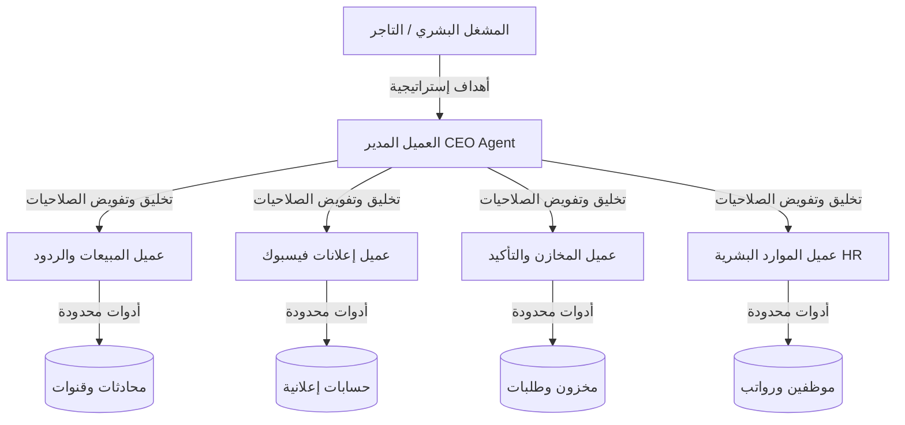
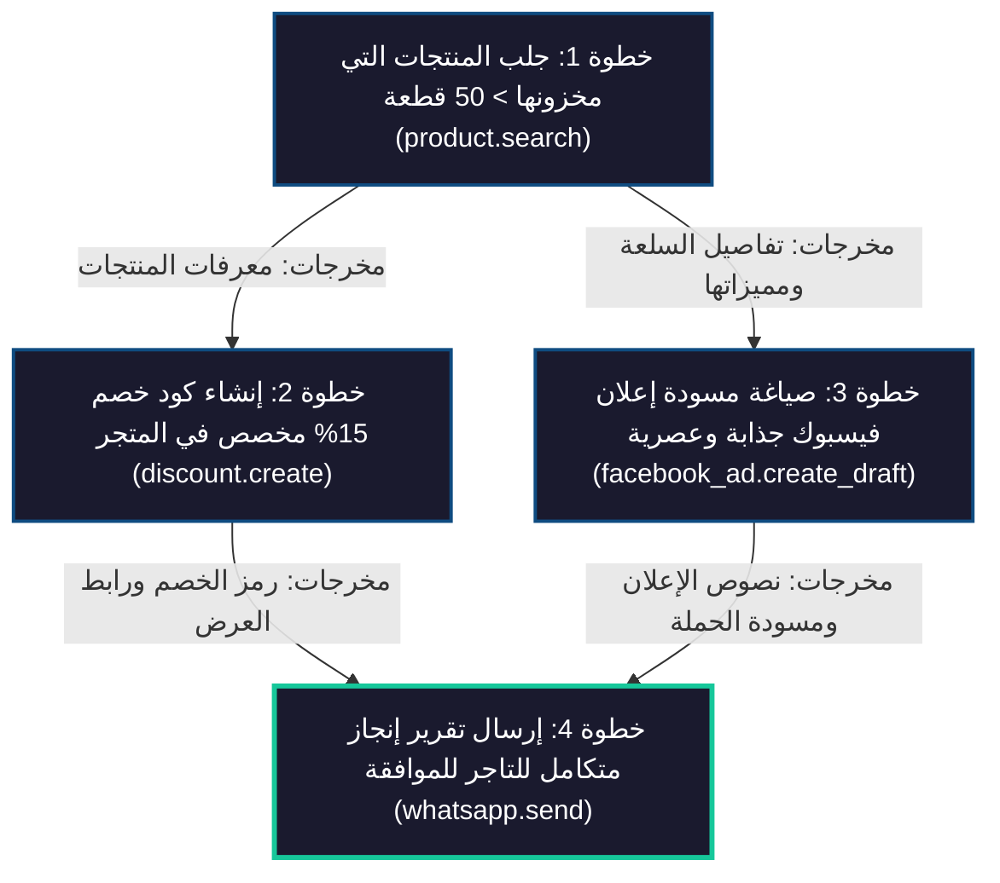
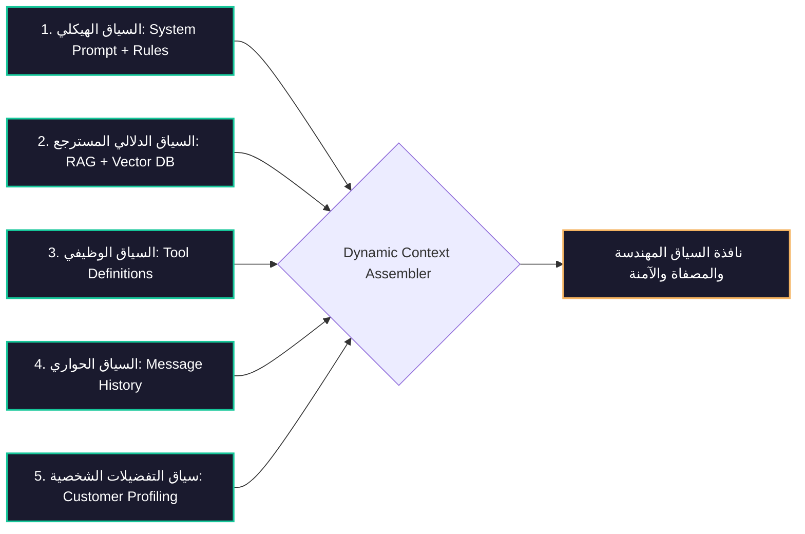
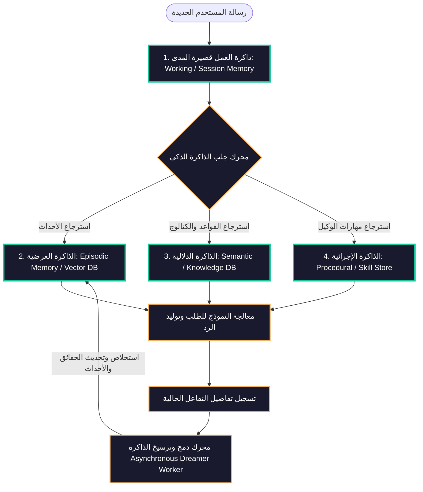
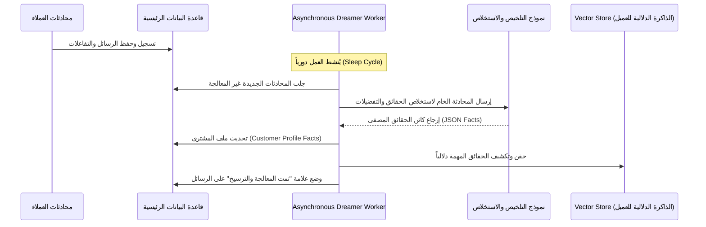
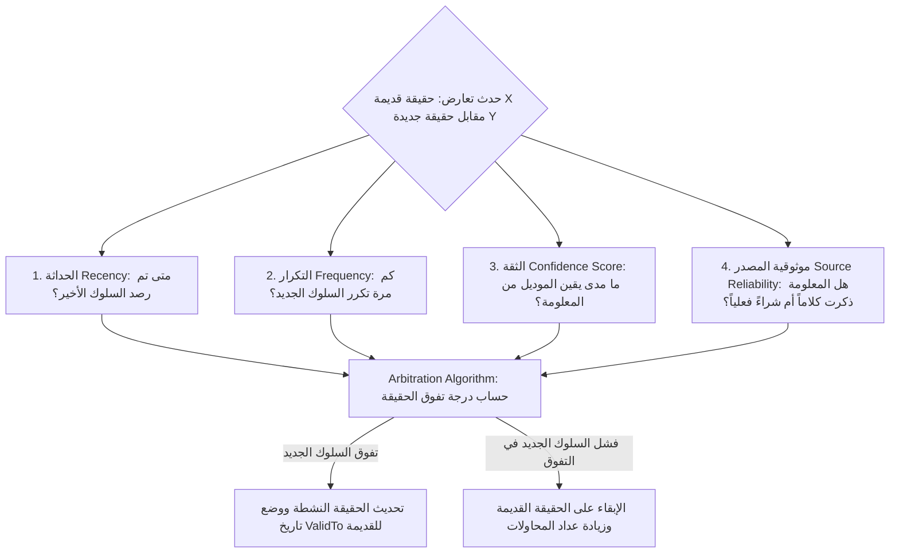
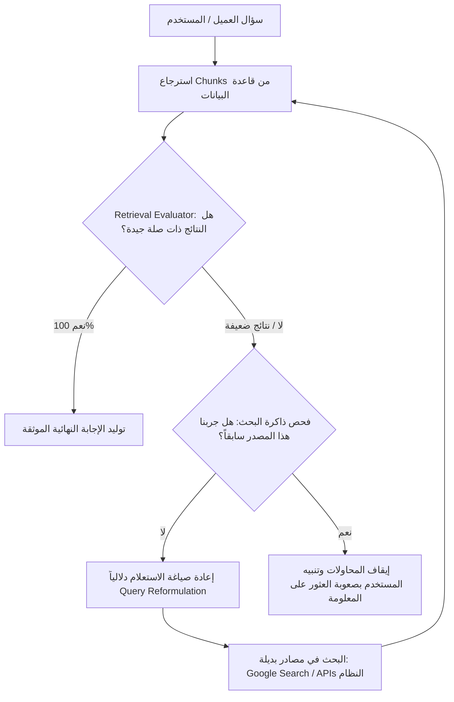
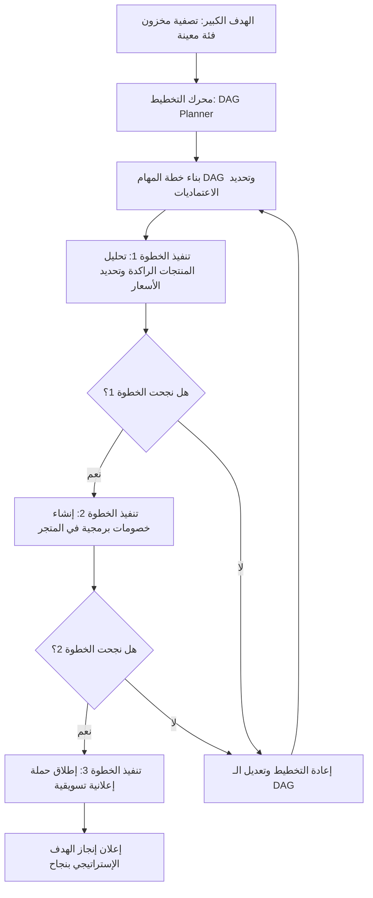
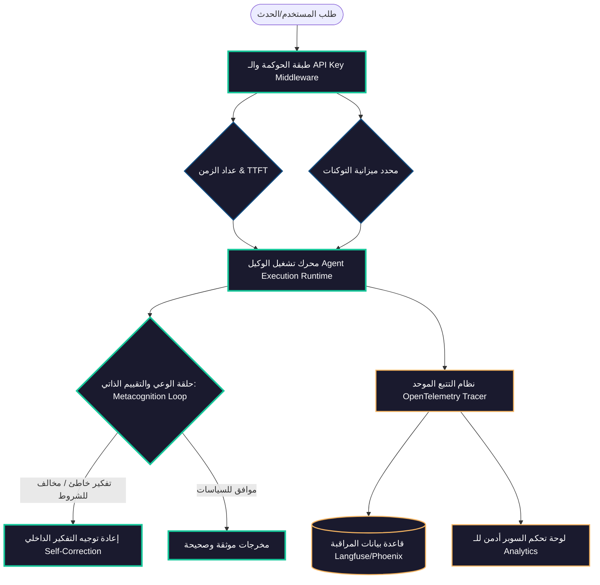

# خطة معمارية العميل الذكي لـ MaxP (مستوحاة من OpenClaw و Hermes و Paperclip)

هذا المستند يمثل مسودة للأفكار والخيارات المعمارية المقترحة لنظام العميل الذكي (Agentic AI) الخاص بالمنصة، ليكون بمثابة مرجع للمناقشة وتحديد التفاصيل النهائية للتنفيذ.

---

## 📌 مقارنة النماذج الملهمة (Inspiration Matrix)

| البعد المعماري | OpenClaw | Hermes Agent (Nous Research) | Paperclip AI | Microsoft Agent Framework (MAF) |
| :--- | :--- | :--- | :--- | :--- |
| **التركيز الرئيسي** | عميل محلي مستقل (Local Agent) للمستخدم الفردي. | عميل فائق الذكاء مستمر للتعلم التراكمي وتطوير المهارات. | لوحة تحكم وتنسيق (Control Plane) لإدارة فرق كاملة من العملاء. | إطار عمل مؤسسي موحد لتنفيذ وحوكمة وكلاء متعددين. |
| **الميزة الأقوى** | **الذاكرة النشطة (Active Memory)** وسهولة الاستخدام. | **التطوير الذاتي للمهارات (Self-Improving)** والجدولة باللغة الطبيعية. | **الهيكل الإداري (Hierarchy)** وحوكمة الميزانية والـ Audit Trail. | **البرمجيات الوسيطة (Middleware)** وهيكلية التجريد الموحد والتسليم. |
| **آلية التشغيل** | تشغيل مباشر ومستمر على جهاز المستخدم. | تشغيل مستمر مع ربط قنوات تواصل متعددة (Omnichannel). | نبضات قلب مجدولة (Heartbeat System) لتوفير التكلفة. | دورات معالجة مرنة تدعم التسلسل والتوازي والتسليم البيني. |
| **الذاكرة** | ملفات Markdown محلية + قاعدة بيانات SQLite. | ملفات `USER.md` و `MEMORY.md` + فحص FTS5. | سجل تحقيق موحد وأبدي (Append-only Audit Trail). | إدارة جلسات سحابية موزعة ونقاط حفظ لحالات التشغيل. |

---

## 🧱 مكونات المعمارية المرجعية الموحدة (Reference Architecture Components Map)

لتأكيد شمولية وثبات المخطط الهندسي لـ **MaxP** وموافقته لأحدث معايير هندسة الوكلاء لعام 2026، يوضح الجدول التالي كيف تغطي الخطة وتوزع كل مكون من المكونات السبعة الحاكمة للنظام، مع توضيح معناها وموقعها في الهيكل البرمجي المطبق:

| المكون الأساسي (Component) | المعنى والوظيفة (Definition) | طريقة التغطية في خطة ومتجر MaxP (Architecture Coverage) |
| :--- | :--- | :--- |
| 🤖 **الوكيل (Agent)** | الوكيل نفسه الذي يجمع بين التعليمات الحاكمة (Instructions) ومجموعة الأدوات المتاحة له (Tools) لحل المهام. | يُمثل برمجياً عبر الكلاس الأساسي `BaseAgent` والوكلاء المتخصصين المعزولين (مثل `CorrectiveRAGEngine` و `CEOAgent`). يقرأ التعليمات الحاكمة من `SOUL.md` و `AGENTS.md` ويملك وصولاً مقيداً للأدوات المسموحة برمجياً. |
| 🧵 **خيط المحادثة (Thread)** | خيط أو قناة المحادثة الفردية التي تحفظ تسلسل الحوار وتحافظ على سياقه العام وتمنع تداخله بين المستخدمين. | يتم تخزينها في جدول `Conversation` مع تتبع دائم للمعرف الفريد `traceId`. يتم ربطها ديناميكياً بقنوات الدعم (WhatsApp JIDs, Messenger Sender IDs) ويتم إدارتها عبر `contextPreparationService` لفرز الحوارات. |
| 🛠️ **الأداة (Tool)** | دالة برمجية صلبة (مكتوبة بلغة JavaScript/TypeScript في بيئتنا، وتكافئ دوال Python) تتيح للوكيل التفاعل مع قاعدة البيانات أو خوادم MaxP أو APIs خارجية. | تُعرف برمجياً بصيغة JSON Schemas وتنفذ عبر `toolOrchestratorService` (مثل أدوات قراءة الكتالوج `product.search` وتعديل المخزون وصناعة الأكواد البرمجية للطلبات). |
| ⛓️ **سير العمل (Workflow)** | تسلسل خطوات محددة مسبقاً أو مولدة ديناميكياً لتنفيذ مهمة معقدة، وتدعم التشغيل المتتالي (Sequential)، والتنفيذ المتوازي (Parallel)، والشرطي (Conditional / Branching). | يُدار بالكامل عبر محرك التخطيط الحركي **`DAGPlannerExecutor.js`** الذي يبني رسم المهام البياني (DAG) ويقوم بفرزها топоولوجياً وتشغيلها بالتوازي عبر `Promise.all` مع إمكانية إعادة التخطيط الديناميكي (Dynamic Replanning) عند فشل خطوة فرعية. |
| 🔌 **البرمجيات الوسيطة (Middleware)** | برامج ومرشحات وسيطة تمر عبرها إجراءات الوكيل للقيام بعمليات حيوية مثل التسجيل (Logging)، المصادقة (Authentication)، ومراقبة وحوكمة الميزانية (Rate Limiting & Token Budgeting). | يتم تشغيلها عبر `Agent Middleware Pipeline` ونظام الميزانية `providerBudgetLedgerService` لتصفية وفحص سلامة استدعاء النماذج والأدوات، وحظر المفاتيح قبل إرسال الطلبات للمزود إذا تخطت الميزانية المحددة. |
| 💾 **الذاكرة (Memory)** | نظام إدارة ذاكرة الوكيل بمستوياتها المتعددة: الذاكرة المؤقتة (In-memory/Redis لبيانات الجلسة)، الذاكرة الدائمة (Persistent SQL/Vector DB للأحداث)، والذاكرة الحركية (Dynamic Facts). | تُغطى بالكامل في **معمارية الذاكرة الرباعية (Agentic Memory)**: ذاكرة العمل قصيرة المدى (Working Session)، الذاكرة العرضية (Episodic Vector DB)، الذاكرة الدلالية (Semantic Knowledge)، والذاكرة الإجرائية (Procedural Tools) مع المشغل الخلفي `Dreamer Worker` لتنقية وترقية الحقائق. |
| 📊 **المراقبة (Observability)** | تتبع تفصيلي لمسار تفكير وخطوات الوكيل وسرعته وتكاليفه بالاعتماد على معيار OpenTelemetry المفتوح. | مُمثلة في جدول تتبع الجلسات (`telemetryTrace` و `telemetrySpan`) ومدمجة برمجياً مع أدوات OpenTelemetry (مثل Langfuse أو Arize Phoenix) لتسجيل مسار التفكير بشكل شجري تفصيلي (Trace Tree) يسهل تتبعه عبر لوحة تحكم السوبر أدمن. |

---


## 🏗️ المعمارية المقترحة لـ MaxP (Autonomous Merchant Control Plane)

بما أن منصة **MaxP** هي منصة سحابية متعددة الشركات (Multi-tenant SaaS)، فإن المعمارية المقترحة تركز على 5 محاور رئيسية تجمع بين أمان الـ SaaS وقوة النظم النظم المستقلة:

### 1. طبقة تنسيق فرق العملاء (Agent Team Coordination - من Paperclip)
*   **عميل المدير التنفيذي (CEO Agent):** يستقبل الأهداف الكبرى من التاجر (مثال: "تجهيز حملة تخفيضات للجمعة البيضاء") ويقوم بتقسيمها إلى مهام فرعية (Sub-tasks) وإسنادها للعملاء المتخصصين.
*   **العملاء المتخصصون (Specialist Agents):**
    *   **عميل التسويق (Marketing Agent):** صياغة إعلانات فيسبوك، تحديد الجمهور المستهدف.
    *   **عميل المخزون والتسعير (Inventory & Pricing Agent):** مراجعة أسعار الأحذية، التأكد من المخزون، كتابة تعديلات الأسعار كمسودة.
    *   **عميل خدمة العملاء (Customer Support Agent):** تولي الردود التلقائية والواتساب وتنبيه التجار بالحالات العاجلة.

### 2. الذاكرة النشطة وتنقية المعلومات (Active Memory & Dreaming - من OpenClaw & Hermes)
*   **الذاكرة النشطة الهجينة (Hybrid Active Memory):** عند وصول رسالة أو مهمة، نقوم بعملية استعلام سريعة تجمع بين دلالات المتجه (Vector Embeddings) والبحث النصي (Lexical/BM25) على قاعدة البيانات لعزل وجلب سياق الشركة فقط.
*   **عامل الأحلام وتنقية الذاكرة (Dreaming Worker):** وظيفة دورية (Cron Job) تراجع المحادثات اليومية وتقوم بترقية الحقائق والتفضيلات المكتشفة إلى ذاكرة مستديمة (`Durable Memories`) وتصفية المتناقضات لتوفير استهلاك الـ Tokens.

### 3. أدوات آمنة مع موافقة بشرية (Scoped Tools & Human-in-the-Loop)
*   **أدوات القراءة (Read-Only):** ينفذها العميل فوراً (عرض تقارير الإعلانات، تفاصيل الطلبات، كمية المخزون).
*   **أدوات الكتابة (Write Actions):** تتطلب موافقة يدوية. يقوم العميل بتجهيز العملية وحفظها كمسودة (Draft / Proposal) ويرسل رمز تأكيد (مثال: `نفذ X92A`) للتاجر عبر تلجرام أو لوحة التحكم للموافقة الرسمية قبل التعديل الفعلي في قاعدة البيانات.

### 4. الجدولة التلقائية باللغة الطبيعية (Natural Language Cron Jobs - من Hermes)
*   **مفهوم التشغيل:** يتيح للتاجر كتابة قاعدة باللغة الطبيعية مثل: *"كل يوم ثلاثاء الساعة 6 مساءً، أرسل رسالة واتساب للعملاء الذين لم يكملوا عملية الشراء اليوم"*، ويقوم النظام بتحليلها وحفظها كمهمة مجدولة في طابور المهام.

### 5. حوكمة الميزانية والـ Audit Trail (من Paperclip)
*   **التحكم المالي (Token Budgeting):** تحديد كوتا مالية يومية/شهرية لكل شركة لمساعد الـ AI لمنع الحلقات تكرارية روتينية (Infinite Loops) وحماية خوادمك من التكاليف المرتفعة.
*   **سجل التدقيق (Audit Trail):** تسجيل كل قرار اتخذه الذكاء الاصطناعي، وكل أداة استدعاها، وكل رد أرسله، ليكون النظام شفافاً تماماً للتاجر لمعرفة "لماذا اتخذ المساعد هذا القرار".

---

## 🤖 ركائز سلوك الوكلاء الذكيين في النظام (Agent Behavioral Archetypes)

لضمان دقة تنفيذ العملاء وأدائهم الذكي، سنصيغ تصميم وتشغيل الوكلاء بناءً على 5 ركائز تفاعلية معتمدة في هندسة الذكاء الاصطناعي:

### 1. الوكلاء المستندون للأهداف (Goal-based Agents)
*   *المفهوم:* المساعد لا يتفاعل بأسلوب رد الفعل البسيط (Reactive) فقط، بل يعمل بنشاط لتحقيق هدف مرسوم له.
*   *التطبيق في المتجر:* المشغل البشري يضع هدفاً إستراتيجياً مثل *"تصفية مخزون الأحذية الحمراء قبل نهاية الأسبوع"*، ويقوم الوكيل بتخطيط خطوات متسلسلة (تجهيز خصم، صياغة إعلانات، إرسال رسائل دورية) حتى يعلن عن إتمام الهدف.

### 2. الوكلاء المستندون للنماذج الداخلية (Model-based Agents)
*   *المفهوم:* يحتفظ العميل الذكي بنموذج عقلي داخلي لحالة النظام يوضح له كيف تتأثر البيئة بأفعاله والقرارات السابقة.
*   *التطبيق في المتجر:* يتتبع المساعد سلوك المبيعات اليومي. فمثلاً، إذا قام بتخفيض السعر ولم تزد المبيعات، يستنتج في نموذجه الداخلي أن المشكلة قد تكون في استهداف الإعلانات وليس السعر، ليقوم بتعديل تصرفاته اللاحقة بناءً على هذا الإدراك.

### 3. الوكلاء المستندون للمنفعة والقيمة (Utility-based Agents)
*   *المفهوم:* الوكيل يقارن بين خيارات وسيناريوهات التنفيذ المختلفة ويختار المسار الذي يحقق "المنفعة القصوى" (أقل تكلفة مادية، أعلى جودة، أسرع استجابة).
*   *التطبيق في المتجر:* عند شحن طلب للعميل، يوازن العميل بين 3 شركات شحن ويختار الشركة التي تقدم التكلفة الأقل مع زمن التوصيل الأسرع للعميل، مستنداً إلى دالة منفعة رياضية مدمجة (Utility Function).

### 4. الوكلاء القابلون للتعلم والتطور (Learning Agents)
*   *المفهوم:* يقسم الوكيل داخلياً إلى شق تشغيلي (Execution) وشق مراقبة وتقييم (Evaluation) يستمع للتعليقات والملاحظات الخارجية لتطوير سلوكه.
*   *التطبيق في المتجر:* عندما يضع التاجر تقييماً لردود المساعد بالرفض (Dislike) أو تعديل إجابته، يتعلم المساعد تلقائياً من هذا الإدخال (عبر Dreaming Worker) ويحدث ذاكرته الدائمة لتلافي الخطأ في المرات القادمة.

### 5. الأنظمة متعددة الوكلاء (Multi-Agent System)
*   *المفهوم:* تجزئة المهام وتوزيعها على شبكة عملاء متخصصين يتبادلون الرسائل بروتوكولياً لحل المشكلات المعقدة.
*   *التطبيق في المتجر:* تعاون عميل خدمة العملاء (Support) مع عميل المخازن (Inventory) لتوفير المقاس البديل للعميل وإرسال الرد له في جزء من الثانية.

---

## 🧠 هيكل المدير والعملاء الفرعيين (The CEO-Agent & Sub-Agents Pattern)

تطوير فكرة وجود **"وكيل مدير" (CEO Agent)** يملك صلاحية تخليق وتفويض **"وكلاء فرعيين متقاطعين" (Specialist Sub-Agents)** لإدارة أقسام الشركة المختلفة (المخازن، خدمة العملاء، الإعلانات، الموارد البشرية، المبيعات).



### 🔍 الأبعاد المعمارية والتقنية للفكرة (Technical Dimensions)

1.  **صيغة التخليق الديناميكي (Dynamic Agent Provisioning):**
    *   الـ CEO Agent يملك أداة برمجية خاصة (مثال: `agent.spawn(role, context, tools)`) تمكنه من إنشاء صف جديد في جدول قاعدة البيانات للوكيل الفرعي.
    *   يحدد له سياقاً محدداً (SOUL.md مخصص) ونوع القنوات التي يستمع إليها (تلجرام، واتساب، أو لوحة التحكم).
2.  **عزل الصلاحيات وحوكمة الأمان (Scoped Authorization):**
    *   لا يصح تقنياً أن يمتلك عميل المبيعات (Sales Agent) صلاحية قراءة رواتب الموظفين (HR) أو تعديل إعلانات فيسبوك.
    *   المعمارية يجب أن تتبع مبدأ **"أقل الصلاحيات الممكنة" (Principle of Least Privilege)**. الوكلاء الفرعيون يرثون الصلاحيات المقيدة فقط بناءً على دورهم المخصص.
3.  **بروتوكول التواصل الداخلي (Agent-to-Agent Communication):**
    *   تحتاج المعمارية لـ **"ممر نقل رسائل### 1) نمط الـ Agentic RAG المصحح والذكي (Corrective & Stateful Agentic RAG)

بدلاً من الـ RAG التقليدي الذي يجلب مستندات قد تكون غير صالحة ويصيغ ردوداً خاطئة، يعمل هذا النمط كـ **آلة حالة واعية (Stateful State Machine)** تقوم بتقييم وتصحيح عملية استرجاع المعرفة ذاتياً:

```mermaid
graph TD
    %% Define Styles & Colors
    classDef startEnd fill:#1A1A2E,stroke:#16C79A,stroke-width:3px,color:#fff;
    classDef process fill:#1A1A2E,stroke:#0F4C81,stroke-width:2px,color:#fff;
    classDef decision fill:#1A1A2E,stroke:#F5B461,stroke-width:2px,color:#fff;
    classDef fail fill:#1A1A2E,stroke:#E84545,stroke-width:2px,color:#fff;

    Start([سؤال المستخدم / التاجر]) :::startEnd --> InitState[تهيئة حالة البحث RAG State]:::process
    
    InitState --> SelectSource[اختيار المصدر الأنسب لم يُجرب بعد]:::process
    
    SelectSource --> Retrieve[استدعاء أداة الاسترجاع Retrieve Chunks]:::process
    
    Retrieve --> Evaluate{مقيم الجودة Evaluator: هل المعلومات كافية ودقيقة؟}:::decision
    
    Evaluate -->|نعم: توافق تام 100%| Generate[توليد إجابة موثقة مع المراجع]:::process
    
    Evaluate -->|لا / ضعيفة أو ناقصة| SaveTrace[تسجيل المحاولة وتحديث triedSources]:::process
    
    SaveTrace --> CheckLimits{هل استنفدنا عدد المحاولات أو كل المصادر المتاحة؟}:::decision
    
    CheckLimits -->|نعم| Handoff([إخفاق البحث: تمرير فوري لخدمة العملاء أو تنبيه المدير]):::fail
    
    CheckLimits -->|لا| Reformulate[إعادة الصياغة الدلالية للاستعلام Reformulate Query]:::process
    
    Reformulate --> TryAlternate[توسيع البحث لمصادر بديلة: API المنتجات / بحث خارجي]:::process
    
    TryAlternate --> SelectSource
    
    Generate --> Success([إرسال الرد للمستخدم]):::startEnd
```

#### 🛠️ تفاصيل الهيكل البرمجي والتحقق (TypeScript & Type-Safe Schema):

```typescript
import { z } from 'zod';

// 1. تحديد المصادر المعرفية المتاحة للاسترجاع
export type KnowledgeSource = 
  | 'vector_db_policies'      // قاعدة بيانات المتجهات لسياسات المتجر (مثل SOUL.md / AGENTS.md)
  | 'vector_db_faq'           // الأسئلة الشائعة والردود الثابتة
  | 'system_api_catalog'       // API الاستعلام المباشر عن المنتجات الحية بالاسم والمخزون
  | 'web_search_fallback';     // البحث الخارجي كخيار أخير في حال تعذر العثور محلياً

// 2. هيكل البيانات الذي يمثل مستنداً مسترجعاً
export interface RetrievedDocument {
  id: string;
  source: KnowledgeSource;
  content: string;
  score: number;
  metadata: Record<string, any>;
}

// 3. حالة الـ RAG المحفوظة في آلة الحالة (RAG State)
export interface AgenticRAGState {
  originalQuery: string;        // السؤال الأصلي كما هو من المستخدم
  currentQuery: string;         // الاستعلام الحالي بعد إعادة الصياغة
  companyId: string;            // عزل صارم متعدد الشركات (Multi-Tenant Isolation)
  retrievedDocs: RetrievedDocument[]; // قائمة المستندات المجمعة
  triedSources: KnowledgeSource[];    // المصادر التي تم تجربتها بالفعل
  reformulationCount: number;   // عدد مرات إعادة الصياغة الدلالية
  maxRetries: number;           // الحد الأقصى للمحاولات قبل إعلان الفشل
  evaluationHistory: {
    source: KnowledgeSource;
    queryUsed: string;
    grade: 'RELEVANT' | 'IRRELEVANT' | 'PARTIAL';
    reason: string;
  }[];
}

// 4. نموذج التحقق الهيكلي لتقييم المستندات (Zod Schema)
export const RetrievalEvaluationSchema = z.object({
  grade: z.enum(['RELEVANT', 'IRRELEVANT', 'PARTIAL']),
  confidence: z.number().min(0).max(1),
  missingInformation: z.array(z.string()).optional(),
  reformulationSuggestion: z.string().optional(),
  reason: z.string().describe('شرح دقيق لسبب تقييم المستندات بهذه الدرجة')
});
```

#### ⚙️ خوارزمية التشغيل والتصحيح الذاتي (Self-Healing Loop Algorithm):
1. **التقييم المستمر للمستندات (Continuous Relevance Evaluation):** عند جلب المستندات، يقوم نموذج `gemini-2.5-flash` مقيد بمخرج JSON بفحص القطع النصية فوراً.
2. **التصحيح التلقائي وتعديل الاستعلام (Self-Healing & Query Reformulation):** إذا كانت النتائج ضعيفة أو ناقصة، يعيد العميل صياغة السؤال دلالياً بالاعتماد على النواقص المحددة من المقيم.
3. **تغيير المصادر والبحث البديل (Source Fallback):** يتنقل المحرك بين المصادر بالترتيب (`vector_db_policies` -> `vector_db_faq` -> `system_api_catalog` -> `web_search_fallback`).
4. **ذاكرة استرداد الحالة (Stateful Retrieval Memory):** يتم تتبع المحاولات برمجياً لمنع الدخول في حلقات مفرغة (Infinite Search Loops) وبلوغ حد استدعاء التوكنات الأقصى.

---

### 2) نمط التخطيط والجدولة متعددة الخطوات (DAG-based Planning & Execution Pattern)

في المهام الكبيرة والمعقدة، لا يمكن للوكيل إنجاز الطلب في خطوة واحدة دون تخطيط مسبق. يقوم هذا النمط بتفكيك الأهداف الكبرى إلى **رسم بياني موجه غير حلقي للمهام (Directed Acyclic Graph - DAG Plan)** وجدولتها ومتابعتها:



#### 🛠️ تفاصيل الهيكل البرمجي والواجهات (Plan Interfaces & Status Machine):

```typescript
// 1. حالات تشغيل المهمة الفرعية
export type TaskStatus = 'PENDING' | 'RUNNING' | 'COMPLETED' | 'FAILED' | 'SKIPPED';

// 2. تعريف هيكل المهمة الفرعية داخل المخطط
export interface DAGTask {
  id: string;                  // معرف فريد للمهمة (مثال: task_fetch_products)
  name: string;                // اسم مقروء للمهمة باللغة العربية
  toolName: string;            // اسم الأداة البرمجية المطلوب استدعاؤها
  status: TaskStatus;          // حالة التشغيل الحالية
  dependsOn: string[];         // قائمة معرفات المهام التي تعتمد عليها هذه الخطوة
  inputParams: Record<string, any>; // المدخلات الأولية أو القوالب الديناميكية
  resolvedInputs: Record<string, any>; // المدخلات الفعلية بعد دمج مخرجات المهام السابقة
  outputData?: any;            // مخرجات المهمة بعد نجاح التنفيذ
  errorMessage?: string;       // تفاصيل الخطأ في حال الفشل
  retryCount: number;          // عدد محاولات إعادة التشغيل المستقلة
}

// 3. كائن المخطط العام (DAG Plan)
export interface DAGPlan {
  planId: string;
  goalDescription: string;     // الهدف الكبير المحدد من التاجر
  companyId: string;
  tasks: Map<string, DAGTask>; // خريطة تضم المهام الفرعية
  status: 'PENDING' | 'EXECUTING' | 'COMPLETED' | 'FAILED' | 'REPLANNING';
  createdAt: Date;
  updatedAt: Date;
}
```

#### ⚙️ آليات تشغيل وتنسيق محرك التخطيط (DAG Executor Execution Mechanics):
1. **فرز وترتيب المهام (Topological Sorting):** يقوم المحرك بفرز المهام وجدولة الخطوات التي لا تعتمد على مهام سابقة للتنفيذ الفوري.
2. **التنفيذ المتوازي (Parallel Execution):** يتم تشغيل المهام الجاهزة في نفس الوقت (Promise.all) لسرعة استجابة هائلة وتوفير الوقت.
3. **حل المتغيرات الديناميكي (Parameter Resolution):** استخدام تعبيرات قوالب مثل `{{get_products.output.productIds}}` ليقوم المحرك تلقائياً بقراءتها واستبدالها بالقيمة الحقيقية الناتجة عن الخطوة السابقة قبل استدعاء الأداة التالية.
4. **محرك إعادة التخطيط الديناميكي (Dynamic Replanning):** في حال حدوث فشل حرج في إحدى المهام وتعذر إصلاحها عبر الـ Retries:
   - يتم إيقاف سريان الـ DAG مؤقتاً والانتقال إلى حالة `REPLANNING`.
   - يتم إرسال حالة النظام كاملة (المهام المكتملة ومخرجاتها، والمهام الفاشلة مع أسباب الفشل) إلى النموذج الذكي `gemini-2.5-pro`.
   - يقرر المخطط ما إذا كان يمكن الاستشفاء تلقائياً من هذا الخطأ بتعديل الخطة (مثال: حذف المهام التابعة للخطوة الفاشلة واستبدالها بخطوات أخرى بديلة كاستخدام الواتساب بدلاً من الفيسبوك).
   - يتم حقن المهام الجديدة في الـ DAG واستكمال التكرار بأمان.

---لقاعدة البيانات:** جداول لتخزين الذاكرة، كشافات الذاكرة، تقييم الردود، والمهام.
*   **مترجم وسائط تلجرام وواتساب:** بنية استقبال الـ Webhooks وإرسال الردود مع ميزة مؤشر الكتابة (Typing Indicator).
*   **أدوات القراءة الأساسية:** دوال جاهزة لقراءة أداء متجرك، الطلبات، المنتجات، والخصومات.
*   **نظام الميزانية وسجلات الكشافات:** تتبع استهلاك مفاتيح الـ LLM وتخزين أثر قرارات المساعد (Active Recall Trace).

### 🚨 2. ما ينقصنا ونحتاج لتطويره ليكون العميل "ممتازاً" (The Gaps to Build)
*   **أ. مهارات الكتابة الكاملة (Actionable Write Tools):** ربط الدوال التي تغير البيانات فعلياً (إنشاء طلبات، تعديل أسعار، إرسال رسائل دورية، إدارة إعلانات فيسبوك).
*   **ب. مهارات معالجة الصورة والوسائط (Vision Skills):** قراءة صور إيصالات التحويل البنكي وتأكيد المعاملات، أو فحص صور المنتجات التالفة وتأكيد مشاكل الدعم.
*   **ج. معالج المستندات والملفات الكبيرة (Batch Processing):** إمكانية رفع ملفات Excel و PDF ضخمة للمخازن وتحديث السلع تلقائياً.
*   **د. جدار الحماية الفوري (Guardrails Engine):** طبقة أمان تفحص مخرجات الـ AI للتأكد من عدم تسريب أي أسرار للنظام أو وضع أسعار خاطئة نتيجة هلوسة النموذج.

---

## 🚀 معايير معمارية الـ AI لعام 2026 (2026 SOTA Agent Architecture)

1.  **بروتوكول سياق النموذج (Model Context Protocol - MCP):** معيار لربط الموديل بقنوات البيانات والأدوات الخارجية بطرق مؤمنة.
2.  **أشجار الحالات الرسومية (Graph-Based Stateful Orchestration):** الانتقال من مجرد Loops تكرارية بسيطة للمساعد، إلى إدارة المحادثات والمهام كـ **آلة حالات (State Machine / LangGraph pattern)**.
3.  **التحقق الهيكلي الصارم للمدخلات والمخرجات (Type-Safe Validation):** فحص كل كائن JSON يرسله أو يستقبله العميل الذكي باستخدام أدوات تحقق صارمة (مثل Zod Schema).
4.  **حوكمة السلوك ككود برمجى (Governance-as-Code):** فرض سياسات الأمان والتراخيص وعزل البيانات برمجياً كطبقة تحكم خارجية مغلفة للـ AI (Harness Layer).

---

---

## 🧠 هندسة السياق مقابل هندسة الأوامر (Context Engineering vs. Prompt Engineering)

في السابق، كان التركيز ينصب على **Prompt Engineering (هندسة الأوامر)**—أي صياغة الكلمات السحرية والتعليمات الدقيقة داخل الرسالة الموجهة للنموذج. أما في بيئات الإنتاج الحديثة لعام 2026، انتقل التركيز تماماً إلى **Context Engineering (هندسة السياق)**.
**هندسة السياق** هي العلم الهندسي الذي يتحكم في **ما يدخل بالفعل إلى نافذة سياق النموذج (Context Window)** من بيانات، وقواعد، وتاريخ محادثات، وأدوات برمجية في كل لحظة زمنية، وكيفية تصفيته وتأمينه لمنع تشتت النموذج أو تسمم بياناته.

### 🌐 أولاً: الأبعاد الخمسة لسياق الوكيل الذكي (The 5 Dimensions of Context)

يتكون سياق تشغيل العميل في متجر **MaxP** من 5 مصادر أساسية متغيرة يتم تجميعها حركياً (Dynamically Assembled) قبل كل استدعاء:



1. **السياق الهيكلي (Structural Context - System Prompt + Rules):**
   ملفات القواعد الأساسية الثابتة والسياسات الخاصة بكل متجر مثل `SOUL.md` و`AGENTS.md` التي تحدد الشخصية، ولهجة الحديث، والمحرمات التجارية.
2. **السياق الدلالي المسترجع (Dynamic Semantic Context - RAG, FAQ):**
   المعلومات التي يتم جلبها ديناميكياً من محركات البحث الدلالي وقواعد المعرفة (مثل تفاصيل الشحن، شروط الاستبدال، وسجلات الكتالوج).
3. **السياق الوظيفي (Functional Context - Tool Definitions):**
   مواصفات وتوصيفات الأدوات البرمجية المتاحة للطلب (APIs) المكتوبة بصيغة JSON Schema والتي تخبر النموذج بالوظائف التي يستطيع القيام بها.
4. **السياق الحواري (Conversational Context - History):**
   تاريخ الرسائل المتبادلة في الجلسة الحالية بين العميل البشري والوكيل الذكي، مع تصفية وتلخيص الأجزاء القديمة لمنع تخطي حدود الذاكرة.
5. **سياق التفضيلات الشخصية (Personalization Context - Customer Profile):**
   معرفة ما يفضله العميل البشري وتاريخ تفاعلاته (مثال: *"العميل يفضل مقاس XL، يشتري دائماً بالدفع عند الاستلام، ويتحدث بلهجة ودية"*).

---

### 🚨 ثانياً: 4 أخطاء سياق قاتلة (وإزاي Skills Approach بيحلها)

عندما تزداد المهام تعقيداً، تواجه الوكلاء مشاكل سياقية قاتلة تؤدي إلى فشلهم بالكامل في بيئة الإنتاج. فيما يلي الأخطاء الأربعة الكبرى وكيفية التغلب عليها هندسياً من خلال معمارية **المهارات المعزولة (Isolated Skills Approach)**:

| الخطأ السياقي القاتل | المشكلة والمعنى في الإنتاج | الحل الهندسي في معمارية المهارات (Skills Solution) |
| :--- | :--- | :--- |
| ☠️ **تسمم السياق (Context Poisoning)** | تسلل معلومات خاطئة أو مشوهة إلى نافذة السياق (مثل سعر خاطئ جلبه الـ RAG، أو محاولة اختراق Prompt Injection)، مما يلوث تفكير المساعد ويجعله يكرر الخطأ في الردود اللاحقة. | **التحقق المستقل للـ Skill:** تفصل كل مهارة (Skill) بيانات مدخلاتها ومخرجاتها برمجياً. قبل تمرير أي معلومة مسترجعة للسياق، تتحقق الـ Skill حتمياً من صحة البيانات (Data Validation) ضد قاعدة البيانات الحقيقية وتمنع حقن النصوص غير الموثوقة. |
| 🌀 **تشتت السياق (Context Distraction / Bloat)** | تضخم نافذة السياق بسبب حشوها بمئات الأدوات ومستندات الـ RAG وتاريخ الشات الطويل، مما يجعل النموذج الذكي يتشتت ويهمل التعليمات الأساسية (Lost in the Middle). | **التركيز أحادي الهدف (Single-Task Focus):** يتم تقسيم الوكيل الشامل إلى مهارات متخصصة معزولة. عندما يتم تشغيل مهارة معينة (مثل: حساب مصاريف الشحن)، يتم تمرير سياق صغير ومحدد جداً لهذه المهمة فقط، مما يضمن كفاءة تركيز النموذج بنسبة 100%. |
| 🔀 **ارتباك السياق (Context Confusion / Tool Hallucination)** | عندما يتم إرسال 20 أو 30 أداة برمجية للنموذج في نفس الوقت، يعجز النموذج عن اتخاذ قرار دقيق ويبدأ في استدعاء أدوات خاطئة بمعاملات هلوسية. | **مبدأ الـ 3 أدوات كحد أقصى (Micro-Tooling Schema):** كل مهارة (Skill) لا تمتلك إلا من أداتين إلى 3 أدوات برمجية كحد أقصى متلائمة تماماً مع مهمتها الفرعية، مما يرفع دقة استدعاء الأدوات للنموذج إلى 99.9%. |
| 💥 **تصادم السياق (Context Collision / State Contradiction)** | تعارض وتضارب المعلومات داخل السياق (مثال: العميل يطلب حذاء بمقاس 42 ثم يغير رأيه في الرسالة التالية ويطلب 44، أو تتضارب شروط الخصم القديمة مع الجديدة). | **التحول الصارم للحالات (Strict State Transition & Context Purge):** عند تغير رغبة المستخدم أو تحديث حالة النظام، تقوم الـ Skill بإصدار أمر حتمي لتطهير (Purge) وحذف السياق القديم المتعارض من الذاكرة اللحظية وكتابة الحالة الجديدة الصافية لمنع تضارب المفاهيم. |

---

---

## 🧠 ذاكرة الوكيل الذكي (Agentic Memory Architecture)

تماماً كالعقل البشري، لا يمكن لوكيل الذكاء الاصطناعي في متجر **MaxP** تقديم تجربة عملاء مستقرة دون **نظام ذاكرة متكامل ومتعدد المستويات (Multi-Tier Memory System)**. بدلاً من الاعتماد فقط على ذاكرة الجلسة البسيطة (Session Storage)، قمنا بتصميم معمارية ذاكرة مقسمة هندسياً إلى أربعة مستويات وظيفية أساسية، مدعومة بمحرك خلفي لتوحيد المعلومات وتحديث الوعي:



---

### 🗂️ أولاً: البنية الرباعية للذاكرة الوكيلة (The 4-Tier Memory Structure)

#### 1. ذاكرة العمل قصيرة المدى (Working / Short-Term Memory):
* **الوظيفة:** إدارة محادثة الجلسة الجارية (Session Context).
* **التفاصيل الهندسية:** تحتفظ بكائن الحالة الفوري للعميل في ذاكرة الخادم اللحظية (أو كاش Redis). يتضمن ذلك المنتجات التي يتفاوض عليها المشتري حالياً، اللون المفضل الذي تم تحديده في Turn السابق، وتفاصيل العنوان التي تم إدخالها جزئياً.
* **التحكم بالتكلفة:** تستخدم مبدأ **النافذة المنزلقة (Sliding Window)**؛ بمجرد تجاوز المحادثة لـ 15 رسالة، يتم ضغط الأجزاء القديمة في ملخص مستمر (Ongoing Summary) وتطهير الرسائل القديمة لتوفير التكلفة.

#### 2. الذاكرة العرضية (Episodic Memory):
* **الوظيفة:** تسجيل وحفظ الأحداث والتفاعلات التاريخية السابقة بالتفصيل.
* **التفاصيل الهندسية:** تحول محادثات الأمس وأفعال المتجر (مثل: *"تم تعليق طلب التاجر بالأمس لعدم توافر حذاء 42"*) إلى ناقلات دلالية (Embeddings) وحفظها في Vector Database.
* **الاسترجاع:** عندما يتحدث المشتري مجدداً، يبحث الوكيل دلالياً في الذاكرة العرضية (Cosine Similarity) ليسترجع سياق مشاكله التاريخية: *"أهلاً بك مجدداً، هل تم حل مشكلة الحذاء مقاس 42 الذي سألت عنه بالأمس؟"*.

#### 3. الذاكرة الدلالية (Semantic Memory / Knowledge Base):
* **الوظيفة:** مستودع المعرفة المنهجية والقواعد الثابتة للمتجر.
* **التفاصيل الهندسية:** تضم كتالوج السلع والأسعار، سياسات الشحن الدقيقة، وعناوين الفروع المخزنة في قواعد البيانات المهيكلة (PostgreSQL SQL Catalog) ومستندات النصوص (RAG Knowledge Base).

#### 4. الذاكرة الإجرائية (Procedural Memory / Skill Store):
* **الوظيفة:** ذاكرة "كيف نفعل الأشياء" (مهارات الأدوات).
* **التفاصيل الهندسية:** الـ Schema الحاكمة لطرق استدعاء الأدوات والتسلسل الصحيح لتنفيذ المهام المعقدة. تتذكر كيفية استدعاء APIs الدفع، كيف تُطلق حملة إعلانية، وكيفية إرسال إشعار على الواتساب بنجاح.

---

### 🌙 ثانياً: محرك ترسيخ الذاكرة ونوم الوكيل (The Dreamer / Sleep Cycle Worker)

في الإنتاج، لا يمكن استخلاص الحقائق وتحديث ملفات تعريف المشترين مباشرة أثناء معالجة رسالة المستخدم (Inline Execution) لأن ذلك سيؤدي لبطء زمن الاستجابة (Latency) وهدر التكلفة. 
بدلاً من ذلك، نعتمد على **محرك خلفي غير متزامن يسمى (Dreamer Worker)** يعمل بشكل دوري (مثال: كل ساعة، أو أثناء أوقات قلة النشاط ليلاً):



#### مهام الـ Dreamer Worker الأساسية:
1. **استخلاص الحقائق وتحديث البيانات (Fact Extraction):** قراءة الشات الخام وتصفية الحقائق المؤكدة (مثال: *"العميل يشتكي دائماً من مصاريف الشحن لمدينة أسيوط"*) وتسجيلها في جدول تفضيلات العميل.
2. **دمج وتلخيص الحوارات (Conversation Consolidation):** تحويل المحادثات الطويلة لملخصات مدمجة مكونة من سطرين، وحذف التفاصيل غير المهمة (مثل إيموجي الترحيب أو الأسئلة المكررة).
3. **تحديث المعرفة المتغيرة (Knowledge Updates):** الكشف عن أي تناقضات (مثال: إذا قال العميل *"تغير رقم هاتفي لـ X"*، يقوم الـ Worker بتعديل الرقم في ملفه الشخصي ومسح الرقم القديم حتمياً).

---

### 📊 ثالثاً: هيكل تخزين حقائق الذاكرة (Memory Fact Extraction DB Schema)

لحفظ وتكشيف الحقائق التي يستخلصها الـ Dreamer بشكل منظم، نستخدم الهيكل البرمجي التالي داخل قاعدة بيانات **MaxP**:

```typescript
// 1. درجة موثوقية المعلومة المستخلصة
export type FactConfidence = 'HIGH' | 'MEDIUM' | 'LOW';

// 2. سجل حقيقة مستخلصة عن تاجر أو مشتري (مع دعم الوعي الزمني ومحرك فض التعارض)
export interface AgenticMemoryFact {
  factId: string;
  companyId: string;
  entityId: string;            // المعرف الفريد للكيان (مثل customerId أو merchantId)
  entityType: 'CUSTOMER' | 'MERCHANT' | 'SYSTEM';
  
  category: 'PREFERENCE' | 'COMPLAINT' | 'BIO' | 'COMMERCE_BEHAVIOR';
  subject: string;             // الكيان الرئيسي (مثال: "مقاس الحذاء")
  predicate: string;           // العلاقة (مثال: "يفضل دائماً")
  object: string;              // القيمة (مثال: "43" أو "XL")
  
  rawSourceText: string;       // النص الأصلي الذي تم استخلاص المعلومة منه للتوثيق
  confidence: FactConfidence;  // درجة الثقة (تحدد هل نستخدمها حتمياً أم نتأكد منها)
  confidenceScore: number;     // درجة رقمية دقيقة من 0.0 إلى 1.0 يتم تقييمها دورياً
  observedFrequency: number;   // عدد مرات رصد وتأكيد هذه الحقيقة عبر التفاعلات (تكرار الحدث)
  
  // حقول الوعي الزمني (Temporal Aware Reasoning)
  validFrom: Date;             // تاريخ بدء صلاحية المعلومة رصدياً
  validTo?: Date;              // تاريخ نهاية صلاحية المعلومة (إذا تغير السلوك)
  
  createdAt: Date;
  lastObservedAt: Date;        // آخر مرة تم رصد وتأكيد هذه الحقيقة فيها في الشات
  updatedAt: Date;
}
```

---

### ⚖️ رابعاً: محرك فض تعارض الذاكرة وحل النزاعات (Truth Arbitration Engine)

في بيئات التجارة الحقيقية، سياق المشترين متغير ومتقلب بشكل مستمر. إذا كانت الذاكرة الدائمة تسجل المعلومات بشكل ساكن وتراكمي دون تنقية، ستتلوث الذاكرة وتتعارض (مثال: العميل يذكر في الـ Bio أنه *"يفضل مقاس XL"*، ولكنه في آخر 3 عمليات شراء حقيقية اشترى مقاس *"L"*). 

لحل هذه المعضلة، يعمل **محرك التحكيم وفض التعارض (Truth Arbitration Engine)** على تصفية وفحص المعلومات وتحديد **الحقيقة النشطة (Active Truth)** بالاعتماد على 4 محاور أساسية:



#### معادلة احتساب وتفوق الحقائق (Arbitration Parameters Evaluation):
1. **الحداثة (Recency):** تعطي وزناً أكبر للمعلومات التي تم رصدها حديثاً. السلوك الذي تم رصده هذا الأسبوع يملك أولوية على سلوك العام الماضي.
2. **التكرار الملاحظ (Observed Frequency):** عدد مرات رصد السلوك الجديد. شراء المقاس "L" لثلاث مرات متتالية يتفوق إحصائياً على تصريح العميل الشفهي لمرة واحدة بأنه يفضل "XL".
3. **درجة اليقين (Confidence Score):** تقييم النموذج لمدى وضوح وصحة المعلومة أثناء الاستخلاص (مثال: تصريح مباشر *"رقم هاتفي هو X"* يملك 1.0، بينما استنتاج *"يبدو أن العميل غاضب من السعر"* يملك 0.4).
4. **موثوقية المصدر (Source Reliability):** تصنيف مصادر المعلومات؛ حيث يملك "الشراء الفعلي وتأكيد الطلب من المخزن" (Commerce Action) موثوقية أعلى بكثير من "حديث العميل اللفظي في المحادثة" (Conversational Chat).

*إذا قرر المحرك تفوق السلوك الجديد، يتم فوراً أرشفة الحقيقة القديمة بوضع تاريخ `validTo = new Date()` وتفعيل الحقيقة الجديدة لتجنب إرسال ردود مشوشة للمشتري.*

---

### 📅 خامساً: الذاكرة الزمنية والمنطق الواعي بالوقت (Temporal Memory & Time-Aware Reasoning)

السلوك التجاري وتفضيلات العملاء ليست حقائق أبدية، بل هي **سلوكيات مرتبطة بالزمن (Time-Dependent Behaviors)**. عدم إدراك المساعد للوقت يجعله عاجزاً عن فهم تغير رغبات العميل أو تغير الفصول التجارية.
لذلك، تدمج معمارية MaxP **طبقة التحليل والمنطق الزمني (Temporal Reasoning Layer)**، حيث تصبح كافة المعلومات مأطرة زمنياً:

#### تطبيقات الوعي الزمني في متجر MaxP:
* **التفضيلات الموسمية (Seasonal Preferences):** التعرف على تفضيلات الشراء المرتبطة بأوقات معينة (مثال: *"العميل يشتري بكثرة ملابس شتوية ثقيلة في شهر ديسمبر، ويهملها تماماً في الصيف"*).
* **تغير رغبات الدفع والشحن:** رصد تحولات العميل (مثال: *"كان العميل يفضل الدفع عند الاستلام (COD)، ولكنه تحول كلياً للدفع الإلكتروني (Card) منذ بداية العام الحالي"*).
* **إشارات الخطر وفترة الصلاحية (Churn & Validity Expiry):** وضع تاريخ نهاية صلاحية تلقائي (`validTo`) للحقائق المؤقتة (مثل: عروض الخصم الممنوحة للعميل صالحة فقط لمدة 7 أيام؛ إذا سأل عنها بعد 10 أيام، يدرك المساعد تلقائياً انتهاء الصلاحية دون الحاجة لتعليمات ثابتة).

```typescript
// مثال لكيفية معالجة الـ Temporal Reasoning للحقائق المتغيرة
const prefersCodFact = {
  fact: "prefers_payment_method",
  object: "COD",
  validFrom: new Date("2025-01-01"),
  validTo: new Date("2026-01-01"), // انتهت الصلاحية لتحوله للدفع بالفيزا
  confidenceScore: 0.95,
  observedFrequency: 12
};

const prefersCardFact = {
  fact: "prefers_payment_method",
  object: "CREDIT_CARD",
  validFrom: new Date("2026-01-02"),
  validTo: null, // الحقيقة النشطة حالياً
  confidenceScore: 1.0,
  observedFrequency: 4
};
```

---


## 🏢 أفكار متبناة من إطار عمل مايكروسوفت للعملاء الذكيين (Microsoft Agent Framework - MAF)

1.  **طبقة البرمجيات الوسيطة للوكلاء (Agent Middleware Pipeline):** تمرير أي إجراء (Action) أو طلب استدعاء أداة عبر سلسلة برمجيات وسيطة لضمان قياس التكلفة والأمان.
2.  **بروتوكول تسليم المهام بين الوكلاء (Agent Handoff Protocol):** توجيه ذكي وسلس للمحادثات بين المساعدين الفرعيين عبر دالة `agent.handoff()`.
3.  **واجهة التجريد الموحد للعملاء (Unified Agent Abstraction):** وراثة جميع الوكلاء من كلاس أساسي واحد (`BaseAgent`) لتسهيل تخليق وضم مساعدين جدد.

---

## 🧩 أنماط التصميم المتقدمة للعملاء (Advanced Agentic Design Patterns)

لتحقيق أقصى درجات الذكاء والمرونة داخل **MaxP**، سنعتمد على نمطين من أرقى أنماط التصميم الهندسية للذكاء الاصطناعي التفاعلي لعام 2026:

### 1) نمط الـ Agentic RAG المصحح والذكي (Corrective & Stateful Agentic RAG)

بدلاً من الـ RAG التقليدي الذي يجلب مستندات قد تكون غير صالحة ويصيغ ردوداً خاطئة، يعمل هذا النمط كـ **آلة حالة واعية (Stateful State Machine)** تقوم بتقييم وتصحيح عملية استرجاع المعرفة ذاتياً:



#### 🛠️ تفاصيل التشغيل الهندسي لـ Agentic RAG:
*   **التقييم المستمر للمستندات (Continuous Relevance Evaluation):** عند استرجاع القطع النصية (Chunks)، يقوم نموذج صغير وسريع (Evaluator Model) بفحصها فوراً وإعطاء درجة توافق (Score).
*   **التصحيح التلقائي وتعديل الاستعلام (Self-Healing & Query Reformulation):** إذا كانت النتائج ضعيفة أو خاطئة، يقوم الوكيل بإعادة صياغة السؤال دلالياً لزيادة فرص الاستهداف الصحيح.
*   **تغيير المصادر والبحث البديل (Source Fallback & Web/System Search):** إذا لم يعثر المساعد على إجابة في مستندات المتجر، يملك مهارة البحث في مصادر بديلة (محرك بحث خارجي، أو استدعاء API من خادم MaxP للبيانات الحية).
*   **ذاكرة استرداد الحالة (Stateful Retrieval Memory):** يتذكر المساعد داخل الجلسة الحالية أنه جرب بالفعل استعلامات معينة ومصادر معينة وفشلت، لمنع الدخول في حلقات مفرغة (Infinite Search Loops).

---

### 2) نمط التخطيط والجدولة متعددة الخطوات (DAG-based Planning & Execution Pattern)

في المهام الكبيرة، لا يمكن للوكيل إنجاز الطلب في خطوة واحدة دون تخطيط مسبق. هذا النمط يمكن العميل من بناء وتحديث **رسم بياني موجه غير حلقي للمهام (DAG Plan)** ومتابعته خطوة بخطوة:



#### 🛠️ تفاصيل التشغيل الهندسي لـ DAG Planner:
*   **بناء الخطة وتحديد الاعتماديات (Plan Generation & Dependency Mapping):** يفكك المخطط (Planner) الهدف الكبير إلى قائمة مهام فرعية مع تحديد اعتمادية كل خطوة على سابقتها (مثل: "لا يمكن إطلاق الإعلان الخطوة 3 قبل تفعيل كود الخصم الخطوة 2").
*   **طبقة المراقبة وتتبع السلوك (Execution Monitoring):** يتابع مشغل النظام (Executor) تنفيذ الخطوات بدقة، ويسجل ناتج كل خطوة (Observation) كمدخل للخطوة التالية.
*   **إعادة التخطيط المرن عند الفشل (Dynamic Replanning & Self-Correction):** إذا فشلت خطوة معينة (مثال: تعذر إطلاق الإعلان بسبب حظر الحساب الإعلاني)، لا يفشل النظام بالكامل. يُعاد إرسال تقرير الفشل إلى المخطط، ليقوم ديناميكياً بتعديل الـ DAG وتوفير قنوات بديلة (مثل واتساب بدلاً من فيسبوك).

---

## 👁️ مراقبة التشغيل والوعي الذاتي في الإنتاج (Production Observability & Metacognition)

في بيئات التطوير المحلية (Local Development)، قد يظهر الوكيل الذكي (Agent) أداءً ممتازاً واستجابات دقيقة. ولكن بمجرد إطلاقه في الإنتاج (Production)، يتحول إلى **صندوق أسود (Black Box)** يصعب تعقبه. 
لحماية النظام التجاري لـ **MaxP** من العشوائية، قمنا بتصميم معمارية **المراقبة والوعي الذاتي (Observability & Metacognition)** للإجابة بدقة على ثلاثة أسئلة حرجة يطرحها المهندسون وأصحاب المتاجر يومياً:
1. **ليه بطيء؟ (latency)** - ما الذي يسبب تأخر استجابة المحادثة أو إنجاز خطة العمل؟
2. **ليه غالي؟ (Cost)** - أين تُهدر التوكنات (Tokens)، وكيف نمنع فواتير الـ LLM الهائلة؟
3. **ليه بيغلط؟ (Correctness)** - كيف نكشف الهلوسة البرمجية والقرارات التجارية الخاطئة ونصلحها ذاتياً؟



---

### 🧠 أولاً: الوعي الذاتي (Metacognition - التفكير في التفكير)

الـ Metacognition هي قدرة الوكيل على **مراقبة ونقد وتقييم مسار تفكيره الخاص** قبل إخراج أي قرار أو استجابة للمستخدم. يتم ذلك عبر بنيتين رئيسيتين:

1. **فصل مسارات التفكير عن الاستجابة (Separation of Thoughts vs. Actions):**
   عند صياغة الاستعلام، يُجبر الموديل (مثل Gemini) على إخراج تفكيره الداخلي (Internal Chain of Thought) بشكل منفصل تماماً عن النص النهائي الموجه للعميل.
   - **Thought Block:** مسودة يكتب فيها العميل معادلات التفكير (مثال: *"التاجر طلب إطلاق إعلان بكود خصم. سأتحقق أولاً هل كود الخصم موجود في قاعدة البيانات، ثم أتحقق من الميزانية"*).
   - **Action Block:** استدعاء الأداة البرمجية أو إخراج النص.
   
2. **محرّك النقد والتقييم الذاتي الداخلي (Self-Critique Engine):**
   قبل تسليم الرد، يمرر الوكيل المخرج المقترح إلى دالة داخلية تقارنه بالسياسات الحاكمة الممررة في السياق (`SOUL.md`). إذا اكتشف الموديل تعارضاً (مثال: كود الخصم المولد أعلى من الحد المسموح)، يقوم بتصحيح تفكيره برمجياً وتعديل الرد تلقائياً.

---

### ⏳ ثانياً: ليه بطيء؟ (تحليل وإصلاح زمن الاستجابة - Latency Profiling)

#### 1. الأسباب الشائعة للبطء في بيئة الإنتاج:
* **زمن استجابة النموذج الأول (Time to First Token - TTFT):** يستغرق نموذج LLM وقتاً طويلاً لبدء إخراج البيانات عند تمرير سياق ضخم (Prompt Bloat) يتجاوز 10,000 توكن.
* **التنفيذ المتسلسل للخطوات (Sequential Step Blockages):** انتظار انتهاء أداة (Tool A) لبدء أداة (Tool B) في بيئات تفاعلية.
* **تعدد قفزات المحادثة (Multi-hop Reasoning Latency):** انتقال الوكيل من تفكير إلى تنفيذ أداة ثم تفكير آخر وتفجير تكرار المكالمات (Reasoning Loops).

#### 2. الحلول الهندسية المطبقة في MaxP:
* **التنفيذ المتوازي المتكيف (Adaptive Parallel Execution):** فرز مهام الـ DAG топоولوجياً وتشغيل كافة الأدوات المستقلة بالتوازي عبر `Promise.all` بدلاً من تتابع الخطوات.
* **البث الفوري للردود (Streaming Support):** بث النصوص الاستجابية للمشترين حرفاً بحرف (Chunk-by-Chunk Token Streaming) عبر قنوات الدعم لتقليل زمن الاستجابة المتصور (Perceived Latency) إلى أقل من **800ms**.
* **المهلات الصارمة للأدوات (Strict Tool Execution Timeouts):** وضع سقف زمني لأي أداة (مثل 3 ثوانٍ)؛ إذا تأخرت الاستجابة، يفترض النظام فشل الأداة ويقوم المخطط بإعادة الجدولة بدلاً من تعليق محادثة المستخدم.

---

### 💸 ثالثاً: ليه غالي؟ (حوكمة وتحسين التكلفة المالية - Cost Governance)

#### 1. الأسباب الشائعة لارتفاع الفواتير:
* **تكرار سياق الذاكرة الطويل (Uncached Conversational Context):** إرسال كامل تاريخ الشات مع كل رسالة جديدة للعميل، مما يجعل تكلفة الرسالة العاشرة أضعاف تكلفة الرسالة الأولى.
* **الحلقات المفرغة (Infinite Loops):** محاولة الوكيل استدعاء أداة تفشل مراراً فيكرر الاستدعاء بشكل حلقي لا ينتهي.
* **الاستدعاء الفائق للنماذج المعقدة (LLM Model Overkill):** استخدام Claude 3.5 Sonnet للإجابة على سؤال بسيط مثل "مواعيد العمل؟".

#### 2. الحلول الهندسية المطبقة في MaxP:
* **التخزين المؤقت الدلالي (Semantic Caching):**
  استخدام Redis لتخزين الأسئلة الشائعة وإجاباتها دلالياً. إذا تطابق سؤال العميل الجديد مع سؤال مخزن بنسبة تشابه دلالي تشير إلى Cosine Similarity > 95%، يتم إرجاع الرد مباشرة من الكاش دون استدعاء الـ LLM، مما يخفض التكلفة بنسبة تصل إلى **40%**.
* **محدد ميزانية الشركة (Multi-Tenant Token Budgeting):**
  فرض حد استهلاك مالي/توكن يومي وشهري على مستوى الشركة (`companyId`). إذا تخطى المتجر الميزانية، يتم تعليق خدمات الوكيل وإرجاع الردود يدوياً أو تنبيه المدير لشحن باقته.
* **التوجيه الذكي للموديلات (Model Registry Routing):**
  توجيه المهام البسيطة (مثل تصنيف نية العميل) إلى نماذج صغيرة وموفرة (`gemini-2.5-flash`) وتوجيه المهام الاستراتيجية (تخطيط DAG) للنماذج الكبيرة الفائقة (`gemini-2.5-pro` أو `claude-3-5-sonnet`).

---

### ❌ رابعاً: ليه بيغلط؟ (ضمان الصحة ومحاربة الهلوسة - Correctness & Alignment)

#### 1. الأسباب الشائعة للأخطاء:
* **حقن الأوامر التخريبية (Prompt Injection Attacks):** تلاعب المشترين بالعملاء لإقناعهم بخفض الأسعار أو تقديم هدايا مجانية.
* **انحراف الشخصية (Persona Drift):** نسيان الوكيل للتعليمات الأساسية للسياسة مع طول المحادثة وتراكم سياق الشات.
* **تنسيقات أدوات خاطئة (Unstructured Tool Arguments):** استدعاء الوكيل لدوال النظام بمدخلات ناقصة أو خارج الصيغة المطلوبة.

#### 2. الحلول الهندسية المطبقة في MaxP:
* **التحقق الهيكلي الصارم للمدخلات والمخرجات (Type-Safe Schema Gate):**
  تطويق كافة استدعاءات الأدوات بنماذج Zod Schemas. لا يمر أي استدعاء API للنظام إلا إذا وافق المعايير المطلوبة 100%، وفي حال الخطأ يتم إرجاع رسالة خطأ هيكلية للوكيل ليعيد صياغة استدعائه ذاتياً (Self-Correction).
* **بوابات التحقق النهائي الحتمية (Deterministic Guardrails):**
  عزل منطق التحقق من السعر والشحن عن منطق الـ LLM. يمر الرد النهائي عبر دالة برمجية صلبة (Non-LLM Guard) تقارن الأسعار المذكورة في نص الرد بالأسعار الحقيقية في قاعدة البيانات؛ إذا وُجد اختلاف، يتم حظر إرسال الرسالة فوراً واستبدالها برد آمن أو تحويل الجلسة لدعم بشري.

---

### 📊 خاماً: معمارية الـ Observability وتتبع العمليات (Observability Architecture)

لتتبع تفاصيل كل محادثة وكل خطوة تخطيطية بشكل حيوي، يتم تسجيل كل عملية استدعاء (Run) في نظام تتبع مهيكل ومترابط (Graph of Spans) يربط العمليات ببعضها:

#### 1. هيكل بيانات التتبع في قاعدة البيانات (Telemetry Database Schema):

```typescript
// 1. نوع خطوة التتبع
export type SpanType = 'LLM_CALL' | 'TOOL_EXECUTION' | 'RAG_RETRIEVAL' | 'CRITIQUE' | 'AGENT_DELEGATION';

// 2. سجل تفاصيل خطوة معينة داخل الجلسة (Span Row)
export interface telemetrySpan {
  spanId: string;
  traceId: string;             // يربط كافة الخطوات التابعة لمحادثة أو طلب واحد
  parentSpanId?: string;       // لإنشاء تتبع شجري (Nested Execution Tree)
  spanType: SpanType;
  name: string;                // اسم الخطوة (مثل product_search_execution)
  startTime: Date;
  endTime: Date;
  latencyMs: number;           // زمن استغراق الخطوة بالملي ثانية
  inputPayload: any;           // المدخلات المرسلة (Prompts / Tool Params)
  outputPayload: any;          // المخرجات المستقبلة (LLM Response / API Data)
  tokenCount?: {
    promptTokens: number;
    completionTokens: number;
    totalCostUsd: number;
  };
  errorMessage?: string;
  metadata: Record<string, any>; // أي بيانات سياقية إضافية (مثل model, temperature)
}

// 3. سجل التتبع العام للمحادثة (Trace Row)
export interface telemetryTrace {
  traceId: string;
  companyId: string;
  userId?: string;             // المستخدم أو العميل صاحب الطلب
  channel: 'WHATSAPP' | 'MESSENGER' | 'DASHBOARD';
  totalLatencyMs: number;      // الزمن الإجمالي لمعالجة الطلب
  totalCostUsd: number;        // التكلفة الإجمالية للطلب
  status: 'SUCCESS' | 'FAILED' | 'HANDED_OVER';
  createdAt: Date;
}
```

#### 2. لوحة تحكم السوبر أدمن لمراقبة الإنتاج (Super Admin Observability Suite):
تضم لوحة تحكم النظام مؤشرات أداء فورية لتقييم صحة العملاء الذكيين:
- **معدل نجاح تنفيذ الأدوات (Tool Execution Success Rate):** النسبة المئوية لاستدعاءات الأدوات الناجحة بدون أخطاء.
- **زمن الاستجابة التفصيلي (Latency Breakdown):** رسم بياني يوضح أين يقضي الوكيل وقته (الاستعلام الدلالي، استدعاء الـ LLM، معالجة الـ APIs).
- **معدل التحويل البشري (Handoff Rate):** نسبة المحادثات التي عجز المساعد عن حلها واضطر لتمريرها لدعم بشري (كلما قلت، دل ذلك على استقرار الـ RAG وتفوق الوكيل).
- **التكلفة المالية الدقيقة (Financial Ledger):** تقرير فوري بتكلفة كل مستخدم وكل متجر في الساعة للتأكد من ربحية النظام البرمجي.

---

## 🛡️ تقييم الثغرات المتقدمة ومعالجة نقاط الضعف (SOTA Gap Analysis)

بناءً على مراجعة دقيقة لمعايير هندسة الوكلاء الأكثر نضجاً لعام 2026، **نعم، هناك فجوات حقيقية ونقاط ضعف في مسودتنا الحالية** إذا تُركت دون معالجة هيكلية مخصصة. طرح هذه النقاط يمثل الانتقال من "نظام عملاء بسيط" إلى **منصة عملاء ذكية من الفئة المؤسسية (Enterprise-Grade Agentic Platform)**. 

فيما يلي تحليل دقيق لكل نقطة ضعف، وتقييم وضعنا الحالي تجاهها، وكيفية سد الفجوة برمجياً:

### 1) طبقة الهوية والسياق الموحد (Unified Identity & Context Graph)
*   **نقطة الضعف:** نعتمد حالياً على ذاكرة RAG مسطحة (Flat Chunks). يفقد العميل العلاقات الهيكلية بين الكيانات (مثل: معرفة أن العميل "أحمد" اشترى "حذاء رياضي" الذي تم الترويج له في "حملة الجمعة البيضاء" التي تملك "ميزانية X").
*   **الحل الهندسي:** بناء **Context Graph (مخطط السياق)**. بدلاً من تخزين النصوص كمتجهات منفصلة فقط، نقوم بتمثيل سياق الشركة كعلاقات (Nodes & Edges) في قاعدة البيانات (مثل استخدام Prisma لعلاقات الجداول المتشابكة أو قاعدة بيانات Graph خفيفة). يستعلم العميل عن الكيانات بصيغة علاقات ليفهم الهوية المتكاملة للعميل والمنتج.

### 2) طبقة "الواقع اللحظي" (Real-Time World State)
*   **نقطة الضعف:** يعمل الوكيل حالياً بأسلوب "طلب/استجابة" ساكن. لا يملك وعياً لحظياً بما يحدث الآن في المتجر (مثل: "هناك 5 سلات تسوق نشطة متروكة الآن"، أو "خادم الدفع معطل حالياً").
*   **الحل الهندسي:** ربط الوكلاء بـ **Real-Time Event Stream** عبر Redis Pub/Sub أو WebSockets. يملك الوكيل "وعياً بالبيئة المحيطة" (State Awareness)؛ حيث يتم تحديث كائن حالة العالم (World State Object) في ذاكرة التخزين المؤقت للعميل بشكل مستمر ليعكس الواقع اللحظي للمتجر قبل كل استدعاء.

### 3) هندسة تعتمد على الأحداث (Event-Driven Architecture) بدل Loops فقط
*   **نقطة الضعف:** تصميم الوكلاء كحلقات تفكير مستمرة (Polling Loops) يستهلك كوتا هائلة ويسبب بطء النظام.
*   **الحل الهندسي:** الانتقال بالكامل إلى **Event-Driven Agentic Architecture (EDAA)**. لا يعمل الوكيل في حلقة مفرغة، بل يتم استدعاؤه كـ Serverless / Short-lived Function يتم إيقاظها فقط عند إطلاق حدث معين في متجر MaxP (مثل: حدث `ORDER_PLACED` أو `PAYMENT_FAILED`). يستيقظ العميل، ينفذ مهمته التخطيطية، يغير الحالة، ثم ينام فوراً لتوفر التكلفة بنسبة 90%.

### 4) طبقة التخطيط الحقيقي (Planner Layer - ReAct & DAG)
*   **نقطة الضعف:** يفترض التصميم الحالي أن الـ CEO Agent يوزع المهام ببساطة. يفتقر النظام لمخطط حقيقي يستطيع تقسيم هدف معقد (مثال: "تصفية مخزون الأحذية الحمراء"). إلى خطة متسلسلة ذات اعتماديات متبادلة (Dependency Graph)، وإعادة التخطيط التلقائي (Replanning) عند فشل خطوة فرعية.
*   **الحل الهندسي:** صياغة **Planner Engine** مستقل يعتمد على معمارية (Plan-and-Solve) أو (Tree of Thoughts). يخرج المخطط قائمة مهام على شكل رسم بياني موجه غير حلقي (DAG). يقوم النظام بتنفيذ المهام بالتوازي أو التوالي، ومراقبة حالة كل مهمة، وإرسال تقارير الفشل للمخطط لإعادة جدولة الخطة تلقائياً.

### 5) نظام "Reflection / Critic Agents"
*   **نقطة الضعف:** يملك الوكيل الفردي معدل خطأ أو هلوسة مرتفعاً إذا تُرك يكتب ويقرر بمفرده دون مراجعة.
*   **الحل الهندسي:** تطبيق نمط **Actor-Critic (العميل والمراجع)**. أي مسودة قرار أو رد يكتبه "عميل المبيعات" أو "عميل التسويق" لا يمر مباشرة للتنفيذ، بل يتم إرساله بروتوكولياً لـ "عميل ناقد" (Critic Agent) مقيد بقوانين صارمة جداً. لا يوافق الـ Critic على الإجراء إلا بعد التحقق من خلوه من الهلوسة ومطابقته للأسعار والسياسات، وفي حال الرفض يرسل تعليقات للـ Actor لتعديل مخرجاته.

### 6) فصل "العقل" عن "الجسد" (Brain vs Runtime)
*   **نقطة الضعف:** تداخل كود استدعاء الـ LLM (التفكير) مع كود تنفيذ الدوال واستدعاء الـ APIs (الحركة). هذا يجعل النظام غير آمن وصعب التحديث.
*   **الحل الهندسي:** الفصل التام. **العقل (LLM Brain):** هو تفكير stateless يعبر عن النية والخطة ومخرجات الأدوات المطلوبة بصيغة JSON نظيفة. **الجسد (Execution Runtime):** هو خادم Express/Node.js آمن وstateful يستلم نوايا العقل، ينفذها برمجياً تحت حوكمة صارمة، يعالج الأخطاء والـ Retries، ثم يغذي العقل بالنتائج (Observations).

### 8) طبقة التخزين المؤقت الدلالي (Semantic Caching Layer)
*   **نقطة الضعف:** سيعيد الوكلاء مراراً وتكراراً معالجة وسؤال نفس الأسئلة المتكررة للعملاء (مثال: "أين فرعكم؟" أو "ما شروط الاسترجاع؟")، مما يحرق آلاف الدولارات في استدعاءات LLM متطابقة تقريباً.
*   **الحل الهندسي:** دمج **Semantic Cache** (مثل GPTCache المعتمد على Redis Vector Search). عند وصول سؤال جديد، نقوم بفحص التشابه الدلالي (Cosine Similarity > 95%) مع الإجابات السابقة. إذا تطابق السؤال دلالياً، نرجع الإجابة فوراً من التخزين المؤقت بزمن استجابة < 50ms وتكلفة $0.

### 9) سجل النماذج والتوجيه الذكي (Model Registry & Routing Intelligence)
*   **نقطة الضعف:** ربط كود الوكيل بنموذج محدد مسبقاً (مثال: Gemini 1.5 Pro للجميع)، مما يؤدي لبطء المهام البسيطة وهدر التكلفة، أو توقف النظام عند انقطاع الخدمة عن المزود.
*   **الحل الهندسي:** إنشاء **Dynamic Model Router**. يسجل النظام قائمة الموديلات المتاحة (Gemini, Claude, DeepSeek, Local Llama). يقوم الموجه الذكي بتحليل صعوبة المهمة:
    *   المهام البسيطة (تنسيق نص، تصنيف نية) ➡️ تُوجه لـ Gemini Flash / Llama-3B (سريع ورخيص).
    *   المهام فائقة التعقيد (تخطيط، مراجعة فنية) ➡️ تُوجه لـ Claude Sonnet / Gemini Pro (ذكي ودقيق).
    *   تأمين ضد انقطاع الخدمة (Fallback Routing) بالتغيير التلقائي للمزود البديل فوراً.

### 10) إصدارات العملاء وقابلية إعادة الإنتاج (Agent Versioning & Reproducibility)
*   **نقطة الضعف:** إذا قمنا بتعديل الـ Prompt أو الأدوات لوكيل المبيعات، سيتأثر جميع التجار فوراً، ولن نتمكن من اختبار الإصدار الجديد أو التراجع عنه في حال حدوث مشاكل.
*   **الحل الهندسي:** معاملة الوكلاء كأصول برمجية غير قابلة للتعديل (Immutable Artifacts). كل وكيل يتم تخزينه كإصدار محدد (مثل: `SalesAgent:v1.2.0` يجمع الـ Prompt والـ Schema والأدوات). يتيح ذلك للتجار تجربة إصدارات تجريبية (A/B Testing للعملاء) والتراجع الفوري للإصدار السابق بضغطة زر.

### 11) نظام تطوير المهارات طويل المدى (Long-Term Skill Evolution System)
*   **نقطة الضعف:** يتعلم الوكيل مهارات مؤقتة تنتهي بانتهاء سياق المحادثة الحالي، ولا يستطيع حفظ مهارة جديدة برمجية وتعميمها على باقي الوكلاء مستقبلاً.
*   **الحل الهندسي:** إنشاء **Long-Term Skill Store (مستودع المهارات)**. عندما ينجح العميل في حل مشكلة فنية معقدة أو يطور مطور بشري كود أداة جديدة، يتم تسجيلها كـ "حزمة مهارة" قابلة للاستدعاء الدائم. يستطيع المدير (CEO Agent) تصفح هذا المستودع وحقن المهارة المناسبة ديناميكياً في الوكيل الفرعي عند الحاجة.

### 12) محرك سياسات مستقل عن الـ Prompt (Independent Policy Engine)
*   **نقطة الضعف:** وضع حدود الأمان والتراخيص داخل نص الـ Prompt (مثال: "لا تعطِ خصماً أكبر من 20%"). هذا عرضة للاختراق بسهولة عبر Prompt Injection والالتفاف على القوانين.
*   **الحل الهندسي:** بناء **Policy Enforcement Engine** برمجي مستقل (مثل كود حاسم أو محرك سياسات كود برمجى مثل OPA). يقترح المساعد إجراء الخصم، ولكن قبل إرسال الطلب لقاعدة البيانات، يمر التعديل عبر محرك السياسات الذي يرفضه فوراً إذا تخطى الـ 20% بغض النظر عما أقنعه به المشتري في الشات.

### 13) طبقة المراقبة والتحليل العميق للعملاء (Observability - Langfuse / Phoenix)
*   **نقطة الضعف:** استخدام سجلات الـ Logs العادية لا يوضح مسار التفكير المتعدد للوكيل (Thought -> Action -> Observation -> Thought) ويجعل تتبع وحل مشاكل الهلوسة في غاية الصعوبة.
*   **الحل الهندسي:** دمج أدوات **Agentic Observability** متخصصة تعتمد على OpenTelemetry (مثل Langfuse أو Arize Phoenix). يتم تسجيل كل خطوة تفكير، واستدعاء أداة، وزمن استجابة، وتكلفة مالية بشكل مرئي تماماً في شجرة تتبع (DAG Trace) تسهل التدقيق اللحظي.

### 15) التحكم في انحراف شخصية العميل (Agent Persona Drift Control)
*   **نقطة الضعف:** مع طول محادثة المشتري على الواتساب، يمتلئ السياق بالرسائل اليومية ويتناسى الموديل التعليمات الأصلية للشخصية (Persona)، فيبدأ بالحديث بأسلوب عامي أو يفقد نبرة العلامة التجارية الرسمية للشركة.
*   **الحل الهندسي:** تطبيق **Context Anchoring (تثبيت السياق)**:
    *   حقن تعليمات الشخصية الأساسية بشكل متكرر في رسائل النظام الأخيرة (System Message Injection).
    *   استخدام الـ dreaming worker لتلخيص المحادثة السابقة وتقديمها للنموذج كـ "ملخص حالة" بدلاً من تمرير مئات الرسائل الخام التي تشتت ذهن الذكاء الاصطناعي.

---

## 🛡️ أبعاد حاسمة وعملية للتشغيل الفعلي (Operational & Production Readiness)

للانتقال بهذا النظام من مجرد أفكار نظرية إلى تطبيق SaaS تجاري حقيقي ومستقر لآلاف الشركات على **MaxP**، هناك 5 أبعاد هندسية بالغة الأهمية يجب حسمها ووضعها في الحسبان منذ اليوم الأول للتصميم البرمجي:

### 1. عزل البيانات الصارم بين الشركات (Multi-Tenant Context Isolation)
*   **التحدي:** في نظام متعدد المستأجرين (Multi-tenant SaaS)، تسريب البيانات بين الشركات هو الكابوس الأكبر. إذا سأل عميل ذكي تابع للشركة (أ) سؤالاً، لا يجب بأي حال من الأحوال أن يسترجع معلومات أو ذاكرة تخص الشركة (ب).
*   **الحل الهندسي:**
    *   **الفلترة الصارمة على مستوى الكود (Hard-coded Vector Filters):** لا نعتمد أبداً على ذكاء الـ AI في عزل البيانات. عند إجراء أي عملية بحث دلالي (Vector Search) أو استعلام RAG، يجب فرض مُعرّف الشركة (`companyId`) كفلتر إجباري غير قابل للتخطي في كود الاستعلام البرمجي.
    *   **تعقيم المدخلات (Input Sanitization):** تفعيل طبقة فحص تمنع هجمات حقن الأوامر (Prompt Injection) التي تحاول إجبار النموذج على قراءة بيانات خارجة عن سياق مستأجر الجلسة.

### 2. إدارة التضارب وتزامن العمليات (Concurrency & Transactional Control)
*   **التحدي:** ماذا يحدث إذا كان "عميل المخازن" يقوم بتحديث كمية حذاء رياضي في نفس اللحظة التي يقوم فيها "عميل المبيعات والواتساب" بتأكيد طلب لنفس المنتج؟
*   **الحل الهندسي:**
    *   **الأقفال المتفائلة (Optimistic Locking):** استخدام نظام تتبع الإصدارات في قاعدة البيانات للتحقق من عدم تعديل البيانات من قِبل وكيل آخر أثناء معالجة الوكيل الحالي.
    *   **محرك المهام غير المتزامن (Async Task Queue):** العمليات الثقيلة (مثل تحليل ملفات الموردين أو صياغة التقارير الإعلانية) يجب إسنادها لخلفية الخادم باستخدام نظام طوابير مهام متين (مثل BullMQ المعتمد على Redis) لضمان عدم توقف واجهة الويب أو قنوات المراسلة أثناء تفكير الوكيل.

### 3. نظام الفوترة الدقيقة والتحكم الديناميكي بالتكلفة (Micro-billing & Telemetry)
*   **التحدي:** النماذج الذكية مثل Gemini 1.5 Pro أو Claude 3.5 Sonnet مكلفة للغاية. إذا أساء تاجر استخدام العميل أو دخل العميل في حلقة تكرارية نهائية (Infinite Loop)، قد يكلفك ذلك مئات الدولارات في ساعات.
*   **الحل الهندسي:**
    *   **عداد الـ Tokens الدقيق (Telemetry & Token Accounting):** بناء كود وسيط (Middleware) يسجل استهلاك كل استدعاء API بدقة (Prompts / Completions Tokens) ويربطها بحساب التاجر.
    *   **التوجيه الديناميكي للنماذج (Dynamic LLM Routing):** استخدام نماذج صغيرة وسريعة ورخيصة جداً (مثل Gemini 1.5 Flash) للمهام الروتينية والتأكيدات البسيطة، واستدعاء النماذج القوية الكبيرة فقط للمهام التخطيطية المعقدة التي تحتاج تفكيراً عميقاً.
    *   **سقف الميزانية الفوري (Hard Budget Caps):** إيقاف عمليات العميل فوراً عند استهلاك الرصيد اليومي المحدد وإخطار التاجر بطلب شحن أو ترقية الباقة.

### 4. تجربة المستخدم المحادثية الهجينة (Generative UI & Human-Agent Handoff)
*   **التحدي:** لا يفضل التجار قراءة جدران نصية طويلة ومملة من الـ AI. كيف يعرض النظام مسودات الإعلانات أو جداول المخازن بشكل جذاب وتفاعلي؟
*   **الحل الهندسي:**
    *   **الواجهات التفاعلية المولدة (Generative UI):** بدلاً من إرسال رد نصي عادي، يستطيع العميل إرسال كائنات JSON مهيكلة تترجمها لوحة تحكم الويب إلى "كروت تفاعلية" (Interactive Widgets) تتيح للتاجر الموافقة، التعديل بالسحب والإفلات، أو الرفض بضغطة زر.
    *   **بروتوكول تعليق الـ AI (Human-Takeover Switch):** عند تعقد المحادثة مع المشتري أو زيادة حدة غضبه، يقوم العميل تلقائياً بتعليق نفسه (AI Paused) وإرسال إشعار فوري للتاجر البشري ليتسلم المحادثة يدوياً، مع تزويده بملخص فوري وجيز للمشكلة.

### 5. الصيانة والاختبار والتقييم المستمر (LLM-as-a-Judge & Self-Healing Suite)
*   **التحدي:** عندما تقوم بتطوير أو تحديث prompt معين أو ترقية مهارة لأحد الوكلاء، كيف تضمن أنه لم يفقد ذكائه السابق في معالجة مهارات أخرى (Regression)؟
*   **الحل الهندسي:**
    *   **بيئة اختبارات السلوك التلقائية (Behavioral Eval Suite):** بناء مجموعة من سيناريوهات المحاكاة الثابتة (مثال: محاكاة مشتري يطلب استرجاع منتج تالف) وتشغيلها دورياً للتأكد من أن جودة وسلوك ردود الوكيل مطابقة لمعايير المتجر، وتقييمها تلقائياً باستخدام نموذج قاضٍ خارجي (LLM-as-a-Judge).
    *   **إعادة المحاولة الذاتية للأدوات (Self-Healing Execution):** إذا حاول الوكيل استدعاء أداة (Tool Call) وحدث خطأ برمجى في المعاملات أو الـ API، يملك الوكيل مهارة قراءة خطأ الخادم وإعادة تنسيق مدخلاته ومحاولة استدعاء الأداة بشكل صحيح تلقائياً قبل إعلان الفشل للتاجر.

---

## 📝 مقترحات لنقاط النقاش القادم (Discussion Agenda)

عندما نتناقش لتحديد تفاصيل النظام، سنحتاج لحسم النقاط التالية:

1.  **قنوات الاتصال الأولى بالتنفيذ:** هل سنبدأ بالربط من خلال لوحة التحكم (الويب) أم من خلال قنوات المراسلة (واتساب وتلجرام) كمرحلة أولى؟
2.  **مزود الـ Embeddings والـ LLM الأساسي:** هل نعتمد كلياً على Gemini (بسبب تكلفته وسرعته ودعمه لـ JSON) أم سنضع خيارات تدوير لمزودين آخرين (مثل Groq/DeepSeek)؟
3.  **تصاريح أدوات الكتابة:** ما هي العمليات التي سنسمح للعميل باقتراحها (إنشاء مهام، تعديل أسعار، إرسال رسائل دورية، إدارة إعلانات فيسبوك)؟
4.  **نموذج التسعير والتكلفة (Monetization & Budget):** كيف سيتم احتساب استهلاك الـ AI للتجار على موقعك لضمان ربحية المعمارية؟
5.  **تفويض الصلاحيات للعملاء الفرعيين:** كيف سنصيغ حظر تداخل صلاحيات وكيل المبيعات مع وكيل الموارد البشرية؟
